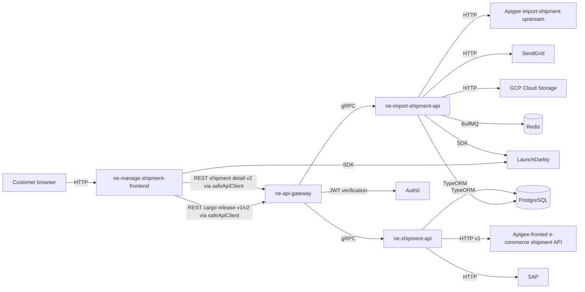

# System: OTS Shipment

## Summary

The OTS shipment system lets customers manage import cargo release requests and view export shipment detail, including Container+ IoT reefer monitoring, through the OTS knowledge base's documented repos. It is described by the company instance at `{{AGENT_HOME}}/companies/ots/index.md` and currently includes one React frontend, one REST gateway, and two NestJS gRPC services. Facts below are limited to existing OTS KB docs; missing contract versions, owners, and some service-to-service operational rules are marked TODO/unknown.

## Context Map

- Customer browser → ne-manage-shipment-frontend: sync, TODO/unknown browser contract, flow —
- ne-manage-shipment-frontend → ne-api-gateway: sync, `ne-api-gateway:REST /v1/cargo-release/* and /v2/cargo-release/*@TODO-major`, flow [Cargo Release Submit]({{AGENT_HOME}}/companies/ots/flows/cargo-release-submit.md)
- ne-manage-shipment-frontend → ne-api-gateway: sync, `ne-api-gateway:REST /v2/shipments/{bookingNo}@2`, flow [Container+ Shipment Detail]({{AGENT_HOME}}/companies/ots/flows/container-plus-shipment-detail.md)
- ne-manage-shipment-frontend → LaunchDarkly: sync, TODO/unknown LaunchDarkly SDK contract, flow —
- ne-api-gateway → ne-import-shipment-api: sync, `ne-import-shipment-api:src/modules/cargo-release/protos/cargo-release.proto@TODO-major`, flow [Cargo Release Submit]({{AGENT_HOME}}/companies/ots/flows/cargo-release-submit.md)
- ne-api-gateway → ne-shipment-api: sync, `ne-shipment-api:src/modules/shipment-dashboard/protos/shipment.proto@TODO-major`, flow [Container+ Shipment Detail]({{AGENT_HOME}}/companies/ots/flows/container-plus-shipment-detail.md)
- ne-api-gateway → Auth0: sync, TODO/unknown Auth0 JWT verification contract, flow —
- ne-import-shipment-api → Apigee import-shipment upstream: sync, TODO/unknown Apigee import-shipment HTTP contract, flow [Cargo Release Submit]({{AGENT_HOME}}/companies/ots/flows/cargo-release-submit.md)
- ne-import-shipment-api → SendGrid: sync, TODO/unknown SendGrid HTTP contract, flow [Cargo Release Submit]({{AGENT_HOME}}/companies/ots/flows/cargo-release-submit.md)
- ne-import-shipment-api → GCP Cloud Storage: sync, TODO/unknown GCP Cloud Storage HTTP contract, flow [Cargo Release Submit]({{AGENT_HOME}}/companies/ots/flows/cargo-release-submit.md)
- ne-import-shipment-api → LaunchDarkly: sync, TODO/unknown LaunchDarkly SDK contract, flow [Cargo Release Submit]({{AGENT_HOME}}/companies/ots/flows/cargo-release-submit.md)
- ne-import-shipment-api → PostgreSQL: sync, TODO/unknown TypeORM/PostgreSQL schema contract, flow [Cargo Release Submit]({{AGENT_HOME}}/companies/ots/flows/cargo-release-submit.md)
- ne-import-shipment-api → Redis: async, TODO/unknown BullMQ/Redis queue contract, flow [Cargo Release Submit]({{AGENT_HOME}}/companies/ots/flows/cargo-release-submit.md)
- ne-shipment-api → Apigee-fronted e-commerce shipment API: sync, `external:/v1/ecommerce/shipments/{bookingNo}/{userId}@1`, flow [Container+ Shipment Detail]({{AGENT_HOME}}/companies/ots/flows/container-plus-shipment-detail.md)
- ne-shipment-api → SAP: sync, TODO/unknown SAP HTTP contract, flow —
- ne-shipment-api → PostgreSQL: sync, TODO/unknown TypeORM/PostgreSQL schema contract, flow —

## Services

| Service | Repo | Stack | Owns | Overview |
|---|---|---|---|---|
| manage-shipment-frontend | ne-manage-shipment-frontend | typescript-nextjs | [] | React/Next.js SPA for import shipment management, cargo release, tracking, and booking management. |
| api-gateway | ne-api-gateway | typescript-nestjs | [] | NestJS REST API gateway that handles authentication, request routing, and REST ↔ gRPC protocol translation. |
| import-shipment-api | ne-import-shipment-api | typescript-nestjs | [CargoRelease, CargoReleaseRequest, CargoReleaseMail, EmailQueue, FileAttachment] | NestJS gRPC import-shipment service that owns cargo release data, email queues, and file attachments. |
| shipment-api | ne-shipment-api | typescript-nestjs | [ExportShipmentDashboard, ExportShipmentDetail, Booking, Container, OSL, Invoice, SAPReceivable] | NestJS gRPC export-shipment service for dashboard/detail data, including bookings, containers, OSL, Container+/IoT, invoices, and SAP receivables. |

## Integration Rules

- Contract-first ordering:
  1. A contract change merges in the **provider** repo first (slice 0).
  2. Implementation slices start after that merge.
  3. Consumers never edit a copy of a contract; they pin `<provider>:contracts/<file>@<major>`.
- Contract locations currently documented in the OTS KB are provider repo proto files, not `contracts/` paths: `ne-import-shipment-api/src/modules/cargo-release/protos/cargo-release.proto`, `ne-shipment-api/src/modules/shipment-dashboard/protos/shipment.proto`, and `ne-api-gateway/src/modules/shipment/protos/shipment.proto`. TODO: decide whether these should move under `contracts/` or whether the schema should allow existing proto paths.
- Versioning is partly documented at API level only: cargo release uses gateway REST v1/v2 plus gRPC; Container+ shipment detail uses frontend REST `v2`, gateway-to-service gRPC, and upstream HTTP `v1`. TODO: document gRPC proto major versions.
- Timeouts and retries between services are TODO/unknown in the existing OTS KB docs.
- Auth documented so far: frontend-to-gateway user-facing endpoints use Auth0 JWT through `AuthGuard`; cargo release retry/restore endpoints use API-key guards or environment checks as documented in the gateway overview and cargo release flow. TODO: document gateway-to-gRPC service authentication, if any.
- Container+ `iotContainer` is pass-through data from upstream Apigee through `ne-shipment-api` and `ne-api-gateway`; neither service should add Container+-specific transformation unless a future feature doc states otherwise.
- Frontend calls backend services through `ne-api-gateway`; no existing OTS KB doc says the frontend calls the gRPC microservices directly.

## System Principles

- `ne-api-gateway` is the REST entry point for the frontend and translates REST ↔ gRPC for backend services.
- Business logic and data ownership stay in the owning service: cargo release lifecycle belongs to `ne-import-shipment-api`; export shipment dashboard/detail belongs to `ne-shipment-api`.
- Container+ data ownership is upstream of the four repos: the OTS repos documented here relay `iotContainer` from the Apigee-fronted e-commerce shipment API, and frontend display rules are documented separately in the Container Plus domain doc.
- Destructive cargo release restore behavior is non-production/QA-only and blocked in production in both gateway and import-shipment API paths.
- Local development for these services uses IPv6 loopback `::1` where documented because the OTS local-dev-testing guide states Citrix VPN blocks IPv4 loopback on macOS.

## Features

> _No cross-repo features yet._

## References

**Local artifacts:**
- `{{AGENT_HOME}}/companies/ots/index.md` — repo list, flat layout, and existing cross-repo flow list.
- `{{AGENT_HOME}}/companies/ots/repos/ne-manage-shipment-frontend/overview.md` — frontend purpose, stack, gateway dependency, LaunchDarkly dependency.
- `{{AGENT_HOME}}/companies/ots/repos/ne-api-gateway/overview.md` — gateway purpose, stack, Auth0, gRPC service dependencies.
- `{{AGENT_HOME}}/companies/ots/repos/ne-import-shipment-api/overview.md` — import-shipment purpose, stack, owned cargo release data, and external integrations.
- `{{AGENT_HOME}}/companies/ots/repos/ne-shipment-api/overview.md` — shipment API purpose, stack, upstream Apigee, PostgreSQL, SAP, and gateway dependency.
- `{{AGENT_HOME}}/companies/ots/flows/cargo-release-submit.md` — FE → gateway → import-shipment-api request, status, and restore flows.
- `{{AGENT_HOME}}/companies/ots/flows/container-plus-shipment-detail.md` — FE → gateway → shipment-api → upstream Apigee shipment detail flow.
- `{{AGENT_HOME}}/companies/ots/domain/cargo-release.md` — cargo release business terms and rules.
- `{{AGENT_HOME}}/companies/ots/domain/container-plus.md` — Container+ business terms, data source notes, and frontend/backend ownership caveats.
- `{{AGENT_HOME}}/companies/ots/infra/local-dev-testing.md` — local port and IPv6 loopback conventions for cargo release testing.

**External authoritative sources:**
- _No external sources were used; this document was built only from existing OTS KB docs per the task request._

## Related

- `{{AGENT_HOME}}/companies/ots/system/service-catalog.yaml`
- `{{AGENT_HOME}}/companies/ots/flows/cargo-release-submit.md`
- `{{AGENT_HOME}}/companies/ots/flows/container-plus-shipment-detail.md`
- `{{AGENT_HOME}}/companies/ots/domain/cargo-release.md`
- `{{AGENT_HOME}}/companies/ots/domain/container-plus.md`
- `{{AGENT_HOME}}/companies/ots/infra/local-dev-testing.md`
- `{{AGENT_HOME}}/companies/ots/infra/gke-clusters.md`
