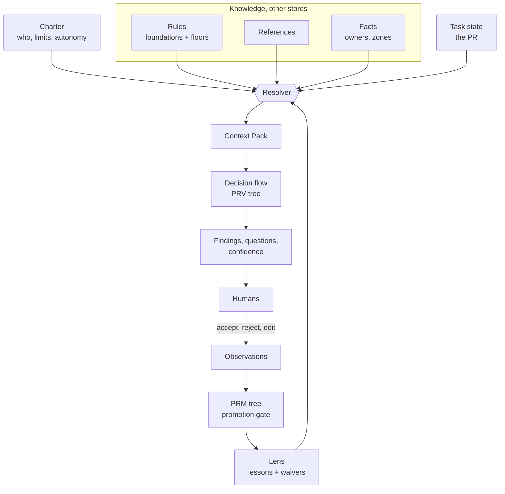

# Agent Foundry (alias: Charter)

> **Plain English:** the Foundry is the **workshop that builds agents**. You describe a job ("review pull requests for the Orders team"). The Foundry turns that into a **Charter** (the agent's written job description), wires it to the right **rules, references and facts**, gives it a **decision flow** to follow, and lets it **learn** team habits slowly, under human control.
> It does not run your SDLC (that is `agentic-sdlc`). It does not hold knowledge (that is `knowledge/` and `companies/`). It **assembles and governs** them for one agent.

Status: **v0.1 draft**, built 2026-10-24 from `proposals/agent-foundry-*.md`. Not yet used in production.

## 1. Where is the brain?

An agent has no single "brain file". Its intelligence comes from **five parts working together**. This table is the map.

| Part | Human analogy | What it is | File(s) |
|---|---|---|---|
| **Reasoning engine** | The neurons | The language model that reads and writes. Chosen by the tool (Claude, Copilot, Codex). **Not stored in this repo** | none |
| **Knowledge** | Education and experience | What is true and what is good practice | Rules `../agentic-sdlc/foundations/`, references `../../knowledge/`, facts `../../companies/` |
| **Decision flow** | The way it thinks things through | Ordered questions that end in a choice, each with a default and an "ask a human when" | [`trees/pr-review.tree.md`](trees/pr-review.tree.md) is the spine |
| **Resolver** | Attention: what to recall right now | Picks the relevant knowledge for this task and settles disagreements | [`resolver.md`](resolver.md) |
| **Lens** | Habits learned on the job | Team-specific lessons and waivers, approved by humans | `schemas/lesson.schema.md`, `schemas/waiver.schema.md`; instance in [`examples/orders-team/`](examples/orders-team/) |
| **Charter** | Job description and character | Purpose, limits, modes, autonomy | [`charters/pr-reviewer.charter.md`](charters/pr-reviewer.charter.md) |
| **Principles** | Values | Eight rules every Foundry agent obeys | [`principles.md`](principles.md) |
| **Floors** | Conscience | Rules no team preference can lower | [`floors.md`](floors.md) |

**Where is the decision/logical flow?** In `trees/`. The main ones:

| Tree | Prefix | Decides | File |
|---|---|---|---|
| PR review | `PRV` | The whole review: zones, floors, rules, lenses, confidence, synthesis | [`trees/pr-review.tree.md`](trees/pr-review.tree.md) |
| Zone classification | `ZN` | Is a file `owned`, `adopted` or `foreign`? | [`trees/zone-classification.tree.md`](trees/zone-classification.tree.md) |
| Knowledge research | `KRS` | Scope, source tiers, claim tracing, the understanding check, saturation | [`trees/knowledge-research.tree.md`](trees/knowledge-research.tree.md) |
| Lesson promotion | `PRM` | Can a learned habit become part of the Lens? | [`trees/lesson-promotion.tree.md`](trees/lesson-promotion.tree.md) |

Trees use the same format as `agentic-sdlc` (`tree/v2`): every node has a `Default` and an `Escalate when`.

## 2. How the parts connect



## 3. Layout

```text
copilot/frameworks/agent-foundry/
├── index.md                       this file
├── getting-started.md             START HERE: what works today, how to run and add a Charter
├── principles.md                  8 principles every agent obeys
├── resolver.md                    selection and conflict rules R1..R7, Context Pack
├── floors.md                      rules no Lens may lower or waive
├── schemas/
│   ├── _system.md                 registry of schemas, shared rules
│   ├── charter.schema.md          the agent definition  (alias: Charter)
│   ├── lesson.schema.md           one learned habit
│   ├── waiver.schema.md           one accepted exception, with expiry
│   ├── zone-map.schema.md         who owns which paths
│   └── context-pack.schema.md     the Resolver's output
├── trees/                         the decision flow
│   ├── pr-review.tree.md          (pr-reviewer)
│   ├── ci-triage.tree.md          (ci-failure-triager)
│   ├── knowledge-research.tree.md (knowledge-researcher)
│   ├── zone-classification.tree.md
│   └── lesson-promotion.tree.md
├── charters/                      one file per agent
│   ├── pr-reviewer.charter.md
│   ├── ci-failure-triager.charter.md
│   └── knowledge-researcher.charter.md
├── examples/
│   └── orders-team/               EXAMPLE Lens: lessons, waiver, zone map (invented team)
└── tools/
    └── validate-foundry.mjs       checks all of the above
```

## 4. Building a new agent with the Foundry

1. **Interview.** State purpose, boundaries, inputs, who the humans are.
2. **Draft a Charter** (`schemas/charter.schema.md`). Copy `charters/pr-reviewer.charter.md` as a start.
3. **Pick the decision flow.** Reuse a tree, or write one in `tree/v2` format.
4. **Bind knowledge** by naming rules, references and facts. Do not copy their text.
5. **Declare Lens scopes** and set `autonomy: suggest-only`.
6. **Validate:** `node tools/validate-foundry.mjs`.
7. **Wrap per tool** with the thin-wrapper pattern (`patterns/shared-procedure-thin-wrapper.pattern.md`, `patterns/artifact-types.pattern.md`).
8. **Earn autonomy** through an eval set (see the Charter schema), not by editing a field.

## 5. Relationship to the other frameworks

| Framework | Relationship | Coupling |
|---|---|---|
| `agentic-sdlc` | Supplies rules (`foundations/`) and the tree format. Foundry **reads** them; it never edits them | The validator resolves rule ids through a `--rules` path (default: sibling folder). No other dependency |
| `company-kb` | Supplies facts (owners, services). Read-only | By name only |
| `knowledge` | Supplies references. Read-only | By name only |

This follows the Backplane idea in `proposals/loose-coupling-backplane.md`: Foundry adds **one** component (Lens) and talks to the others through named lookups, not through their folder layouts. Today the lookups are plain paths because the Backplane resolver does not exist yet.

## 6. Files

| File | Purpose |
|---|---|
| `principles.md` | The 8 principles |
| `resolver.md` | Selection, ordering, conflict rules, Context Pack |
| `floors.md` | The non-waivable rules, with reasons |
| `schemas/*` | Shape of every Foundry file |
| `trees/*` | The decision flow |
| `charters/*` | Agent definitions |
| `tools/validate-foundry.mjs` | `node tools/validate-foundry.mjs [--rules <foundations dir>]` |

## References

**Local artifacts:**
- `proposals/agent-foundry-architecture.md`, `agent-foundry-worked-example.md`, `agent-foundry-charter-and-floors.md`: the design and its reasoning.
- `proposals/loose-coupling-backplane.md`: the component and port model this framework follows.
- `copilot/frameworks/agentic-sdlc/schemas/tree.schema.md`: the decision tree format reused here.
- `copilot/frameworks/agentic-sdlc/schemas/agent-role.schema.md`: the role schema whose section names the Charter reuses.

## Related

- `{{AGENT_HOME}}/frameworks/agentic-sdlc/index.md`: the SDLC framework (a different kind of agent system).
- `{{AGENT_HOME}}/patterns/artifact-types.pattern.md`: how Charters become skills, prompts and agents per tool.
