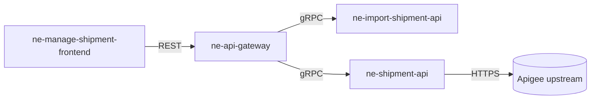

# Schema: system-architecture

_Applies to: `system/architecture.md` (optional; only for companies whose repos form one multi-repo system)_

The map of everything **between** repos: which services exist, how they connect, and the rules every repo follows. A repo's own internals stay in that repo's `docs/architecture.md`; this doc never restates them. This replaces the separate "system repo" from agentic-sdlc v1.

---

## Required Sections (in this order)

```
---
schema: system-architecture
last-updated: YYYY-MM-DD
system-ref: <integer>
---

# System: <name>

## Summary
## Context Map
## Services
## Integration Rules
## System Principles
## Features
## References
## Related
```

---

## Front-matter

- `system-ref`: an integer, starting at `1`. Add 1 every time **Context Map** or `system/service-catalog.yaml` changes. Each repo's `docs/architecture.md` records the `system-ref` it last synced with. A repo whose number is lower is out of date.

## Section Definitions

### `## Summary`
**Required. 2–4 sentences.** What the system does, for whom, and a link to the company `index.md`.

### `## Context Map`
**Required.**
- A Mermaid `flowchart` or ASCII diagram with every service and external system.
- Then one bullet per edge: `A → B: sync|async, <provider>:contracts/<file>@<major>, flow <link or —>`.
- Every edge that is a request path links to a `flows/*.md` doc when one exists.

### `## Services`
**Required.** Must match `system/service-catalog.yaml` exactly.

| Service | Repo | Stack | Owns | Overview |
|---|---|---|---|---|

### `## Integration Rules`
**Required.** Bullets: contract-first ordering, versioning, timeouts and retries between services, auth between services.
Default contract-first rule:
1. A contract change merges in the **provider** repo first (slice 0).
2. Implementation slices start after that merge.
3. Consumers never edit a copy of a contract; they pin `<provider>:contracts/<file>@<major>`.

### `## System Principles`
**Required.** Rules every repo's constitution must include. Repos may add stricter rules, never weaker ones.
If none: `> _No system-wide principles yet._`

### `## Features`
**Required.** Lists every file in `system/features/`.

| Id | Title | Status | Doc |
|---|---|---|---|

If none: `> _No cross-repo features yet._`

### `## References`
**Required.** Contract files and source paths cited above.

### `## Related`
**Required.** `{{AGENT_HOME}}/companies/<company>/...`-anchored links: `service-catalog.yaml`, flows, domains.

---

## Example (excerpt)

````markdown
## Context Map

- GW → IMP: sync, `ne-import-shipment-api:contracts/import.proto@2`, flow [Cargo Release Submit]({{AGENT_HOME}}/companies/ots/flows/cargo-release-submit.md)
````
