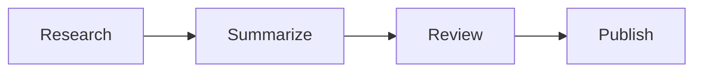
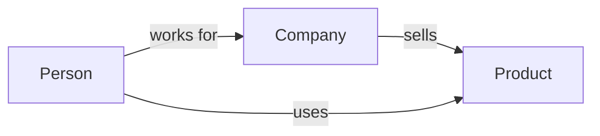
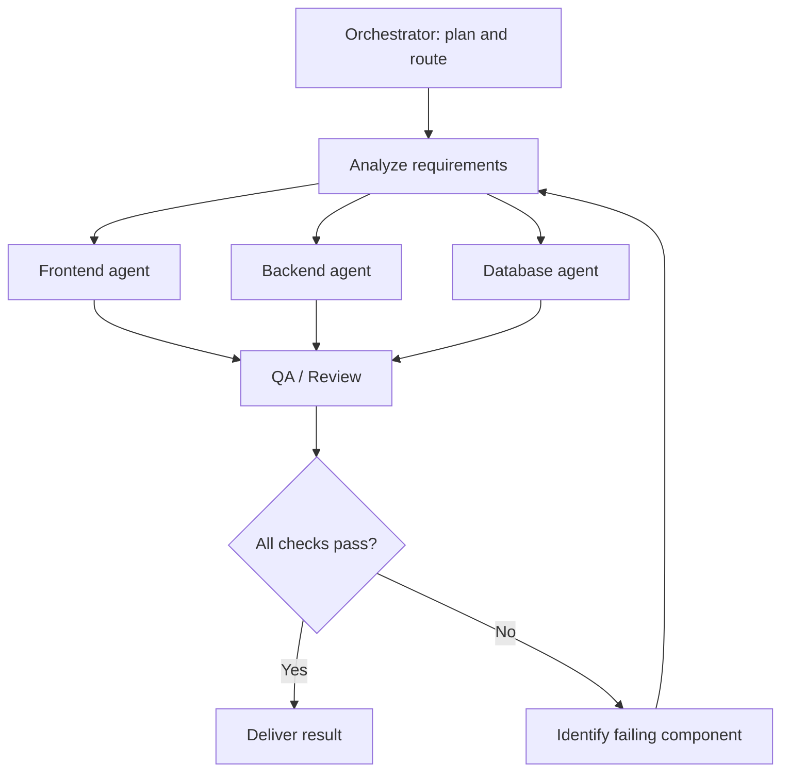
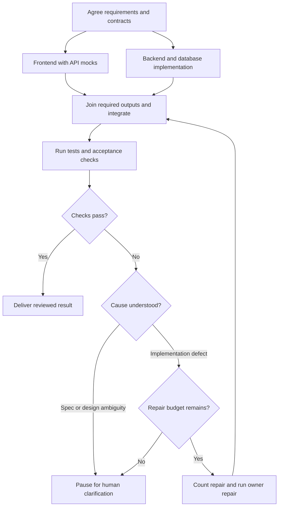
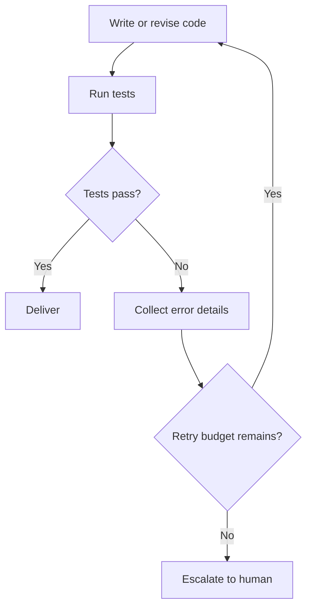
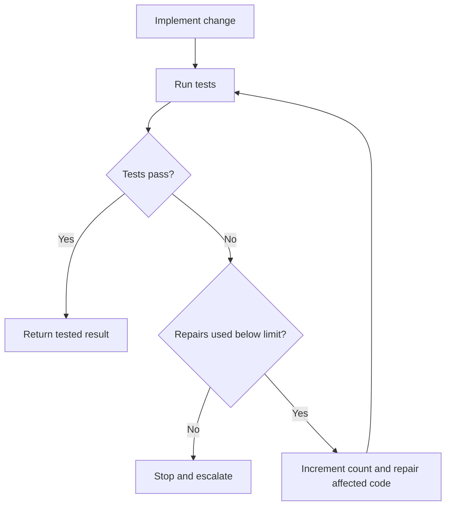
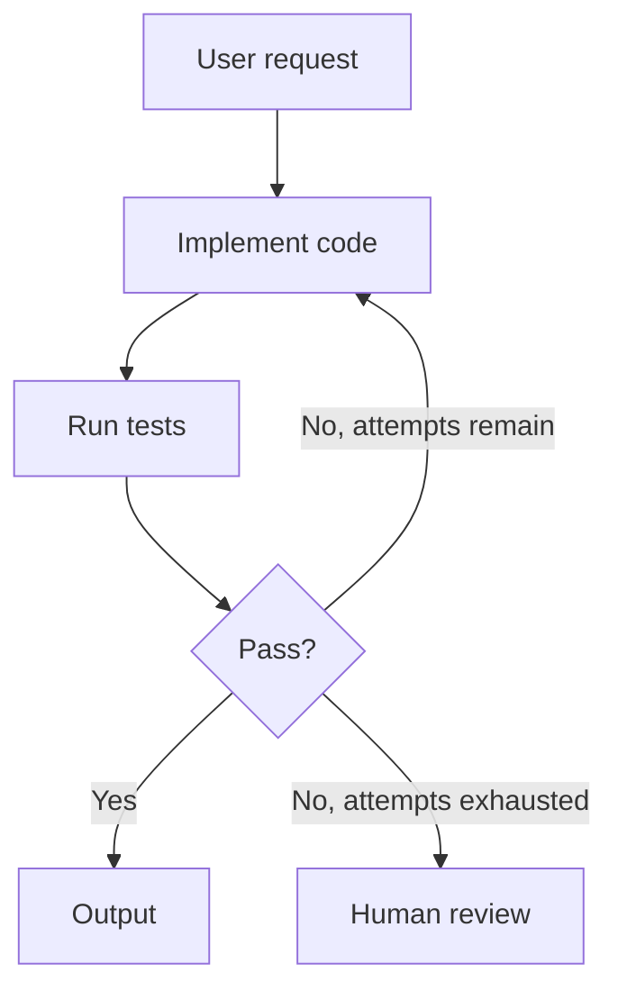

# Graph Engineering — An Introductory Study Guide

**Revision:** v1 · 2026-10-26

## Summary

**TL;DR:** Graph Engineering means deliberately designing how work, decisions, information, and control move through a system represented as a graph. In the AI-agent usage discussed here, it refers to orchestrating agents, tools, and tasks as explicit nodes and transitions.

**Use this when:** learning agent/workflow graphs, choosing whether explicit orchestration helps, or explaining how graph coordination differs from knowledge graphs.

## Problem

In the context of AI systems, **Graph Engineering** is the practice of designing and controlling how tasks, tools, people, and optionally AI agents work together using a graph-based architecture.

A capable single agent can be enough. When coordination needs explicit control, you design:

- **Who** performs each task.
- **What** information each task receives and produces.
- **When** tasks run, including sequential and parallel work.
- **How** decisions determine which task executes next.
- **What happens** when something fails, needs review, or must be retried.

Its foundations include **directed graphs, workflow orchestration, state machines, and distributed systems**. No LLM or multi-agent setup is required to implement the underlying pattern.

**Scope and evidence boundary:** _Graph Engineering_ is not a single universally standardized term or certified methodology. It can also refer to designing knowledge graphs or graph-based data systems. This guide focuses on **AI agent/task orchestration graphs** and distinguishes them from knowledge graphs below. The DataCamp tutorial is supplementary reading. Technical explanations here are grounded in the official LangGraph documentation and the other primary sources in References; those sources establish the mechanisms, not universal adoption of this label.

### Workflow versus agent: who chooses the next step?

✅ Following [Anthropic's architectural distinction](https://www.anthropic.com/research/building-effective-agents), a workflow follows predefined code paths, while an agent lets the model choose more of its actions dynamically. Both can use graphs. A graph may enforce an approval gate while a node's agent chooses which debugging tool to call. The useful design question is **which choices belong to code, which to the model, and which to a person?**

## Mental model

**Analogy:** Think of it as designing an organization of AI workers rather than only giving instructions to one AI worker.

### Building blocks

| Component              | Meaning                                   | Example                                                  |
| ---------------------- | ----------------------------------------- | -------------------------------------------------------- |
| **Node**               | A unit of work                            | Coding agent, database tool, test runner, human reviewer |
| **Edge**               | A connection or permitted transition      | After code generation → run tests                        |
| **State**              | Shared or passed information              | User request, generated files, test results, errors      |
| **Router / condition** | Logic that chooses the next path          | Tests pass? Deliver; otherwise retry                     |
| **Orchestrator**       | Logic that coordinates workflow execution | Schedule parallel agents, merge results, apply retries   |

### Related engineering perspectives

| Concept                 | Core question                        | Primary focus                                    |
| ----------------------- | ------------------------------------ | ------------------------------------------------ |
| **Prompt Engineering**  | What should the AI do?               | Instructions and task framing                    |
| **Context Engineering** | What should the AI know?             | Relevant information, retrieved materials, state |
| **Loop Engineering**    | How should the AI iterate?           | Execution → feedback → adjustment                |
| **Graph Engineering**   | How should units of work coordinate? | Workflow architecture, routing, dependencies     |

#### Same project, four different perspectives

Suppose you are implementing an e-commerce shopping cart:

- **Prompt Engineering:** Tell a coding agent to implement cart behavior and follow specific requirements.
- **Context Engineering:** Give it repository files, business rules, API contracts, and conventions.
- **Loop Engineering:** Make it code → run tests → inspect errors → fix issues.
- **Graph Engineering:** Coordinate frontend, backend, database, integration QA, and approval, including dependencies and failure paths.

**Boundary:** These approaches overlap but are _not substitutes_. A graph node may contain an agent with its own prompt, context, and internal retry loop. "Loop Engineering" here is a descriptive label, not a universally fixed discipline.

### Agent/task graphs and knowledge graphs

|               | **Agent/task graph**                 | **Knowledge graph**                       |
| ------------- | ------------------------------------ | ----------------------------------------- |
| Represents    | Work and execution paths             | Facts, entities, and relationships        |
| Typical nodes | Agents, tasks, tools                 | People, products, organizations, concepts |
| Typical edges | Executes next, delegates to, retries | Owns, works for, is related to            |
| Main purpose  | Coordinate actions                   | Organize/query connected knowledge        |
| Example tools | LangGraph                            | Neo4j, graph databases, GraphRAG systems  |

✅ A graph database such as [Neo4j](https://neo4j.com/docs/getting-started/graph-database/) is a storage/query technology. Microsoft [GraphRAG](https://microsoft.github.io/graphrag/) is a retrieval and indexing approach that uses graph-derived information; it is not itself a graph database or a synonym for agent orchestration.

#### Two mental pictures

**Task graph:** Research → summarize → review, with a bounded revision route and an explicit approval before publication.



This diagram shows the successful route. Here, **Review → Publish** means review has approved publication. If review requests changes, return to summarization within a revision budget; if the budget is exhausted or approval is withheld, pause without publishing. The simple diagram omits those branches; it does not authorize automatic publication.

**Knowledge graph:**



**Memory aid:**

- **Knowledge Graph = What the system knows.**
- **Agent Graph = How the system works.**

This is a helpful simplified distinction: an agent graph also stores/uses knowledge, and a knowledge graph may be queried as part of an agent workflow.

#### Directed graphs, DAGs, and cycles

A **directed graph** gives each edge a direction. A **DAG** (directed acyclic graph) has no directed cycles, so a dependency schedule can move forward without revisiting a node. A repair edge returning to tests creates a **cycle**: useful for feedback, but it requires termination rules. A finite recorded execution can still be represented as an unrolled sequence even when its reusable workflow definition contains a cycle.

## How it works

### Software development workflow

**Seven roles in this illustrative workflow:**

- **Orchestrator** — its job: select the next task, via routing rules.
- **Requirements analyst** — its job: define behavior and contracts, via the agreed specification.
- **Frontend worker** — its job: build the user interface, via frontend files and API mocks.
- **Backend worker** — its job: implement application behavior, via backend files and the API contract.
- **Database worker** — its job: implement storage changes, via schema and migration files.
- **Integrator** — its job: combine required outputs, via the join and merge rules.
- **QA / reviewer** — its job: check the integrated result, via tests and acceptance criteria.

These are responsibilities, not a requirement to run seven AI agents. One person, function, or agent can perform several roles.

**Role overview: separate frontend, backend, and database workers**

This overview keeps the responsibilities visible. Its arrows are a conceptual sketch: the QA node assumes an integration join, and the return to analysis applies when evidence calls for replanning. For implementation defects, use owner repair and a shared repair budget, as shown in the detailed diagram below.



Frontend, Backend, and Database work can run **in parallel** when dependencies permit. Their outputs then converge for integration and QA. Failed checks can cause another iteration.

**Detailed execution: contracts, integration, bounded repair, and clarification**



In this example, agree the API and data contract first. Frontend work can then use mocks while backend and database work proceed together. The join must wait for **all required outputs**; arrows alone do not implement a synchronization barrier.

An implementation defect goes to the responsible worker, followed by reintegration and checks. Re-plan only when evidence points to a requirement, dependency, or design problem. The clarification node **pauses this run**; a person authorizes a revised plan before a new run. Set a shared repair limit, deadline, and cost budget so nested loops cannot multiply retries unchecked.

> A graph does not automatically make work parallel: dependencies, shared resources, and execution-engine capabilities determine what can safely run concurrently.

### Branching and feedback

Imagine a coding agent with an automated test loop. The graph can contain explicit branching and feedback:

**Decision view: keep error collection visible**



In this view, collecting error details supplies the repair input. The retry decision must also increment a repair counter before taking its Yes edge. The following diagram makes that counter explicit; both views describe the same bounded feedback loop.

**Explicit repair-count view**



#### Walk through both paths

**Path A — tests pass:**

1. Coding agent implements the change.
2. Test runner executes checks.
3. Tests pass.
4. Workflow follows the **Yes** edge and delivers the result.

**Path B — tests fail:**

1. Coding agent implements the change.
2. Test runner returns errors.
3. Workflow follows the **No** edge.
4. Errors are sent back to the coding agent for repair.
5. Increment the repair count before each repair. With two permitted repairs, there are at most three implementation attempts: the initial attempt plus two repairs. Repeated failures stop and escalate.

**Essence:** You define the execution paths and the conditions selecting them, rather than leaving the entire workflow implicit in an agent’s reasoning.

## Worked example

### Learning roadmap

1. **Graph fundamentals:** nodes, edges, directed graphs, cycles, DAGs.
2. **State and control flow:** shared state, transitions, conditions, retries.
3. **Orchestration:** sequential work, parallel work, fan-out/fan-in, routing.
4. **Practical implementation:** build a simple graph workflow with LangGraph or a comparable framework.
5. **Production reliability:** checkpointing, bounded retries, observability, evaluation, human-in-the-loop review.

#### Suggested starter project

Build a small **coding workflow**:



Then expand it to frontend, backend, database, and integration-test subflows.

For the starter diagram, define **attempts** as the initial implementation plus subsequent repairs. Check the repair budget and increment the repair counter before returning to implementation. Agree contracts before expansion, wait for required branch outputs at integration, and keep the same run-wide repair limit.

#### Runnable starter project: explicit routing without dependencies

Copy the following into `graph_demo.py` and run `python graph_demo.py` with Python 3. It requires no packages or API key. This is a **deterministic simulation**, not an AI coding agent or a production runtime: `pass_on` supplies a simulated test outcome so you can study routing independently.

```python
def run(pass_on=2, max_repairs=2):
    if pass_on < 1 or max_repairs < 0:
        raise ValueError("pass_on >= 1 and max_repairs >= 0 required")
    state = {"attempts": 0, "repairs": 0, "passed": False}

    def implement():
        state["attempts"] += 1  # Simulates a new implementation attempt.
        return "test"

    def test():
        state["passed"] = state["attempts"] >= pass_on
        if state["passed"]:
            return "done"
        if state["repairs"] >= max_repairs:
            return "escalate"
        state["repairs"] += 1
        return "implement"

    nodes = {"implement": implement, "test": test}
    node, trace = "implement", []
    while node in nodes:
        trace.append(node)
        node = nodes[node]()
    trace.append(node)
    return node, state, trace

for pass_on in (1, 2, 99):
    status, state, trace = run(pass_on)
    print(status, state["attempts"], " -> ".join(trace))
```

Expected output:

```text
done 1 implement -> test -> done
done 2 implement -> test -> implement -> test -> done
escalate 3 implement -> test -> implement -> test -> implement -> test -> escalate
```

`nodes` holds executable work; returned names select edges; `state` carries progress; the driver executes the chosen node. `max_repairs=2` means **two repairs after the initial attempt**, not two total attempts.

**Experiment:** Predict the result of `run(pass_on=2, max_repairs=0)` before running it. Answer: escalation after one failed attempt. With `pass_on=1`, even a zero-repair budget succeeds immediately. Production code also needs exception handling, per-call timeouts, persistence, and side-effect controls.

Next, implement equivalent nodes and conditional edges with LangGraph, then add checkpointing. Only introduce parallel workers after defining contracts, branch ownership, and join behavior.

## Edge cases

These are engineering design checks, not guarantees supplied by drawing a graph.

| Failure mode | Concrete control and reason |
| --- | --- |
| Two workers overwrite the same output | Give each worker separate output keys/files; validate and merge at a join. Define how conflicts are resolved. |
| A parallel branch silently fails | Track success, failure, and cancellation per required branch; never treat missing output as completion. |
| A router selects an invalid path | Validate its result against allowed destinations; stop or escalate on an unknown value. |
| Repeated calls produce different answers | Evaluate against independent acceptance checks; preserve inputs and evidence for diagnosis. |
| Nested retries inflate cost and latency | Apply both local limits and a run-wide deadline/cost budget. |
| A crash loses progress | Persist checkpoints: enough state to know what finished and what can resume. |
| Resuming repeats an external action | Use idempotency keys or recorded completion checks before retrying payments, messages, or deployments. |
| Nobody can explain a bad result | Trace node inputs/outputs, routing reasons, versions, timing, failures, and review decisions. |

**Parallel state example:** frontend writes `frontend_result`, backend writes `backend_result`, and the join constructs `integrated_result`. If both append to `findings`, define an explicit combination rule. In LangGraph, reducers specify how state updates combine; the appropriate rule depends on the field. Appending lists does not resolve contradictory business facts. ✅ See [Graph API](https://docs.langchain.com/oss/python/langgraph/graph-api) for the reducer mechanism; the choice of business conflict policy remains the application’s responsibility.

**Another application:** An invoice workflow extracts fields, validates totals, and routes uncertain cases to a reviewer. Only accepted records reach accounting. A bounded re-extraction attempt may help a parsing error; an ambiguous invoice needs human clarification. This is an illustrative use case, not a claimed customer deployment.

## Trade-offs

**It helps when:**

- A task has distinct steps with clear dependencies.
- Specialized tools or agents must cooperate.
- You need conditional routing or human approval.
- You need retries, error handling, or auditability.
- Some work can be parallelized and later merged.

**It may be unnecessary when:**

- A single prompt or function handles the task reliably.
- Additional orchestration would add more complexity than value.
- The workflow is so fluid that an explicit graph would be overly restrictive.

**Trade-off:** Graphs improve visibility, control, and testability, but require more architecture, state management, and maintenance.

## Takeaways

> **Graph Engineering moves some coordination logic from the individual agents into the architecture connecting them.**

This makes complex AI systems more **inspectable, testable, and controllable**. It does not mean every task needs multiple agents or a graph.

### Five questions for review

1. What do **nodes** and **edges** represent in an agent graph?
2. What is the difference between a **task graph** and a **knowledge graph**?
3. When should a workflow **branch**, **retry**, or **escalate**?
4. How do **prompt**, **context**, **loop**, and **graph** engineering complement one another?
5. What added complexity does graph orchestration introduce?

### Answer key

1. Nodes perform work; edges represent permitted transitions or dependencies.
2. Task graphs coordinate execution; knowledge graphs represent entities and relationships.
3. Branch when outcomes need different actions; retry a repairable problem within a budget; escalate on ambiguity, unsafe action, or exhaustion.
4. Prompts give instructions, context supplies information, loops use feedback, and graph design coordinates these mechanisms.
5. State merging, dependency management, termination, persistence, observability, and maintenance all add work.

## Used by

- _Not cited by any rule yet._

## Verification status

- Verified: 3 claims · Unverified: 0 claims · Last verified: 2026-10-26

The three marked claim groups were checked against primary sources. The named terminology is context-specific. Diagrams, design controls, invoice scenario, and Python simulation are illustrative engineering material, not vendor guarantees. The Python block was executed and its documented output and zero-repair cases checked; Mermaid blocks were checked as source, not visually rendered. Framework-specific deployment, checkpoint recovery, concurrency semantics, and performance require a dedicated investigation. The diagrams use Mermaid code blocks. Markdown tools with Mermaid support render them as flowcharts; otherwise the text remains readable.

## References

- [LangGraph Graph API](https://docs.langchain.com/oss/python/langgraph/graph-api) — LangChain, living. Backs: state, nodes, edges, conditional routing, and reducers.
- [LangGraph overview](https://docs.langchain.com/oss/python/langgraph/overview) — LangChain, living. Backs: stateful workflow and agent orchestration.
- [Building effective agents](https://www.anthropic.com/research/building-effective-agents) — Anthropic, 2024. Backs: workflow/agent architectural distinction.
- [Graph database concepts](https://neo4j.com/docs/getting-started/graph-database/) — Neo4j, living. Backs: graph databases model entities and relationships.
- [GraphRAG](https://microsoft.github.io/graphrag/) — Microsoft, living. Backs: graph-based indexing and retrieval, distinct from agent execution.
- [Graph Engineering: A Hands-On Guide](https://www.datacamp.com/tutorial/graph-engineering-guide) — DataCamp, living. Supplementary terminology/tutorial reading; not the primary evidence for runtime behavior.
- `graph-engineering-vs-sdd-ai-dlc-spec-kit.md` — companion concept comparison and integration example.
- `../documentation/learning-explanation-framework.md` — reusable method for studying and explaining technical concepts.

## Related

- [Graph Engineering, SDD, AWS AI-DLC, and GitHub Spec Kit](graph-engineering-vs-sdd-ai-dlc-spec-kit.md).
- [Learning Explanation Framework](../documentation/learning-explanation-framework.md).
- [Loop Engineering](loop-engineering.md) — feedback inside a worker or workflow.
