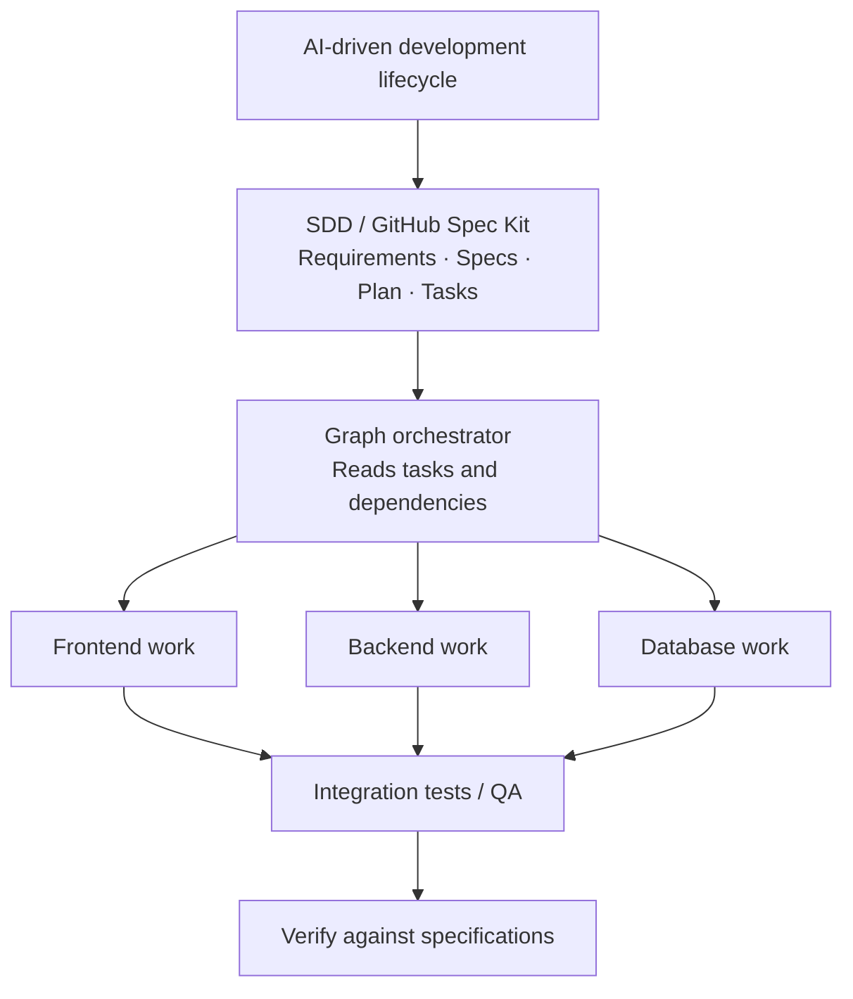
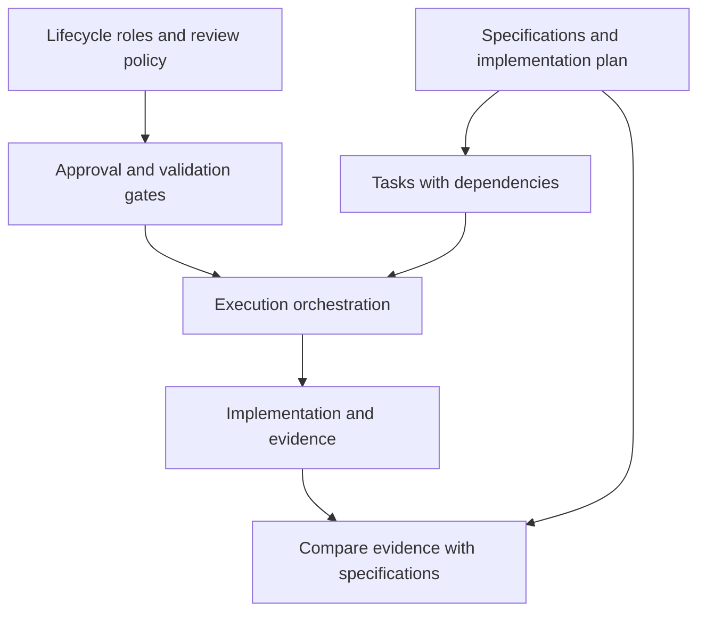
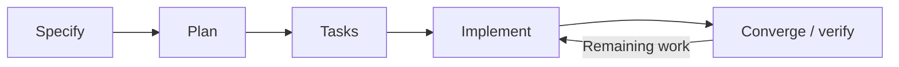
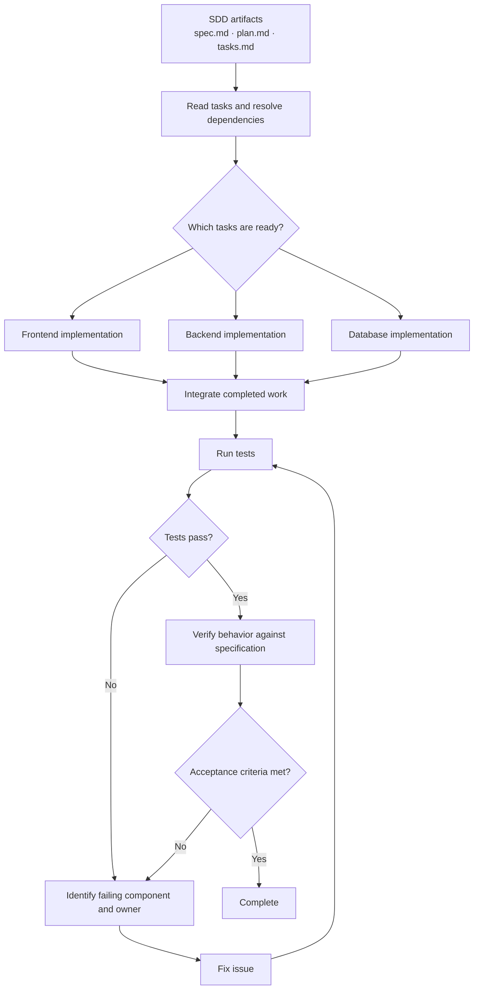
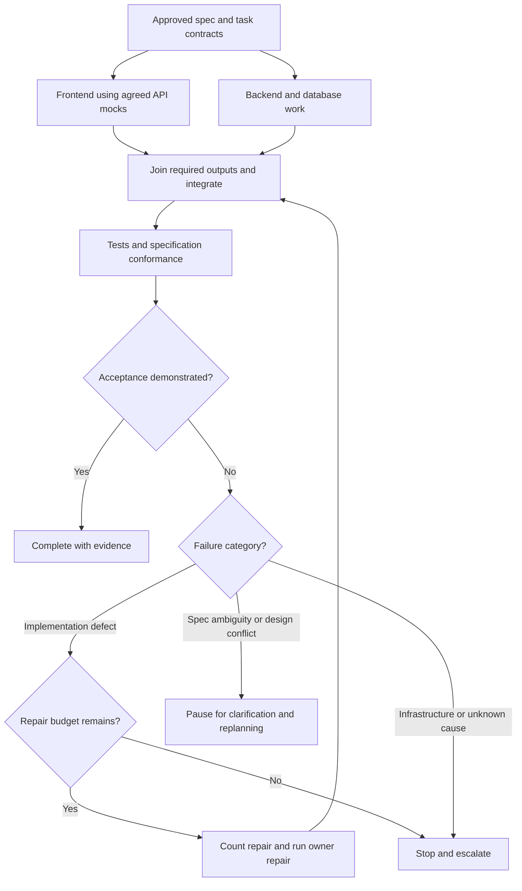

# Graph Engineering, SDD, AWS AI-DLC, and GitHub Spec Kit — A Concept Comparison

**Revision:** v1 · 2026-10-26

## Summary

**TL;DR:** SDD describes required behavior and its verification; graph orchestration describes how work executes and recovers. Spec Kit supports repeatable processes, while AWS AI-DLC describes a broader human–AI delivery lifecycle. These concerns can be combined without requiring one fixed stack.

**Use this when:** distinguishing these four concerns or deciding whether graph orchestration adds value to a specification-driven workflow.

## Problem

> **Core answer:** Graph Engineering is primarily an **architecture and orchestration approach**, not inherently a Spec-Driven Development (SDD) framework. It can be integrated with SDD, GitHub Spec Kit, or AWS AI-DLC because they address different concerns.

Confusing a specification discipline, a toolkit, a lifecycle methodology, and an execution architecture leads to unnecessary tooling or missing coordination rules.

## Mental model

- **Spec-Driven Development (SDD):** A development approach in which specifications guide implementation and verification. **Question:** *What needs to be built, and how do we know the result satisfies it?*
- **GitHub Spec Kit:** A toolkit with an SDD process, templates, and agent integrations. Its current scope also includes other processes and workflow automation; here we focus on its SDD path. See the [official overview](https://github.github.com/spec-kit/).
- **AWS AI-Driven Development Lifecycle (AI-DLC):** A broader methodology for organizing human–AI collaboration across software delivery stages, including inception, construction, and operations. It is **not merely another name for SDD**.
- **Graph Engineering:** Designing explicit nodes, dependencies, routing decisions, transitions, retries, and execution paths among tasks, tools, people, and/or AI agents. **Question:** *What runs, in what order, under which conditions, and what happens when something fails?*

**Essential difference:**

> **SDD governs requirements and their fulfillment. Graph Engineering governs execution and coordination.**

These two concerns may overlap, but neither inherently contains the other. “Graph Engineering” is not a universally standardized label; in some contexts it also refers to knowledge-graph engineering. Here, it means graph-based workflow/agent orchestration.

| Concept | Classification | Principal focus |
|---|---|---|
| SDD | Development approach/methodology | Specifications and conformance |
| GitHub Spec Kit | Process toolkit with a core SDD workflow | Repeatable specs → plan → tasks → implementation workflow |
| AWS AI-DLC | AI-driven software lifecycle methodology | Human–AI collaboration across lifecycle activities |
| Graph Engineering | Architectural/orchestration approach | Nodes, edges, dependencies, decisions, control flow |

### House-building analogy

- **SDD:** Define building requirements and check the completed building against them.
- **Spec Kit:** Provide a repeatable process and templates for planning and tracking the build.
- **AI-DLC:** Coordinate the broader project lifecycle and human–AI responsibilities.
- **Graph Engineering:** Design handoffs, parallel work, inspection gates, and rework paths.

## How it works

### Combining the concerns

**Lifecycle-to-work overview**



This is one optional arrangement. It assumes agreed contracts, a join waiting for all required outputs, and bounded rework; it does not imply that AI-DLC requires Spec Kit or a graph runtime.

**Independent concerns and validation inputs**



*Conceptual integration, not a mandatory hierarchy or the official architecture of AWS or Spec Kit. Real tasks may need sequencing; parallelism is only valid where dependencies permit it.*

- The **specification layer** describes desired behavior, constraints, and acceptance criteria.
- The **execution graph** routes work among eligible tasks and workers.
- **Validation gates** decide whether to retry, escalate, approve, or finish.

**Neither requires the other:** SDD can be followed manually without a graph runtime; graph-based orchestration can coordinate work unrelated to software specifications.

### Workflow responsibilities

#### GitHub Spec Kit: specification-centered, with broader tooling

A simplified feature flow:



The return edge means reviewing the convergence report and executing remaining tasks. It requires an explicit stopping budget; Converge assesses gaps rather than repairing code itself.

The [current quickstart](https://github.github.com/spec-kit/quickstart.html) establishes a **constitution** once per project, then uses **Specify → Plan → Tasks → Implement → Converge** for features. Clarify, Checklist, and Analyze provide additional quality gates.

The constitution records project principles. Typical feature artifacts include `spec.md`, `plan.md`, and `tasks.md`. Converge checks the implementation against its artifacts and can append remaining tasks; it does not itself repair code. It is a real documented step. Review outcomes before continuing; put a repair budget and escalation path around automated repetition.

The [command reference](https://github.github.com/spec-kit/reference/agentic-sdd.html) uses names such as `/speckit.specify`; invocation syntax varies by integration. The current Copilot skills examples use `/speckit-specify`, while Codex examples use `$speckit-specify`. Check your installed version and integration before copying commands.

**Boundary:** SDD is the specification discipline; Spec Kit is one toolkit supporting it. Current Spec Kit also supports workflow automation and customization, so describing it as “only a checklist with no orchestration” would be misleading. A separate graph runtime is optional; neither the methodology nor a Markdown task list requires one.

**Critical boundary:** A sequence of SDD steps can be **represented as a graph** without necessarily using a dedicated graph-execution engine. A checklist is not automatically an orchestrator.

#### AWS AI-DLC: lifecycle-centered

[AWS's methodology introduction](https://aws.amazon.com/blogs/devops/ai-driven-development-life-cycle/) describes three phases:

| Phase | Emphasis |
| --- | --- |
| Inception | Develop business intent into requirements and units of work; the team validates proposals through **Mob Elaboration**. |
| Construction | Build designs, code, and tests with ongoing technical clarification through **Mob Construction**. |
| Operations | Carry context into infrastructure and deployment activities under team oversight. |

**Units of Work** organize scope; **bolts** are short work cycles. AI proposes plans and actions while people validate consequential decisions. These terms belong to AWS's methodology description; they are not requirements of every graph runtime or SDD toolkit.

A graph can automate or coordinate selected activities and gates; it does not replace the methodology. Combining AI-DLC, Spec Kit, and a graph runtime is an integration choice, not an official mandatory stack.

AI-DLC is a broader methodology for arranging human–AI collaboration and decision-making through software delivery. It addresses questions such as:

- What happens before implementation?
- What do people own versus AI agents?
- Which artifacts, review points, and approvals are expected?
- How does a team transition from requirements to construction and operations?

#### Graph Engineering: execution-centered

The graph defines:

- **Nodes:** steps, tools, validators, human approvals, and/or agents.
- **Edges:** handoffs or permitted transitions.
- **Conditions:** rules for choosing the next step.
- **State:** inputs, intermediate results, errors, and progress.
- **Execution policies:** dependencies, parallelism, retries, timeouts, checkpointing, and escalation.

A graph does **not** require multiple AI agents. A simple function-and-validation workflow is already a legitimate graph-based design.

✅ Spec Kit’s [quickstart](https://github.github.com/spec-kit/quickstart.html) and [command reference](https://github.github.com/spec-kit/reference/agentic-sdd.html) document the feature workflow, convergence behavior, and integration-dependent invocation.

✅ AWS describes the phases and human oversight in its [AI-DLC methodology introduction](https://aws.amazon.com/blogs/devops/ai-driven-development-life-cycle/).

## Worked example

**Project:** React frontend + ASP.NET Core backend + PostgreSQL e-commerce application.

#### Step A — SDD defines the shopping-cart specification

**Behavioral intent**

```yaml
feature: Shopping Cart
requirements:
  - Users can add products.
  - Users can update quantities.
  - Users can remove products.
  - Cart totals are calculated correctly.
acceptance_criteria:
  - Invalid quantities are rejected.
  - Cart contents remain consistent.
  - Tests verify required behavior.
```

**Measurable acceptance example**

```yaml
feature: Shopping Cart
scope: Single-currency cart; taxes, shipping, and discounts excluded.
acceptance_criteria:
  - id: AC1
    given: Product A costs 1250 minor currency units and the cart is empty.
    when: Add product A with quantity 2.
    then: One line exists with quantity 2 and subtotal 2500.
  - id: AC2
    given: The cart contains product A with quantity 2.
    when: Set its quantity to 0, -1, or 1.5.
    then: Return HTTP 400 and leave the persisted cart unchanged.
  - id: AC3
    given: The cart contains A at 1250 x 2 and B at 500 x 1.
    when: Remove product A.
    then: Only B remains and the cart subtotal is 500.
```

These are illustrative product decisions, not universal cart rules. Define authentication, stock, price changes, persistence, and concurrency separately if they are in scope.

The specification and related tasks set the **target**. They do not, by themselves, dictate how many agents to run or how to route failures.

#### Step B — Graph Engineering defines execution

**Ready-task and owner-diagnosis view**



This view separates test success from specification acceptance. Its repair arrows assume the shared repair budget, reintegration, and escalation policy below; the arrows alone do not enforce them.

**Bounded execution and failure-classification view**



> **Execution policy:** Agree contracts before branching; the join waits for every required output. Increment a shared repair counter before routing to the owner, and rerun integration checks after repairs. Ambiguity pauses execution for a human decision and a revised approved plan; do not silently weaken acceptance criteria to make tests pass. Infrastructure failures need their own bounded policy.

> **Important:** The frontend, backend, and database branches are only parallelizable when their contracts and prerequisites are sufficiently defined. A real orchestrator must respect actual task dependencies and prevent conflicting edits or unsafe simultaneous migrations.

#### Step C — Turn task descriptions into executable dependencies

Spec Kit's [complex-feature guide](https://github.github.com/spec-kit/concepts/complex-features.html) discusses `[P]` tasks and delegation where the host agent supports it. A parallel marker is useful input, not proof that arbitrary tasks can safely run together.

The following table is **an illustrative adapter design**, not a built-in Spec Kit schema or a claim that it automatically compiles Markdown into LangGraph:

| Task | Requires | Owner/output | Completion evidence |
| --- | --- | --- | --- |
| T01: agree API and data contract | Approved requirements | Reviewed contract | Human acceptance of AC1–AC3 mapping |
| T02: implement cart UI | T01 | Frontend files and mock tests | UI checks pass |
| T03: implement persistence and API | T01 | Backend files and migrations | API/storage checks pass |
| T04: integrate and verify | T02, T03 | Integration report | AC1–AC3 pass against integrated build |

An adapter extracts IDs and prerequisites, validates missing dependencies and dependency cycles, assigns ownership, and schedules only ready tasks. It isolates conflicting edits, records results against a spec/commit version, and implements an all-required-results join. Keep the task dependency DAG separate from the runtime's bounded repair cycles. Human review is necessary when prose does not define a safe dependency relation.

The separation of responsibility is precise:

| Concern | Owner |
|---|---|
| What behavior must exist? | SDD specifications |
| Which tasks are needed? | SDD plan/tasks, with engineering judgment |
| Which task executes next? | Graph routing/dependency rules |
| What happens on failure? | Graph retry/error/approval paths |
| Is the implementation acceptable? | Tests + specification conformance checks |

**Five roles in this worked scenario:**
- **Reviewer** — its job: approve intent, via the specification and acceptance criteria.
- **Planner** — its job: define prerequisites, via the task/dependency table.
- **Orchestrator** — its job: select eligible work, via dependency and routing rules.
- **Workers** — their job: implement assigned outputs, via owned files and task contracts.
- **Validator** — its job: check results, via tests and specification evidence.

1. **Reviewer:** approve AC1–AC3 in the YAML example; 1250 minor units means 12.50 in a currency with 100 minor units per major unit, so two units total 2500 minor units.
2. **Planner:** record T01 as the contract prerequisite for T02 and T03 in the task table; these are task identifiers, not dates.
3. **Orchestrator:** release T02 and T03 only after T01 succeeds; keep their file ownership separate.
4. **Workers:** write the UI/mock-test and API/migration outputs locally; the integration join waits for both.
5. **Validator:** check the integrated build against AC1–AC3. These are acceptance-criterion identifiers. Local tests need no network; a live API/storage integration check may cross a network boundary depending on deployment.
6. **Orchestrator:** on a defect, count a repair and route to its owner; on ambiguity, pause for the reviewer; on success, return the implementation evidence. No actual agents or deployments are launched by this example.

## Edge cases

**No, not by definition.** They are complementary, orthogonal concerns.

#### Case A: SDD without Graph Engineering

A developer and one coding agent follow `spec.md`, `plan.md`, and `tasks.md`, implement work sequentially, and verify acceptance criteria. No graph orchestration runtime is needed.

#### Case B: Graph Engineering without SDD

A workflow routes documents through extraction → classification → review → retry → publication. It is graph-based but unrelated to spec-driven software development.

#### Case C: Both together

Approved specifications generate implementation tasks; a graph coordinates ready tasks, integration, tests, human approval, and rework. Here Graph Engineering **implements/augments** the execution side of an SDD process.

#### Key conceptual boundary

- **Graph-shaped process:** A diagram describes order, branching, and dependencies.
- **Graph-engineered orchestration:** Those relationships become explicit operating rules in a workflow system, with state and control over transitions.
- **SDD:** The requirements and verification discipline can exist in either setup.

A graph can orchestrate the **SDD stages themselves** as well as the implementation tasks produced by those stages.

| Case | What happens | Why |
| --- | --- | --- |
| A task has `[P]` but shares files or unresolved prerequisites | Serialize or isolate it before scheduling | The marker alone cannot establish independence |
| Tests pass but acceptance evidence is missing | Return to verification or clarification | Passing tests does not establish unspecified behavior |
| A repair repeats without progress | Stop at the budget and escalate | A feedback edge needs a termination rule |
| People disagree about quantity-zero behavior | Clarify the specification before further repairs | The ambiguity is in the target behavior |


## Trade-offs

| Scenario | Recommended starting point |
|---|---|
| Small feature, clear requirements | Spec Kit / simple SDD workflow + one coding agent |
| Medium project, disciplined planning and verification | SDD with explicit review and testing |
| Large project with independent workstreams | SDD + graph-managed dependencies and handoffs |
| Many specialized AI agents sharing code | SDD + graph orchestration + integration/ownership controls |
| Research or document workflow | Graph orchestration, possibly without SDD |
| Organization-wide AI-assisted software delivery | AI-DLC, optionally supported by SDD and graph orchestration |

**Avoid unnecessary complexity:** Do not introduce a multi-agent graph merely because a project follows SDD. Start with a simple, deterministic process; add orchestration when concurrency, conditional routing, independent review, failure recovery, or auditable handoffs justify the overhead.

## Takeaways

```text
SDD              → WHAT should be built and verified?
GitHub Spec Kit  → HOW do we operationalize spec-driven work?
AWS AI-DLC       → HOW is the human–AI software lifecycle organized?
Graph Engineering→ HOW do executable steps coordinate and transition?
```

**One-sentence conclusion:**

> **Graph Engineering is not a competing SDD framework; it is an architecture/orchestration technique that can execute, coordinate, and enhance SDD workflows, including Spec Kit or processes organized under AI-DLC.**

### Recall checklist

- [ ] Can I explain SDD and Graph Engineering in one sentence each?
- [ ] Can I distinguish Spec Kit (toolkit) from AI-DLC (lifecycle methodology)?
- [ ] Can I describe a graph's nodes, edges, state, conditions, and retries?
- [ ] Can I give an SDD-without-graph example?
- [ ] Can I give a graph-without-SDD example?
- [ ] Can I explain when combining them improves a real project?

**Recall prompt:** *If the specifications are complete but coding agents keep duplicating work or getting stuck in retry loops, which concern needs improvement—and why?*

**Answer:** Inspect evidence before assigning the cause. If workers agree on the required result but both were assigned the same files, fix ownership and scheduling. If they disagree about quantity-zero behavior because the spec is silent, clarify the spec first. If they repeatedly attempt the same failed repair, inspect test feedback and routing, then stop at the budget. A “complete” document can still contain ambiguity.

## Used by

- _Not cited by any rule yet._

## Verification status

- Verified: 2 claims · Unverified: 0 claims · Last verified: 2026-10-26

The two marked claim groups were checked against current primary documentation. Architecture comparisons are explanatory analysis; integration diagrams, task adapters, shopping-cart rules, failure policies, and scenario recommendations are illustrative designs. No adapter or vendor integration was executed. Product behavior can change; use the installed release’s documentation before invoking commands.

## References

- [Spec Kit overview](https://github.github.com/spec-kit/) — GitHub, living. Backs: scope, independent processes, and workflow customization.
- [Spec Kit quickstart](https://github.github.com/spec-kit/quickstart.html) — GitHub, living. Backs: constitution, feature steps, artifacts, and convergence.
- [Agentic SDD command reference](https://github.github.com/spec-kit/reference/agentic-sdd.html) — GitHub, living. Backs: command behavior and invocation forms.
- [Complex features](https://github.github.com/spec-kit/concepts/complex-features.html) — GitHub, living. Backs: scoped implementation and host-supported delegation of parallel tasks.
- [AI-Driven Development Life Cycle](https://aws.amazon.com/blogs/devops/ai-driven-development-life-cycle/) — AWS, 2025. Backs: lifecycle phases, units of work, bolts, and human oversight.
- [Adopt AI in software development practices](https://aws.amazon.com/isv/resources/adopt-ai-in-software-development-practices-with-aws/) — AWS, living. Supplementary lifecycle reading.
- [Collaborative AI-DLC methodology notes](https://github.com/aws-samples/sample-collaborative-ai-dlc/blob/main/docs/getting-started/methodology.md) — AWS Samples, living. Supplementary sample implementation; not the normative definition of every AI-DLC process.
- [Spec Kit repository](https://github.com/github/spec-kit) — GitHub, living. Project implementation and release history.
- [Graph Engineering tutorial](https://www.datacamp.com/tutorial/graph-engineering-guide) — DataCamp, living. Supplementary terminology reading.
- `graph-engineering-study-guide.md` — definitions, routing examples, and a runnable simulation.
- `../documentation/learning-explanation-framework.md` — explanation checklist and reusable prompts.

## Related

- [Graph Engineering — An Introductory Study Guide](graph-engineering-study-guide.md).
- [Learning Explanation Framework](../documentation/learning-explanation-framework.md).
