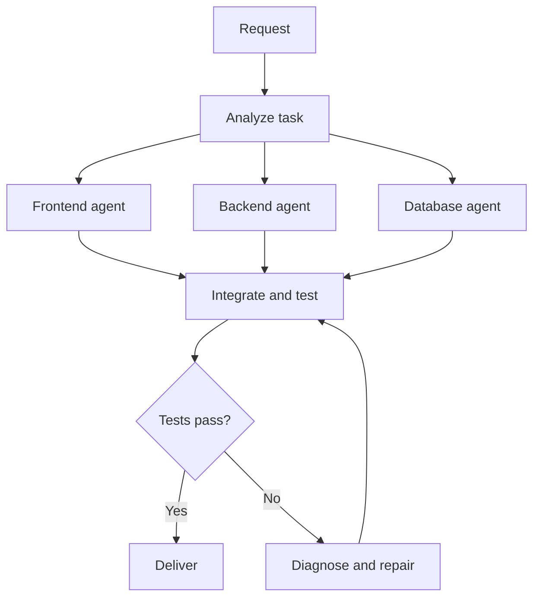
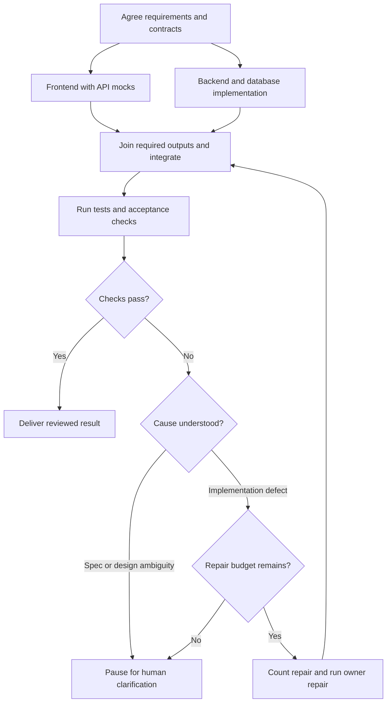
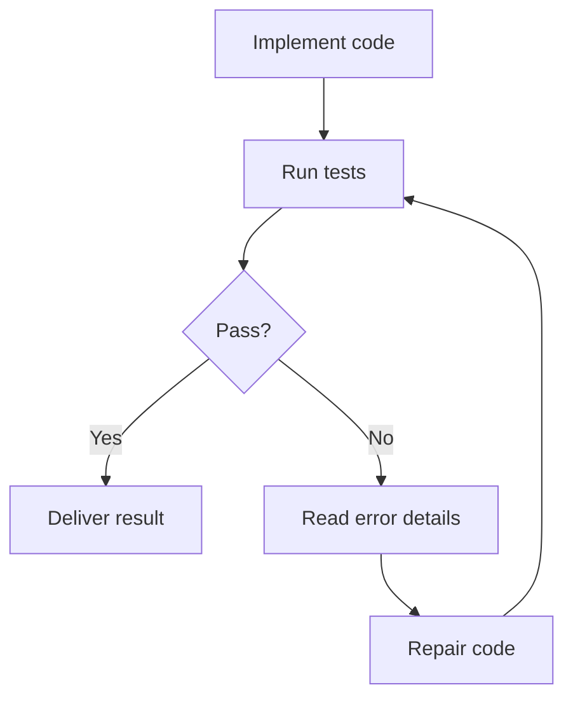
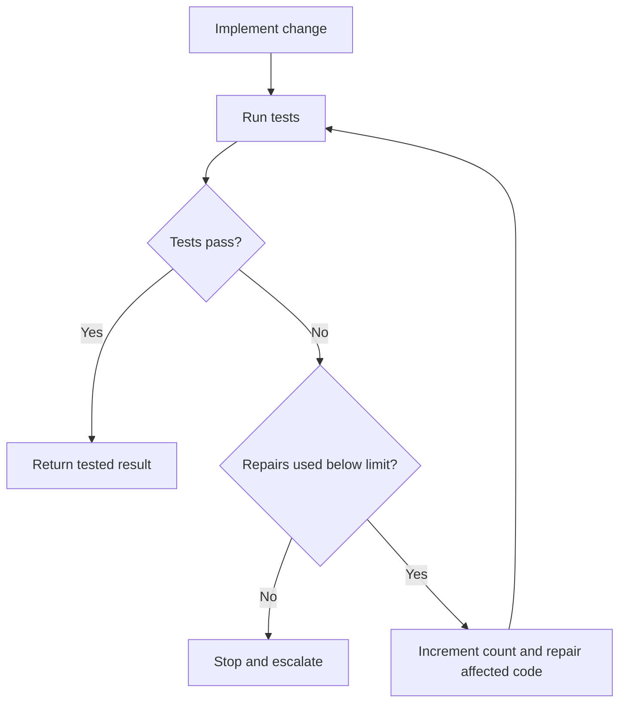

# Learning Explanation Framework — A Practical How-to Guide

**Revision:** v1 · 2026-10-26

## Summary

**TL;DR:** Use a goal, audience, example, and verification checklist to build an explanation that is comprehensive enough to understand and concise enough to recall. The prompts and Graph Engineering worked example show how to apply the method; the checklist is a menu, not a compulsory answer template.

**Use this when:** preparing a technical explanation, studying a concept, or checking whether a guide supports understanding and recall.

## Goal & prerequisites

**Goal:** Produce an explanation that covers what the concept means, why it exists, how it behaves, and where its boundaries lie.

Choose a topic, audience/prior knowledge, learning goal, and output depth. Use primary sources when factual or product claims need verification. No particular AI agent, diagram renderer, or programming environment is required; runnable implementation examples need their stated runtime.

**Analogy:** Plan a lesson like packing a toolkit: include the tools needed for this job, then check that each one works. The concrete tools here are the checklist, copyable prompts, worked scenario, and recall log.

> A reusable framework for learning technical concepts clearly, deeply, and efficiently.
>
> **Goal:** Comprehensive enough to understand the subject, concise enough to remember it.

This is a reusable authoring and learning method. It does not automatically override an agent’s operating instructions or prove that a learner understands a topic.

## Steps

1. Choose the audience, learning goal, and depth using the scale table.
2. Select the useful checklist items and gather supporting evidence.
3. Use one of the quoted prompts as a drafting artifact, adapting it to the task.
4. Check the worked example for the relationship between definitions, diagrams, failure cases, and recall.
5. Verify the explanation, then record what you can explain independently and what to revisit.

### Explanation structure and scale

A strong explanation should cover not only **what something is**, but also **why it exists, how it works, what it looks like in practice, and where its boundaries are**.

A useful sequence is **definition → intuition → mechanism → example → comparison → limits → recall**. Adjust the depth to the topic and audience; a simple vocabulary distinction may need only a short comparison table, while an engineering workflow benefits from a diagram and runnable experiment.

**Choose the scale:**

| Depth | Appropriate output |
| --- | --- |
| Quick understanding | Definition, core distinction, one example, takeaway |
| Study guide | Components, meaningful visual, worked scenario, trade-offs, references, recall questions |
| Implementation guide | Study guide plus executable example, failure handling, validation evidence, version assumptions |

The checklist below is a menu of learning needs, not an instruction to force twelve sections into every answer.

**A fuller study-guide sequence (adapt to the learning goal):**

```text
Definition
    ↓
Fundamental idea / intuition
    ↓
Essential building blocks
    ↓
Visual model / diagram
    ↓
Practical example
    ↓
Decision flow / interactive experiment
    ↓
Comparison with nearby concepts
    ↓
Boundaries, exceptions, and trade-offs
    ↓
Real-world uses and further reading
    ↓
Core takeaway
```

### Reusable explanation checklist

- [ ] **Definition:** State the term in one or two precise sentences.
- [ ] **Fundamental idea:** Express its essence in plain language (ideally one memorable sentence).
- [ ] **Purpose:** Explain which problem it solves and why it matters.
- [ ] **Key components:** Identify the smallest set of concepts required to understand it.
- [ ] **Visualization:** Add a diagram, flowchart, tree, timeline, or table that fits the subject.
- [ ] **Concrete example:** Demonstrate the concept in an everyday or software-engineering scenario.
- [ ] **Behavior / decision logic, when relevant:** Show different inputs and failure paths; use a runnable or manual experiment when it improves learning. A static flowchart is not an interactive widget.
- [ ] **Related concepts:** Explain similarities and the specific dimension where each differs.
- [ ] **Boundaries:** State what the concept *is not*, common misconceptions, and when it should not be used.
- [ ] **Trade-offs:** Cover benefits, costs, and constraints without overselling.
- [ ] **Further reading:** Verify primary sources for factual/product claims; distinguish optional tutorials and unverified references. Never invent URLs.
- [ ] **Essence / takeaway:** Finish with a short mental model that can be recalled later.

#### Quality requirements

1. **Clear before complex:** Use accessible language first, then introduce technical terms.
2. **Detailed, not bloated:** Every section should provide new understanding.
3. **Comparable, not isolated:** Clarify boundaries against similar concepts.
4. **Visual when meaningful:** Prefer diagrams that reveal relationships or changes, not decoration.
5. **Concrete before abstract:** Translate important statements into recognizable scenarios.
6. **Truthful about uncertainty:** Mark emerging terminology and context-dependent definitions.
7. **Revisable:** Keep definitions, examples, open questions, and references easy to update.
8. **Consistent:** Diagrams, prose, and code must agree about dependencies, counters, outcomes, and stopping rules.
9. **Evidence-aware:** Mark official facts, teaching simplifications, proposed designs, and uncertainty separately. A tracking parameter in a URL is not evidence that the reference is fabricated.
10. **Testable:** State whether code was executed, what was checked, and which behaviors are only simulated.

### Copy-and-use prompts

**Compact structured prompt**

```text
Explain [TOPIC] as a practical, structured learning guide.

Please include:
1. A precise, beginner-friendly definition.
2. The fundamental idea, purpose, and one memorable analogy.
3. Essential components and how they fit together.
4. A visual diagram or logical tree (Mermaid if suitable).
5. A concrete real-world or software-engineering example.
6. A step-by-step decision flow, including branches and failure cases where relevant.
7. A comparison with related concepts, showing both overlap and clear boundaries.
8. Common misconceptions, exceptions, limitations, and trade-offs.
9. Practical applications and links to trustworthy references.
10. A concise takeaway and suggested learning path.

Make it comprehensive but concise. Explain the essence, not just dictionary definitions.
Keep visuals and examples consistent with the explanation.
Distinguish established facts from emerging or context-specific usage.
```

Apply the scale and evidence rules above to this compact form; a visual is useful when it explains relationships, and implementation depth needs executable evidence.

**Audience- and goal-specific prompt**

```text
Explain [TOPIC] for [AUDIENCE / PRIOR KNOWLEDGE].
Goal: [UNDERSTAND / COMPARE / IMPLEMENT].
Depth or approximate length: [QUICK / STUDY GUIDE / IMPLEMENTATION GUIDE].

Start with a precise definition and its fundamental idea in plain language.
Explain the problem it solves, then use a concrete example.
Compare nearby concepts on the same dimensions, including overlap and boundaries.
Add a diagram only when relationships, branching, or change need visualization.
For processes, include relevant failure paths and explicit stopping conditions.
For implementation goals, provide a small runnable example and say whether tested.
Include limitations and a short takeaway; add recall questions with answers if useful.

Scale the sections to the request; omit items that add no understanding.
Label analogies, illustrative designs, emerging terminology, and uncertainty.
Verify changing technical claims with current primary sources when access permits.
Only present links as verified if opened; otherwise label them unverified or omit them.
Never invent citations. Do not mistake a diagram for an interactive experiment.
Keep diagrams, prose, and code consistent. End with a useful next learning step.
```

### Worked example: Graph Engineering

#### Definition and purpose

In the **AI agent/workflow orchestration** context, *Graph Engineering* can describe the practice of designing and operating interconnected tasks, agents, tools, and decisions as a graph.

> **Core idea:** Rather than depending on one AI agent to improvise the entire workflow, explicitly design the units of work and the rules governing their coordination.

**Terminology note:** “Graph Engineering” is not universally defined as one formal discipline. In other contexts, it can refer to engineering graph-shaped data systems and knowledge graphs. Always clarify which meaning is intended.

##### Why this exists: a shopping-cart scenario

A React frontend and ASP.NET Core API must agree on quantity validation and totals. Without explicit coordination, workers can implement different contracts, overwrite shared files, or announce completion before integration checks run. Agree the contract, assign outputs, and define a join and a bounded repair policy. This is an illustrative engineering scenario.

**Analogy:** A kitchen coordinates preparation, cooking, and inspection. Different cooks help only if the recipe, handoffs, and serving criteria are clear. A single cook may still be sufficient.

#### Building blocks

| Element | What it means | Example |
| --- | --- | --- |
| Node | A task, agent, tool, or approval | Coding agent |
| Edge | A permitted transition or dependency | Coding → Tests |
| State | Data passed or retained during execution | Requirements, errors, outputs |
| Router / decision | Selects the next path | Tests pass? |
| Orchestrator / runtime | Coordinates execution | Executes eligible tasks |
| Feedback loop | Repeats work based on results | Fail → Fix → Retest |

#### Workflow visualization

**Role and feedback overview**



This simplified view assumes the contract, join, repair limit, and escalation rules shown below. It illustrates responsibilities and feedback; use the bounded view to define execution.

**Bounded execution view**



The frontend uses agreed API mocks while backend/database implementation proceeds. The join waits for both required outputs. Repairs go to the responsible owner; specification or design ambiguity pauses the run for clarification. A later restart uses a reviewed plan and an explicit new budget.

The agent branches illustrate possible parallel work, but real dependency constraints matter: e.g., backend and database changes might have to be coordinated before integration succeeds.

#### Decision logic and manual experiment

**Minimal feedback mechanism**



This simplified view assumes the contract, join, repair limit, and escalation rules shown below. It illustrates responsibilities and feedback; use the bounded view to define execution.

**Bounded execution view**



**Pass:** Follow the success edge and deliver.  
**Fail:** Follow the correction edge and run tests again.  
**Budget convention:** Two repairs allow at most three attempts, including the initial implementation. Increment before each repair and preserve the count across retries. Add timeouts for individual calls and a deadline for the run.

##### Manual experiment: predict the route

This is a paper exercise, not an embedded interactive control. Start with `repairs_used = 0` and `max_repairs = 2`.

| Test outcomes by attempt | Your predicted result | Answer |
| --- | --- | --- |
| Pass | Cover the answer and predict | Finish after one attempt; zero repairs |
| Fail, pass | Cover the answer and predict | Finish after two attempts; one repair |
| Fail, fail, fail | Cover the answer and predict | Stop and escalate after three attempts; two repairs |
| Fail with a zero-repair budget | Cover the answer and predict | Stop after the first attempt |

Explain why the counter must not reset inside the repair node. **Answer:** Resetting it would allow the workflow to keep finding available retries forever.

**Production caution:** Add retry limits, human escalation, and logging so the loop does not run forever.

#### Nearby engineering concepts

| Concept | Main question | Emphasis |
| --- | --- | --- |
| Prompt Engineering | What should the AI do? | Instructions |
| Context Engineering | What should the AI know? | Useful information |
| Loop Engineering | How should it iterate and improve? | Feedback cycles |
| Graph Engineering | How should components coordinate? | Workflow architecture |

“Loop Engineering” and “Graph Engineering” are descriptive labels here, not a standardized taxonomy of disciplines. These concepts **overlap and complement one another**. For example, a graph node may use a carefully engineered prompt, read selected context, and run an internal revision loop.

#### Agent graphs and knowledge graphs

| | Agent / workflow graph | Knowledge graph |
| --- | --- | --- |
| Represents | Work, transitions, dependencies | Entities, facts, relations |
| Node examples | Agent, tool, approval step | Person, company, product |
| Edge examples | Delegate to, run next | Works at, owns, located in |
| Main goal | Coordinate execution | Organize connected knowledge |

**Memory aid:** A knowledge graph models **what the system knows**. A workflow graph models **how the system works**.

##### Workflow versus agent

Using [Anthropic's distinction](https://www.anthropic.com/research/building-effective-agents), predefined workflow code controls some paths while an agent dynamically chooses actions. A hybrid can use fixed acceptance gates and allow tool choice inside a node. Graphs do not inherently require multiple agents.

#### Applicability and trade-offs

**Useful when:** There are specialized agents, conditional routes, parallelizable work, explicit approvals, stateful retries, or audit requirements.

**Potentially unnecessary when:** A simple one-step prompt or linear script can solve the problem reliably. Graph architectures introduce coordination, debugging, and operational complexity.

**Operational trade-off:** Parallel work needs ownership and merge rules. Cyclic repair routes need budgets. Recovery needs saved state and protection against repeated side effects. More workers can increase both cost and latency through coordination overhead.

**Named implementation:** [LangGraph](https://docs.langchain.com/oss/python/langgraph/overview) is a real orchestration runtime for stateful workflows and agents. It is an implementation option, not proof that “Graph Engineering” has one standardized definition. An illustrative second application is invoice extraction → validation → human review for uncertain results.

#### Learning progression

1. Directed graphs, nodes, edges, cycles, and directed acyclic graphs (DAGs).
2. State machines and conditional transitions.
3. Sequential and parallel task orchestration.
4. Implement a small code → test → repair workflow.
5. Add persistence, observability, retry limits, and human approval.

The worked example has five responsibilities:

- **Analyst** — its job: agree expected behavior, via requirements and contracts.
- **Workers** — their job: implement separate outputs, via owned frontend/backend/database files.
- **Integrator** — its job: combine required outputs, via the explicit join.
- **Validator** — its job: check the result, via tests and acceptance criteria.
- **Router** — its job: choose delivery, repair, or clarification, via the outcome and repair counter.

Walkthrough: **Analyst** supplies the contract; **workers** write the owned outputs; **integrator** waits for all required branches; **validator** returns evidence; **router** either finishes, counts and schedules a repair, or pauses for clarification. These are illustrative in-process responsibilities. A network boundary exists only when an actual implementation calls an external service; these diagrams and the manual experiment perform no external calls.

✅ [LangGraph](https://docs.langchain.com/oss/python/langgraph/overview) is a stateful orchestration runtime; this worked example uses it as an implementation reference rather than claiming one standardized definition of Graph Engineering.

## Verify

Use the checklist to check definition, purpose, example, mechanism, boundaries, evidence, and takeaway. Compare each diagram’s branches with the prose and any code. For a runnable example, execute it and record the runtime, observed output, and limits; for a paper exercise, label it as manual.

**Worked check:** With zero repairs used and a two-repair budget, outcomes `fail, pass` finish after two attempts with one repair; `fail, fail, fail` escalate after three attempts with two repairs. If the prose says two total attempts instead, correct the inconsistency. Ask the learner to explain why resetting the counter prevents reliable termination.

### Personal learning notes

**Example note:** “I can explain why two repairs permit three attempts. I still need to learn how checkpoint recovery avoids repeating external actions.”

**What I can explain without looking:** …

**My own example and where the analogy fails:** …

**One uncertainty to investigate:** …

**Recall questions and answers:**

1. Does a graph require multiple agents? **No; ordinary functions and decisions are enough.**
2. Can a parallel marker replace dependency checks? **No; prerequisites, shared resources, and output ownership still matter.**
3. Does passing tests prove every requirement? **No; tests must cover the intended acceptance criteria, and some requirements need other evidence.**

**Suggested review:** Try explaining the concept without notes tomorrow, then again in a week. Revisit earlier if a real implementation exposes a gap; re-check product details before using commands from an older document.

**Personal review log:** Date: … · Gap found: … · Next action: …

### Additional review fields

**What I understand now:**

- 

**What still confuses me:**

- 

**My own example:**

- 

**Topics to revisit:**

- 

**Last reviewed:** YYYY-MM-DD

## Troubleshooting

| Symptom | Cause | Fix |
| --- | --- | --- |
| Correct definition, but the learner cannot use it | No concrete example or decision exercise | Add one input/output scenario and ask the learner to predict the result |
| Twelve sections repeat the same idea | Checklist treated as a mandatory template | Choose only the learning needs that add understanding |
| Diagram and prose disagree | Dependencies or stopping rules were changed in one place | Reconcile them and rerun any executable example |
| Reference looks authoritative but cannot be checked | URL or claim was assumed | Find the primary source; label remaining uncertainty |
| Learner recalls the analogy but misunderstands behavior | The analogy’s limits were omitted | Add where the analogy breaks and a real artifact |


## Takeaways

- Scale an explanation to the reader’s goal; retain useful detail, examples, and boundaries.
- Treat diagrams, manual exercises, and runnable code as different evidence artifacts.
- Use recall to find gaps, then verify the relevant technical behavior against primary sources.

> **Final takeaway:** Put coordination rules into an explicit execution structure when the work is too complex or important to leave entirely to a single agent's implicit choices.

## Used by

- _Not cited by any rule yet._

## Verification status

- Verified: 1 claims · Unverified: 0 claims · Last verified: 2026-10-26

The marked implementation claim was checked against the primary source. The explanation sequence, checklist, prompts, analogies, and review schedule are practical recommendations, not empirically established guarantees of learning. The Graph Engineering scenarios are illustrative; the manual route cases were checked arithmetically. Links used as technical evidence were opened; supplementary reading is not claimed as primary evidence.

## References

- [Diátaxis](https://diataxis.fr/) — Daniele Procida, living. Backs: different documentation purposes require different forms; this specific checklist is a practical authoring design, not a validated learning theory.
- [Building effective agents](https://www.anthropic.com/research/building-effective-agents) — Anthropic, 2024. Backs: workflow/agent distinction used in the worked example.
- [LangGraph overview](https://docs.langchain.com/oss/python/langgraph/overview) — LangChain, living. Backs: stateful workflow and agent runtime example.
- [Graph database concepts](https://neo4j.com/docs/getting-started/graph-database/) — Neo4j, living. Backs: the data-centered use of graphs.
- [Mermaid flowchart syntax](https://mermaid.js.org/syntax/flowchart.html) — Mermaid, living. Backs: diagram authoring syntax.
- [Graph Engineering tutorial](https://www.datacamp.com/tutorial/graph-engineering-guide) — DataCamp, living. Optional terminology/tutorial reading.
- `../ai-agents/graph-engineering-study-guide.md` — dedicated concept guide and executable routing simulation.
- `../ai-agents/graph-engineering-vs-sdd-ai-dlc-spec-kit.md` — dedicated comparison of workflow, specification, toolkit, and lifecycle concerns.
- `../../patterns/explaining-mechanisms.pattern.md` — actor ownership, artifacts, diagrams, and step-by-step mechanism explanations.
- `../../patterns/revise-without-erasing.pattern.md` — preserving useful explanatory detail when revising a guide.

## Related

- [Graph Engineering — An Introductory Study Guide](../ai-agents/graph-engineering-study-guide.md).
- [Graph Engineering, SDD, AWS AI-DLC, and GitHub Spec Kit](../ai-agents/graph-engineering-vs-sdd-ai-dlc-spec-kit.md).
- [Doc template base](doc-template-base.md) — separate conventions for team-facing documents.
