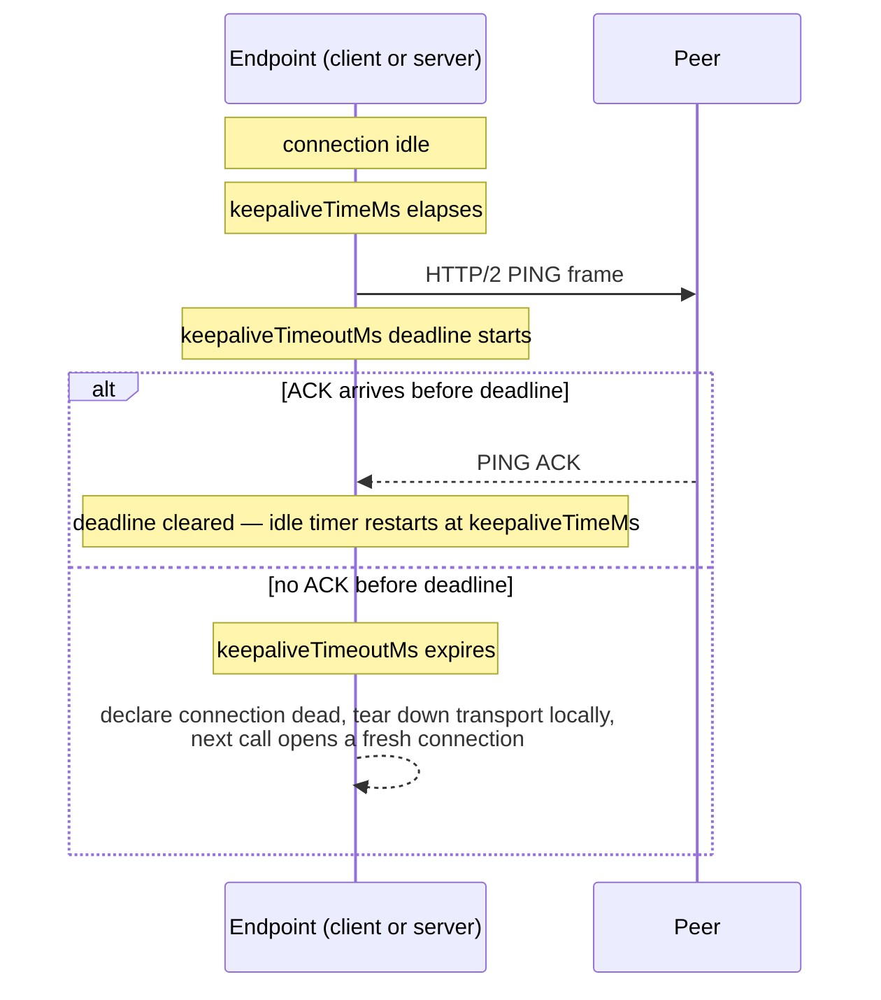
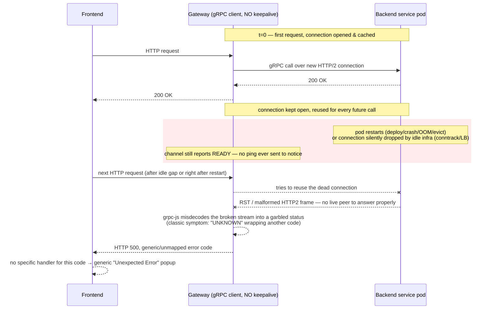

# gRPC Stale Connection ("keepalive") Failures — Concept + Case Study

Generic knowledge about a recurring class of bug in Node.js/NestJS microservices that
talk to each other over persistent gRPC (HTTP/2) connections, plus a concrete case
study from investigating NE-69092 ("Unexpected Error" popup in Export/Import Shipment
Overview, ne-manage-shipment-frontend / ne-api-gateway / ne-shipment-api /
ne-import-shipment-api).

---

## 1. The underlying mechanism (applies to any gRPC/HTTP2 client)

gRPC calls are multiplexed over a **single long-lived TCP connection** per target
(the "channel"). This is by design — opening a new TCP + TLS + HTTP/2 handshake per
RPC would be far too slow, so the client opens one connection and reuses it for every
subsequent call, indefinitely, until something explicitly closes it.

The catch: **TCP does not proactively notify either side when the other end
disappears.** If no bytes are flowing, a socket can go dead — peer process
restarted, pod evicted, NAT/conntrack entry expired, load balancer idle-timeout,
network blip — and neither side finds out until something tries to *use* that socket
again. Until then, the client's gRPC channel happily reports itself as `READY`. It's
lying; it just doesn't know it yet.

**`keepalive` is gRPC's fix for this.** When configured, the client (and/or server)
periodically sends an HTTP/2 `PING` frame on an otherwise-idle connection. If no `PING`
ACK comes back within the timeout, the endpoint proactively tears down that connection
and the next RPC opens a fresh one — instead of discovering the rot mid-request and
surfacing a confusing error to a real user.

### Key options (grpc-js / `@nestjs/microservices` `GrpcOptions.options`)

| Option | Meaning | Typical value |
|---|---|---|
| `keepaliveTimeMs` | How often to send a PING when the connection is idle | `6 * 60 * 1000` (6 min) |
| `keepaliveTimeoutMs` | How long to wait for a PING ACK before declaring the connection dead | `5 * 1000` (5 s) |
| `keepalivePermitWithoutCalls` | `1` = send PINGs even when there are no active RPCs in flight (needed — otherwise keepalive only runs *during* a call, which defeats the point for bursty/idle traffic) | `1` |

By default (no `keepalive` block at all), grpc-js effectively never pings — the
channel can sit "READY" over a dead socket forever.

---

## 2. Deep dive: `keepaliveTimeMs` vs `keepaliveTimeoutMs`, and how client/server interact

These two options are two halves of one state machine, not two independent
settings. Verified directly against this stack's installed packages
(`node_modules/@nestjs/microservices/{client,server}/*.js` and
`node_modules/@grpc/grpc-js/build/src/{transport,server}.js`) rather than assumed
from general gRPC docs — the NestJS `keepalive` block is a thin passthrough that maps
1:1 onto grpc-js channel args:

```
keepaliveTimeMs             → grpc.keepalive_time_ms
keepaliveTimeoutMs          → grpc.keepalive_timeout_ms
keepalivePermitWithoutCalls → grpc.keepalive_permit_without_calls
```

### `keepaliveTimeMs` — the ping *cadence*

- **Definition:** the length of an idle interval after which this endpoint sends an
  HTTP/2 `PING` frame to probe whether the peer is still there.
- **Conception:** TCP already has a "keepalive" concept, but OS-level TCP keepalive
  is off by default and, even when enabled, defaults to ~2 hours before the first
  probe on Linux — far too slow for a request path with a real SLA. gRPC keepalive
  reimplements the same idea one layer up, at HTTP/2, so it's configurable per
  service and independent of OS/kernel settings or what's running on the box.
- **Behavior:** it's a *trigger interval*, not a wait-for-response timeout by itself.
  The timer resets on real traffic; once it fires (idle for `keepaliveTimeMs`), a
  `PING` goes out and the *other* option's clock starts.
- **Default when unset:** effectively "never." In this stack's grpc-js:
  `keepaliveTimeMs = -1` on the client transport, and `~(1 << 31)` ms (≈ 24.8 days,
  i.e. `INT32_MAX`) on the server — both are "don't bother" values.

### `keepaliveTimeoutMs` — the ACK *deadline*

- **Definition:** once a `PING` has been sent, how long to wait for the `PING ACK`
  before this endpoint unilaterally declares the connection dead.
- **Conception:** this is the actual liveness bound — it caps how long a connection
  that's actually broken can keep pretending to be `READY`. If the ACK lands in
  time, the cycle resets and another `keepaliveTimeMs` idle window begins. If not,
  the endpoint tears the transport down **itself**, locally — it does not wait for
  the OS/kernel to notice a dead peer.
- **Default when unset:** `20000` ms (20 s) — but this default is moot unless
  `keepaliveTimeMs` is also set, since with no ping cadence no `PING` is ever sent to
  time out in the first place.

### One full cycle



### Client-side and server-side run this independently — and protect *different* things

Both sides run this exact machine on their own; grpc-js in this stack does **not**
require the two sides' values to match (confirmed — this Node server implementation
does not enforce the "ping abuse" `GOAWAY`/`ENHANCE_YOUR_CALM` policy that some
other-language gRPC servers, e.g. Go/C++/Java, use to penalize a client that pings
too aggressively via `grpc.http2.min_ping_interval_without_data_ms`. That specific
pitfall is real gRPC-ecosystem knowledge worth knowing about if this call ever
crosses a non-Node hop — e.g. an Envoy/Istio sidecar or a non-Node service — but it
does not apply between two grpc-js NestJS services talking directly, as here).

#### PING → ACK is protocol-mandatory, independent of the *peer's* config

This is the detail that makes everything else make sense: replying to a `PING` with
a `PING ACK` is an **HTTP/2-spec-level obligation** (RFC 7540 §6.7), handled by the
HTTP/2 layer itself, not by grpc-js's `keepalive` option. That means:

- Side **A** can fully detect a dead **B** using only **A's own** `keepalive` config
  — **B does not need any `keepalive` block at all** for A's pings to work, as long
  as B's process/HTTP2-stack is alive and reachable. B will auto-ACK regardless.
- The only thing a missing `keepalive` block on a given side controls is whether
  *that side* ever sends its *own* outbound probes. It has zero effect on that
  side's ability to *answer* the other side's probes.
- Practical consequence for this ticket: configuring keepalive on **either** side
  alone would have been enough to let *that side* detect a dead peer — client-side
  in `ne-api-gateway` would have protected the user-facing request path by itself;
  server-side in `ne-shipment-api` protects the server's own bookkeeping. They are
  additive, not redundant, because each only watches the direction it initiates.

#### What "declaring the connection dead" actually does on the wire

Traced in `transport.js`/`server.js`: on a `keepaliveTimeoutMs` expiry (or a failed
ping *send*), both client and server call **`session.destroy()`** — a forceful,
non-graceful teardown (not a polite `GOAWAY`-then-close). Effects:

- If the network path to the peer is still functional, `session.destroy()` causes
  the OS to send a TCP `RST`/`FIN` that the peer's kernel/HTTP2 stack will typically
  see almost immediately (a `'close'`/`'error'` event on their session) — **so the
  peer often finds out too, fast, as a side effect, even without its own keepalive
  configured.** This is a real cascade, not just a same-side cleanup.
- If the network path is *not* functional in that direction (the actual "stale
  connection" case — NAT/conntrack mapping gone, peer's network namespace already
  torn down) — that `RST`/`FIN` goes nowhere. The peer gets no cascade signal at
  all and remains oblivious until **its own** keepalive fires, or until it tries a
  real RPC over the dead connection and that fails outright.
- Any RPCs that were actively in flight on the connection at the moment of teardown
  are failed immediately, locally (`call.onDisconnect()`), rather than hanging.

#### The `keepalivePermitWithoutCalls` timing trap

Also traced in `transport.js` (`addActiveCall`/`maybeStartKeepalivePingTimer`):
if `keepalivePermitWithoutCalls` is **not** set to `1`, that side's ping loop only
runs while `activeCalls.size > 0`. With zero calls in flight (exactly the state of
a Shipment Overview page sitting open with no user interaction), the idle timer
never starts — `canSendPing()` returns false, and the pending-ping flag just waits.

When the *next* real RPC finally starts, grpc-js does fire the overdue ping at that
same moment — but the ping and the real RPC race concurrently on the same
(possibly-dead) connection. **The real RPC is not shielded from the race — it can
still fail on that first call after the idle gap.** Only calls *after* that one
benefit from the now-fresh connection. In other words: `keepalive` block present but
`keepalivePermitWithoutCalls` missing/`0` ⇒ the mechanism silently degrades to
"detect the staleness by sacrificing the user's next click" instead of "detect it
proactively in the background before the user ever notices." `keepalivePermitWithoutCalls: 1`
is what converts this from a mitigation into an actual fix for the idle-then-comeback
pattern this ticket describes.

#### Graceful shutdown (`GOAWAY`) is a *separate*, faster mechanism — and it's not wired up here

Distinct from ping-based keepalive: if a gRPC server shuts down gracefully (NestJS
`app.enableShutdownHooks()` + the framework calling `server.tryShutdown()` on
`SIGTERM`), it sends a `GOAWAY` frame telling connected clients "stop opening new
streams here" *before* the process exits. A well-behaved client sees this
immediately and routes its next call to a fresh connection — no keepalive timeout
needed, no user-facing failure, because the notice arrives at shutdown time instead
of being discovered later by a failed probe.

**Checked directly in this codebase: neither `ne-shipment-api` nor
`ne-import-shipment-api` calls `enableShutdownHooks()` anywhere in `src/`** (only
`ne-api-gateway` has a graceful-shutdown service, for its own HTTP layer). So a pod
restart of either backend service today is **not** preceded by a `GOAWAY` — from
gRPC's point of view it's an abrupt death, not a graceful one. This is exactly why
this ticket's symptom is real: there is currently *no* fast/graceful notification
path for these two services' restarts, which makes the client-side `keepaliveTimeoutMs`
window the *only* mechanism standing between "backend pod restarted" and "user sees
Unexpected Error." (Adding `enableShutdownHooks()` + graceful gRPC shutdown to these
two services would be a complementary, not alternative, fix — worth a separate
follow-up ticket, not in scope here.)

#### Full case matrix — what breaks, and what actually catches it

| # | Scenario | Client-side keepalive catches it? | Server-side keepalive catches it? | User-facing impact if *neither* configured |
|---|---|---|---|---|
| 1 | Server shuts down **gracefully** (hypothetical — not currently true here, see above) | N/A — `GOAWAY` handled instantly, no ping needed | N/A | None |
| 2 | Server pod restarts/crashes **abruptly** (today's reality — no shutdown hook) and the old socket cannot deliver any signal (namespace torn down) | **Yes** — this is the only thing that catches it | No — the process that would ping is gone | "Unexpected Error" on the first request that lands on the stale connection |
| 3 | Server pod restarts abruptly, but the OS on that node still manages to emit a `RST`/`FIN` before the network namespace disappears | Yes, and often the client also learns near-instantly via the `RST`/`FIN` cascade, independent of keepalive timing | No (server process still gone) | Usually a fast, clean connection-refused/reset error rather than the confusing `UNKNOWN`/`NOT_FOUND` — less likely to be *this* exact symptom |
| 4 | Gateway pod/process dies abruptly while the backend stays up | No (client is the dead one) | **Yes** — server reclaims the socket instead of leaking it | No direct user-facing 500 (a live gateway replica or the next gateway instance handles new traffic); but without server keepalive, the surviving server slowly accumulates zombie connections/resources |
| 5 | Fully bidirectional silent black-hole — both processes healthy, but infra (conntrack/NAT/LB idle timeout) drops the mapping | Yes, if configured with `keepalivePermitWithoutCalls: 1` | Yes, independently, same caveat | Neither side finds out until whichever side tries a real RPC first — that RPC fails |
| 6 | `keepalive` configured on the relevant side, but `keepalivePermitWithoutCalls` left `0`/unset, and the connection has been fully idle (no calls) | Partially — detected only *at* the next real call, racing it (see trap above) | Same caveat, mirrored | The very first request after the idle gap can still fail; only later ones are protected |

---

## 3. Failure timeline



**Why it looks "random":** it only reproduces when (a) enough idle time has passed, or
a backend restart happened, since the channel's last successful call, **and** (b) the
very next call happens to land on that now-dead connection. It correlates with idle
gaps / deploy windows, not with any particular user action or record.

---

## 4. Why retries don't save you

Even with a retry policy configured, it usually only retries `Status.UNAVAILABLE` —
the "clean" disconnect code. A stale-connection failure frequently does **not**
surface as `UNAVAILABLE`; it surfaces as `UNKNOWN` (or another wrapped code) because
the client got a malformed/partial response rather than a clean immediate refusal.
If `UNKNOWN` isn't in the retryable set, the error goes straight to the caller.

---

## 5. Case study — NE-69092 (Aug 2026)

**Symptom:** "Unexpected Error" popup randomly on the Export/Import Shipment
Overview screens in `ne-manage-shipment-frontend`.

**Repro cURL / response supplied by reporter:**
```
GET https://ecomm-test.one-line.com/api/v1/import-shipments/NB4BNE901600
→ 500 {"status":500,"code":"ERR-500","message":"5 NOT_FOUND: Not Found",
       "stack":"Error: 2 UNKNOWN: 5 NOT_FOUND: Not Found\n at callErrorFromStatus
       (.../@grpc/grpc-js/.../call.js) ... at Observable._subscribe
       (.../@nestjs/microservices/client/client-grpc.js) ..."}
```
`2 UNKNOWN: 5 NOT_FOUND` — a status wrapped inside another status — is the
textbook grpc-js symptom of exactly the stale-connection failure described above.

### Call path
Browser → `ne-api-gateway` `GET /api/v1/import-shipments/:bookingNo`
→ gRPC `getImportShipmentDetail` → `ne-import-shipment-api`.

(Same class of bug affects the parallel Export path: gateway → `ne-shipment-api`.)

### What was found (grep across the 3 repos)

| Repo | File | `keepalive` configured? |
|---|---|---|
| ne-api-gateway (client → import-shipment-api) | `src/modules/import-shipment/importShipment.module.ts` (`ClientProxyFactory.create`) | ❌ Missing |
| ne-api-gateway (client → shipment-api, Export Overview) | `src/modules/shipment/shipment.module.ts` (`ClientProxyFactory.create`) | ❌ Missing |
| ne-shipment-api (gRPC server) | `src/grpc-client.options.ts` | ❌ Missing |
| ne-import-shipment-api (gRPC server) | `src/grpc-client.options.ts` | ✅ Already set (added in commit `4d21208`, May 2026) |

Meanwhile ~14 **other** gRPC client providers already inside `ne-api-gateway` (bookings,
cargo-release, schedule, system, support, survey, reefer-iot/EDH, master-data,
shipping-instruction, blk-ecom, bl-processing, efinance, rate-tariff, pom) **already
carry** the identical `keepalive` block:
```ts
keepalive: {
  keepalivePermitWithoutCalls: 1,
  keepaliveTimeMs: 6 * 60 * 1000,
  keepaliveTimeoutMs: 5 * 1000,
},
```

### Historical precedent (this exact bug has hit this repo before)

```
e49bf2a7  2022-10-14  "fix: set keepalive timeout for grpc"
d12d0303  2024-01-26  "#Add configs to keep alive connection with ne-edh-api"
89750380  2024-01-30  "#Update config keepalive"
```
Each of those commits added the same block to a *different* module after that
module hit the same stale-connection symptom. It was fixed per-module reactively,
never applied systematically — `shipment` / `import-shipment` were simply missed.

### Also relevant: retry policy gap
`ne-api-gateway/src/common/grpc/retry-policy.ts`:
```ts
export const RETRY_POLICY = {
  maxAttempts: 4,
  initialBackoff: '0.5s',
  maxBackoff: '5s',
  backoffMultiplier: 2,
  retryableStatusCodes: [Status.UNAVAILABLE],
};
```
Only `UNAVAILABLE` is retried. The observed `UNKNOWN` failure is not, so it passes
straight through to the client as a 500.

### Frontend surfacing
`ne-manage-shipment-frontend/src/shared-frontend/shared/configs/apiClient.ts` —
`handleResponseError()` special-cases `401/503/504/429`; anything else (including
this unmapped 500) falls through to `throw new CommonServerError(response.data)`,
which renders the generic "Unexpected Error / An error has occurred while processing
data. Please try again later." modal.

### Infra context (why it's plausible in this environment)
- Backend services are called via cluster-internal DNS (`ne-shipment-api:5002`,
  `ne-import-shipment-api:5010`), plain gRPC, no TLS termination proxy in the path
  that would independently reset idle connections for you.
- `stage` / `internal-test` overlays run `replicas: 1` for both
  `ne-shipment-api` and `ne-import-shipment-api` — a single pod, so any restart of
  that one pod (redeploy, crash, OOM) invalidates every existing connection to it at
  once, with no other pod to fail over to at the connection level.
- `production` runs HPA `minReplicas: 2` / `maxReplicas: 6` — adds a second failure
  mode there: because k8s Service load-balances at the *TCP connection* level (not
  per-request) for a long-lived multiplexed HTTP/2 connection, a gateway pod sticks to
  whichever backend pod it first connected to. Scale-down events or rolling deploys
  that terminate that specific pod strand the gateway's cached connection.

### Deterministic repro recipe
1. Open Shipment Overview → Import tab on stage/Unicorn-test, click into one booking
   so the detail call succeeds once (this opens & caches the gateway→
   import-shipment-api connection).
2. Trigger a restart of the `ne-import-shipment-api` pod in that environment
   (rolling restart / redeploy) **without** restarting `ne-api-gateway`.
3. As soon as the new pod is ready, click into a booking detail again (or refresh
   the list) on the frontend. The gateway reuses its now-stale connection to the
   terminated pod → same `UNKNOWN`/`NOT_FOUND` → "Unexpected Error" popup.

(Organic/non-deterministic repro: leave the page idle long enough to exceed
whatever silent idle-connection timeout the network path enforces, then interact
again — first request after the gap is the one likely to fail.)

### Prescribed fix (matches the Jira ticket's "Technical Solution")
Add the same `keepalive` block used elsewhere in the gateway to the three missing
spots:
1. `ne-api-gateway/src/modules/import-shipment/importShipment.module.ts` — pending, owned by colleagues (import path, out of scope for this investigation)
2. `ne-api-gateway/src/modules/shipment/shipment.module.ts` — pending, owned by colleagues (client-side half of the Export path)
3. `ne-shipment-api/src/grpc-client.options.ts` — **done** (server-side half of the Export path, applied 2026-08-13)

Per §2's client/server table above: #3 alone hardens the server's own connection
hygiene but does not close the loop on the exact symptom reported in this ticket
(gateway holding a stale connection to a since-restarted/dead server pod) — that
needs #2, the gateway's client-side keepalive, which is still open.

---

## 6. General takeaway / checklist for any new gRPC client in this system

- [ ] Every `ClientProxyFactory.create({ transport: Transport.GRPC, ... })` and every
      `MicroserviceOptions` gRPC server block should carry a `keepalive` option unless
      there's a specific reason not to.
- [ ] Don't rely on retry policies to paper over stale connections — they typically
      only cover `UNAVAILABLE`, and stale-connection failures often surface as other
      codes (`UNKNOWN`, garbled/wrapped statuses).
- [ ] When a new gRPC-consuming module is scaffolded by copying an existing one,
      diff it against a module that has already been through this class of incident
      (e.g. `reefer-iot`, `bookings`) rather than a bare/older one — otherwise the
      omission just gets copy-pasted forward again.
- [ ] `grep -rn "keepalive" src/` in `ne-api-gateway` periodically to catch any client
      provider that's missing it before it becomes a support ticket.
