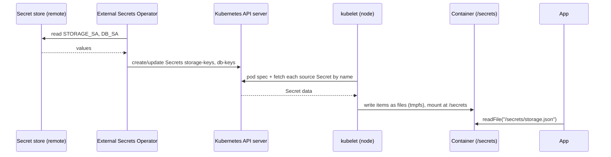

# Volumes, Secret volumes and projected volumes

## Summary
**TL;DR:** A **Secret** is a stored object, a **volume** is a recipe that turns something into a folder, and `volumeMounts` says where that folder appears in a container. `secret:` builds the folder from **one** Secret; `projected:` builds it from **several** sources and can pick keys from each.
**Use this when:** you read a Deployment's `volumes:` and `volumeMounts:`, switch a mounted Secret to a projected volume, or wonder where a mounted credential file actually lives.
**Not this doc:** how a Secret's values get filled in from an outside store (the External Secrets Operator is only sketched here), and how apps use the credential once they read the file.

## Problem
Three different things share similar names, so people mix them up:

| # | Thing | Lives in | Is it a folder? |
|---|---|---|---|
| A | **Secret** (an object named, say, `app-keys`) | The cluster database, as key → value pairs | No: it is an object, like a table row |
| B | **Volume** (an entry under `volumes:`) | The pod spec (YAML) | No: it is a recipe |
| C | **Folder** at the `mountPath` | Inside the running container | Yes: built when the pod starts |

The most common real confusion is the change from the **previous way** (`secret:`) to the **new way** (`projected:`):

| | Previous way: `secret:` | New way: `projected:` |
|---|---|---|
| Reads from | **One** Secret object | **Several** sources (Secrets, ConfigMaps and others) |
| Which keys | All keys by default; the `items:` list can pick some | The `items:` list under each source picks keys per source |
| Folder content | One Secret's keys | A merge of every source's chosen keys |
| Typical reason to switch | — | A hand-made catch-all Secret is replaced by purpose-built Secrets, and each pod mounts only the files it reads |

Note that `items:` is **not** what separates the two. A plain `secret:` volume can pick keys too. What only `projected:` can do is combine several sources into one folder.

## Mental model
A volume is a **drawer** the pod can open. The volume type says what fills the drawer: a `secret:` drawer is filled from one box (one Secret); a `projected:` drawer is filled from several boxes (the `sources`), taking only the items on your shopping list (`items`). `volumeMounts` says where the drawer sits in the container's room (`mountPath`).

The two YAML shapes, side by side:

```yaml
# Previous way: one Secret, every key becomes a file
volumes:
  - name: creds                  # the label that links volume and mount
    secret:
      secretName: all-keys       # a reference to an existing Secret object, not a folder

# New way: several Secrets, only the listed keys become files
volumes:
  - name: creds
    projected:
      sources:                   # the boxes
        - secret:
            name: storage-keys   # box 1
            items:
              - key: storage.json    # key inside the Secret
                path: storage.json   # file name in the folder
        - secret:
            name: db-keys        # box 2
            items:
              - key: db.json
                path: db.json

# Same in both: where the folder appears inside the container
containers:
  - volumeMounts:
      - name: creds              # which volume
        mountPath: /secrets      # where
```

`volumes:` sits at the **pod** level (a sibling of `containers:`), so every container in the pod can mount it. `volumeMounts:` sits inside a **container** and only picks a volume by name and a path. The `name` is the only link between the two. ✅ ([Volumes](https://kubernetes.io/docs/concepts/storage/volumes/))

## How it works
**6 actors** take part from a stored credential to a file the app reads:

- **Secret store** (an external service holding the real value) — its job: keep the source of truth, via its own API.
- **External Secrets Operator (ESO)** — its job: copy the value into a Kubernetes Secret, via an `ExternalSecret` resource. ✅ ([ESO overview](https://external-secrets.io/latest/introduction/overview/))
- **Kubernetes API server** — its job: store Secret objects and pod specs, via its database.
- **kubelet** (the agent on each node) — its job: build the volume folder for the pod, via reading the Secrets from the API server and writing files.
- **Container runtime** — its job: show that folder inside the container, via the `volumeMounts` mount.
- **App** — its job: use the credential, via opening the file at the path it was configured with.

**The artifacts.** An `ExternalSecret` that fills the Secret `storage-keys`:

```yaml
apiVersion: external-secrets.io/v1
kind: ExternalSecret
metadata: { name: storage-keys }
spec:
  refreshInterval: 1h            # how often ESO re-reads the store
  secretStoreRef: { name: my-store, kind: SecretStore }
  target: { name: storage-keys, creationPolicy: Owner }
  data:
    - secretKey: storage.json    # becomes the key inside the Secret
      remoteRef: { key: STORAGE_SA }   # the name in the external store
```

**The steps**, in order (`local` means inside the cluster; `remote` means a call leaves the cluster):

1. **ESO → secret store (remote):** reads `STORAGE_SA` through the store's API.
2. **ESO → API server (local):** creates or updates the Secret `storage-keys` with key `storage.json`. This repeats every `refreshInterval`.
3. **Pod scheduled → kubelet (local):** the kubelet reads the pod spec and finds the volume `creds`.
4. **kubelet → API server (local):** for each entry in `sources`, it fetches that Secret by name. The kubelet reports an Event and keeps retrying if a Secret cannot be fetched. ✅ ([Secrets](https://kubernetes.io/docs/concepts/configuration/secret/))
5. **kubelet (node, local):** writes only the keys named in `items` into a RAM-backed folder, using the `path` as the file name. Secret volumes are backed by tmpfs and are never written to non-volatile storage, and they are always mounted read-only. ✅ ([Volumes](https://kubernetes.io/docs/concepts/storage/volumes/))
6. **Container runtime (local):** exposes that folder at `/secrets` inside the container.
7. **App (local):** calls `readFile('/secrets/storage.json')`. This is the only step the application code takes part in.



**The folder on the node and the `..data` symlinks.** The kubelet writes files so they can be replaced atomically. It writes the real files into a timestamped directory, then points a symlink `..data` at that directory, and the visible file names are symlinks into `..data`:

```
/secrets/
 ├─ ..2026_10_18_00_20_38.431130660/     ← real directory with the real files
 │    ├─ storage.json
 │    └─ db.json
 ├─ ..data -> ..2026_10_18_00_20_38.431130660        ← symlink that gets swapped
 ├─ storage.json -> ..data/storage.json              ← what the app opens
 └─ db.json      -> ..data/db.json
```

When a Secret changes, the kubelet writes a new timestamped directory and renames the `..data` symlink onto it in one atomic step, so a reader never sees a half-updated set of files. ✅ ([kubelet atomic writer source](https://github.com/kubernetes/kubernetes/blob/master/pkg/volume/util/atomic_writer.go)). The scheme is identical for `secret:` and `projected:` volumes.

## Worked example
A pod mounts the credential files at `/secrets`.

**Previous way**, with one catch-all Secret of 20 keys and `secret: { secretName: all-keys }`:

```
Secret all-keys (object, 20 keys)          /secrets/ in the container (20 files)
 ├─ storage.json                       →    ├─ storage.json
 ├─ pubsub.json                        →    ├─ pubsub.json
 ├─ db.json                            →    ├─ db.json
 ├─ reports.json                       →    ├─ reports.json      ← the app never reads this
 └─ … 16 more                          →    └─ … 16 more
```

**New way**, with two purpose-built Secrets, `projected` and `items`:

```
Secret storage-keys ──┐ storage.json
                      ├─ pubsub.json     ┐
Secret db-keys ───────┘ db.json          ├─► /secrets/ in the container (3 files)
                                         ┘
```

Observed on a live cluster (2026-10-19): the new-way pod listed exactly the three files above plus the `..data` mechanics, and its mount was `tmpfs ... ro`, so the projected volume is also RAM-backed. ✅ (observed, not stated in the projected-volumes docs) The app code did not change, because it opens the same `/secrets/<file>.json` paths.

## Edge cases

| Case | What happens | Why |
|---|---|---|
| Only some keys listed in `items` | Only those keys appear as files; the rest are not projected | "Only keys specified in `items` are projected" ✅ ([Distribute credentials](https://kubernetes.io/docs/tasks/inject-data-application/distribute-credentials-secure/)) |
| A referenced Secret does not exist | The kubelet keeps retrying the pod and reports an Event with the fetch problem | Secret volume sources must be fetchable before the pod runs ✅ ([Secrets](https://kubernetes.io/docs/concepts/configuration/secret/)) |
| Secret is marked `optional` and missing | Kubernetes ignores it | `optional` is the documented opt-out ✅ ([Secrets](https://kubernetes.io/docs/concepts/configuration/secret/)) |
| A source lives in another namespace | Not allowed | "All sources are required to be in the same namespace as the Pod" ✅ ([Projected volumes](https://kubernetes.io/docs/concepts/storage/projected-volumes/)) |
| The Secret's value changes later | The volume is updated eventually, not instantly; the app sees new bytes only if it re-reads the file | Eventually-consistent update ✅ ([Secrets](https://kubernetes.io/docs/concepts/configuration/secret/)) |
| The Secret is mounted with `subPath` | The container never receives updates | Documented limitation ✅ ([Volumes](https://kubernetes.io/docs/concepts/storage/volumes/)) |
| Volume type is `emptyDir` or a PVC | The folder is backed by node disk or network storage (`emptyDir` can use RAM with `medium: Memory`), not by tmpfs by default | The type decides the backing ✅ ([Volumes](https://kubernetes.io/docs/concepts/storage/volumes/)) |

## Trade-offs

| Option | Gains | Costs |
|---|---|---|
| `secret:` (one Secret) | Shortest YAML; one object to manage | The folder holds every key of that Secret; a catch-all Secret mounts files a pod never reads |
| `projected:` (several sources) | Least privilege per pod; Secrets stay small and purpose-built | More YAML; each added source is another Secret that must exist before the pod starts |

## Takeaways
- A volume `name` creates nothing by itself; it only links a `volumes:` entry to a `volumeMounts:` entry. [rule-candidate]
- `secret.secretName` is a reference to an existing Secret **object**, never a folder.
- A volume is "storage that appears as a folder"; its type decides whether it is RAM, node disk or network storage.
- Choose `projected:` when one pod needs files from several Secrets; choose `secret:` with `items:` when one Secret is enough.
- After switching a mount to a projected volume, confirm every listed key exists in its Secret before rollout.

## Used by
- _Not cited by any rule yet._

## Verification status
- Verified: 13 claims (✅) · Unverified: 0 claims (⚠️) · Last verified: 2026-10-19

## References
- [Volumes](https://kubernetes.io/docs/concepts/storage/volumes/) — Kubernetes project, living. Backs: tmpfs-backed Secret volumes, read-only mounts, `subPath` limitation, `emptyDir` and PVC backing, `volumes` vs `volumeMounts`.
- [Projected Volumes](https://kubernetes.io/docs/concepts/storage/projected-volumes/) — Kubernetes project, living. Backs: `projected` merges several sources into one directory, the list of source types, same-namespace rule.
- [Secrets](https://kubernetes.io/docs/concepts/configuration/secret/) — Kubernetes project, living. Backs: kubelet retry and Event on fetch failure, optional Secrets, eventually-consistent updates, `subPath` limitation.
- [Distribute Credentials Securely Using Secrets](https://kubernetes.io/docs/tasks/inject-data-application/distribute-credentials-secure/) — Kubernetes project, living. Backs: `items` projects only the listed keys.
- [External Secrets Operator overview](https://external-secrets.io/latest/introduction/overview/) — External Secrets project, living. Backs: ESO fetches from an external API and creates Kubernetes Secrets.
- [ExternalSecret API](https://external-secrets.io/latest/api/externalsecret/) — External Secrets project, living. Backs: `refreshInterval` and `creationPolicy` fields.
- [`atomic_writer.go`](https://github.com/kubernetes/kubernetes/blob/master/pkg/volume/util/atomic_writer.go) — Kubernetes source, living. Backs: timestamped directory plus `..data` symlink swap.
- `{{AGENT_HOME}}/patterns/explaining-mechanisms.pattern.md` — the structure used for How it works.

## Related
- `{{AGENT_HOME}}/knowledge/gcp/gke-lens-setup.md` — legacy: inspecting a GKE cluster, including pods and their mounts, with Lens.
- `{{AGENT_HOME}}/knowledge/operations/index.md` — config and secrets handling at startup in application code.
