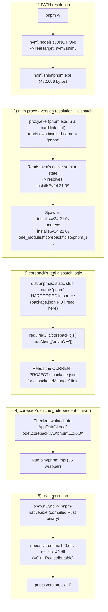

# Node.js / nvm / corepack / pnpm / yarn Architecture (Windows)

Investigated 2026-09-26 while debugging "pnpm/yarn not recognized despite install commands
succeeding" on a machine using an nvm4w-style Windows nvm build (installed under
`...\Author Software\nvm\`) managing Node 24.21.0.

## Key paths found on the investigated machine

- nvm root: `C:\Users\<user>\AppData\Local\Author Software\nvm\`
- `nvm\.nodejs` is an NTFS **junction** → real target is `nvm\.shim\` (verified via
  `fsutil reparsepoint query`).
- `nvm\.shim\{pnpm,yarn,corepack,npm,npx}.exe` are all **hard links** of the same file
  `nvm\proxy.exe` (all exactly 452,096 bytes) — a "multi-call binary" that behaves differently
  based on `argv[0]`/the name it was invoked as.
- `nvm\.shim\node.exe` is a *different*, separate proxy (736,768 bytes) — node itself doesn't
  need JS dispatch, so it has its own simpler logic to just exec the real `node.exe` of the
  active version.
- `nvm\installs\v24.21.0\` = the real installed Node distribution. The real `node.exe` here is
  93,580,104 bytes — the actual Node runtime, not a shim.
- `nvm\installs\v24.21.0\node_modules\{npm,corepack,yarn}` = real bundled/installed packages,
  **not** shims:
  - `npm`: the real bundled npm CLI. Node's own build hardcodes `npm.cmd`/`npm.exe` →
    `node_modules\npm\bin\npm-cli.js` directly. npm's own `package.json` has **no** `"bin"` field
    at all (confirmed via search) — npm bypasses corepack entirely, always.
  - `corepack`: the real bundled corepack package (ships with every Node.js release since 16.9).
  - `yarn`: was a **leftover** from a manual `npm i -g yarn` done previously on this machine;
    unused now since corepack's shim takes priority on `PATH`. It coincidentally matched the same
    version (`1.22.22`) that corepack later downloaded independently, because classic Yarn 1.x's
    last-ever published release is `1.22.22` (frozen for years — not a coincidence of active
    development, just that there's only one possible "latest" 1.x version).
- Corepack's own download cache (fully independent of nvm — exists identically even without nvm):
  `C:\Users\<user>\AppData\Local\node\corepack\v1\{pnpm,yarn}\<version>\`
  - e.g. `...\pnpm\12.6.0\bin\pnpm.mjs` (JS wrapper) + `...\pnpm\12.6.0\pnpm-native.exe`
    (the real compiled binary that does the actual work)

## Corrected fact: a package's own `package.json` "bin" field is NOT read at runtime

Verified experimentally: deleting the `bin` / `publishConfig.bin` fields from corepack's **own**
`package.json` (`nvm\installs\v24.21.0\node_modules\corepack\package.json`) has **zero** effect —
`pnpm -v` / `yarn -v` still work identically afterward.

Reason: `dist/pnpm.js` is a static, pre-generated stub file whose own source code hardcodes the
string `'pnpm'`:

```js
#!/usr/bin/env node
process.env.COREPACK_ENABLE_DOWNLOAD_PROMPT??='1'
require('module').enableCompileCache?.();
require('./lib/corepack.cjs').runMain(['pnpm', ...process.argv.slice(2)]);
```

This file is generated **once**, at corepack's own build/publish time (see its `mkshims.ts` build
script referenced in its `package.json` `scripts.build`) — the command-name association is baked
directly into the file's content, not looked up from `package.json` on every invocation.
`package.json`'s `bin` field is **install-time/publish-time metadata only** — used once by
whatever tool creates OS-level shims (npm's global-install machinery, or Node's own build process
when it bundles corepack). It is never re-read per command invocation.

Do **not** conflate this with a *project's own* `package.json` (e.g. the repo you're working in) —
that one genuinely **is** read live, on every invocation, by the logic inside corepack's bundled
`lib/corepack.cjs`, specifically to check for a `"packageManager": "pnpm@x.y.z"` field for
per-project version pinning. Two different `package.json` files serve two entirely different
purposes in this flow — one is dead metadata after install, the other is live configuration read
every time.

## Full end-to-end flow — `pnpm -v` (with nvm), file by file



Step-by-step narration:

1. Shell resolves `pnpm` via `PATH` → `nvm\.nodejs\pnpm.exe` (junction) → real file
   `nvm\.shim\pnpm.exe`.
2. That file is a hard link of `nvm\proxy.exe`. It reads its own invoked name (`"pnpm"`) plus
   nvm's internal active-version state, and resolves the active version folder
   `installs\v24.21.0`.
3. It spawns: `installs\v24.21.0\node.exe  installs\v24.21.0\node_modules\corepack\dist\pnpm.js  -v`
   — i.e. the real `node.exe`, with the JS entry file's path plus the original CLI args passed
   through as plain `argv`.
4. `dist/pnpm.js` requires `./lib/corepack.cjs` (corepack's real bundled logic), calling it with
   `['pnpm', '-v']`.
5. `corepack.cjs` reads the **current project's** `package.json` for a `"packageManager"` field.
   If absent, it falls back to corepack's bundled "known good" default version for that tool.
6. It checks/downloads into corepack's own cache:
   `AppData\Local\node\corepack\v1\pnpm\<version>\`.
7. It runs `bin\pnpm.mjs` (a JS wrapper), which locates and spawns the real compiled
   `pnpm-native.exe` sitting next to it, with stdio inherited straight through.
8. `pnpm-native.exe` needs `vcruntime140.dll` / `msvcp140.dll` (the Microsoft Visual C++
   Redistributable) to even load as a process. If missing, Windows kills it instantly with
   `STATUS_DLL_NOT_FOUND` (exit code `-1073741515`) and **zero** output — which looks exactly like
   "the command does nothing" from the terminal's perspective.

### `npm` and `yarn` take shortcuts through this same chain

- **`npm`/`npx`** skip steps 3–6's corepack dispatch entirely: the nvm proxy (step 2) still
  resolves the active version, but then directly spawns
  `installs\v24.21.0\node.exe node_modules\npm\bin\npm-cli.js` — no corepack involved at all,
  because Node's own build hardcodes this mapping (npm doesn't need per-project version pinning
  the way pnpm/yarn do).
- **`yarn`** follows the identical steps 2–6 as pnpm, but stops after step 6 — classic Yarn 1.x is
  pure JavaScript, so there's no native binary / DLL dependency step 7–8 at all. This is exactly
  why, in the real debugging session, yarn started working the instant its shim existed, while
  pnpm needed the additional VC++ Redistributable fix.

## Filesystem term glossary (all verified against the real machine, not just definitions)

- **Hard link** — Multiple directory entries (file names, possibly in different folders) pointing
  to the exact same underlying file data (same NTFS MFT record/inode). There is no "original" vs.
  "copy" — they are byte-for-byte indistinguishable, same size, same content, and deleting one name
  doesn't affect the others as long as at least one link remains. Editing the data through any one
  name changes it for every name. Verified on this machine: `.shim\pnpm.exe`, `.shim\yarn.exe`,
  `.shim\corepack.exe`, `.shim\npm.exe`, `.shim\npx.exe` are all hard links of `nvm\proxy.exe` (all
  exactly 452,096 bytes).
- **Junction** — An NTFS reparse point that redirects a **directory** path to another directory
  path, transparently, at the filesystem-driver level. Local NTFS volumes only (can't cross drives
  or span network paths reliably); notably does **not** require Administrator privileges to create,
  unlike symlinks. Verified via `fsutil reparsepoint query`: `nvm\.nodejs` is a junction whose
  target is `nvm\.shim` — accessing `nvm\.nodejs\anything` is 100% equivalent to accessing
  `nvm\.shim\anything`, same physical files under two path names.
- **Symlink (symbolic link)** — A more general reparse point that can target files *or*
  directories, can cross volumes/drives, but on Windows normally requires either Administrator
  rights or Developer Mode enabled to create. Not used for `.nodejs`/`.shim` in this nvm tool — a
  junction was used instead, most likely specifically to avoid the elevated-privilege requirement
  during a normal (non-admin) install.
- **Shim** — An informal, general term (not a specific OS mechanism) for a thin stand-in program
  placed on `PATH` under a command name, whose entire job is to forward execution to the "real"
  implementation living elsewhere. It can be implemented via a hard link + `argv[0]`-detection
  (this machine's `.shim\*.exe` files), a plain static batch/`.cmd` script (what the official
  nodejs.org Windows installer generates for `pnpm.cmd`/`corepack.cmd` when nvm is **not** used),
  or any other forwarding mechanism — "shim" describes the *role*, not the *implementation*.

## Without nvm — plain official Node.js install (single version, no version manager)

- No proxy/hard-link/junction layer at all: `C:\Program Files\nodejs\node.exe` **is** directly the
  real ~90MB+ Node binary, with zero indirection.
- `pnpm.cmd` / `corepack.cmd` etc. are simple, static batch-file shims that Node's official
  installer generates once at install time, each literally containing something equivalent to:
  `node "%~dp0\node_modules\corepack\dist\pnpm.js" %*` — fixed, with no dynamic "which version is
  active" resolution needed, because there is only ever one Node version on the machine.
- Steps 3 onward (corepack dispatch → project's `packageManager` field check → corepack's own
  download cache → real `pnpm-native.exe` → VC++ runtime dependency) are **byte-for-byte
  identical** whether or not nvm is used — corepack's cache path
  (`AppData\Local\node\corepack\...`) and its internal logic don't know or care how Node itself
  was installed.
- Practical differences: switching Node versions is a manual reinstall/replace without nvm, versus
  an instant `nvm use <version>` with nvm. Without nvm, you also entirely avoid the nvm-specific
  bug class hit in this investigation (a broken ACL on the `.shim` folder blocking
  `corepack enable` from writing new shim files — a problem that has nothing to do with corepack
  or Node itself).
- Corepack's own behavior is identical regardless of nvm: bundled with Node since 16.9, but **not**
  auto-enabled since Node 22+ — `corepack enable` must be run once either way, or `pnpm`/`yarn`
  commands will have no shims at all and fail as "not recognized" (the original symptom that
  triggered this whole investigation).

## Real debugging case this was derived from

Two independent root causes were found on the investigated machine, both producing the same
user-visible symptom ("install command prints something, but then the command is not
recognized"):

1. **Yarn**: the `.shim` folder's ACL had write access revoked for the owning user (only
   `ChangePermissions`/`WRITE_DAC` was granted, not `FILE_WRITE_DATA`) — likely from some prior
   antivirus/backup/permission-reset event. This blocked `corepack enable` from writing the
   missing `yarn`/`yarn.CMD`/`yarn.exe` shim files with `EPERM`. Fix: grant Modify permission via
   `icacls "<path>\.shim" /grant "<user>:(OI)(CI)M" /T`, then re-run `corepack enable`.
2. **Pnpm**: the real `pnpm-native.exe` (a compiled Rust binary) crashed silently with
   `STATUS_DLL_NOT_FOUND` (exit `-1073741515`) because the Microsoft Visual C++ Redistributable
   (x64) was not installed — `vcruntime140.dll`, `vcruntime140_1.dll`, `msvcp140.dll` were all
   absent from `System32`. Fix: install `vc_redist.x64.exe` from Microsoft.

Separately, a leftover **npm global install** (`npm i -g yarn` run previously) had actually
succeeded and produced real files in `nvm\installs\v24.21.0\yarn.cmd` / `yarn.ps1` — but that
folder was never added to `PATH` (only `nvm\` and `nvm\.nodejs\` were), so the install "worked"
(printed success) yet the resulting binary was permanently unreachable from any shell. This is a
distinct, third possible cause of the same "installed but not recognized" symptom class, worth
checking for specifically (`where.exe <tool>` returning nothing despite a successful install log)
before assuming a corepack/nvm issue.
