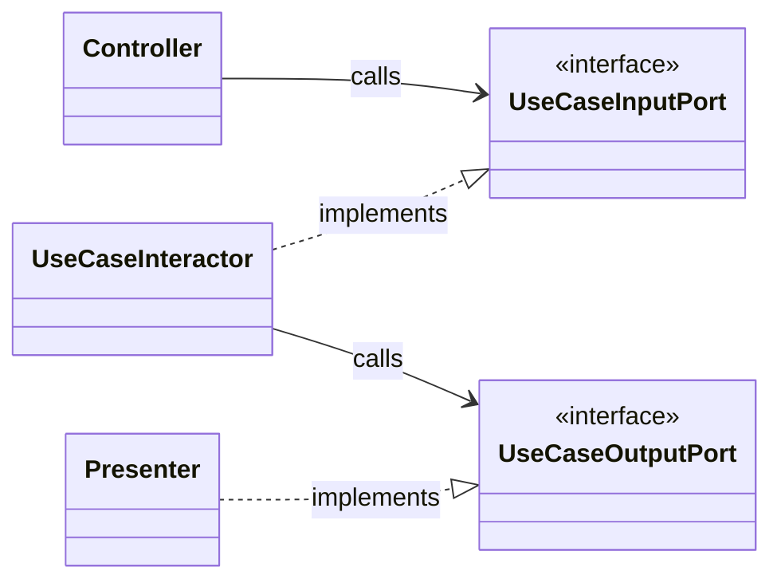
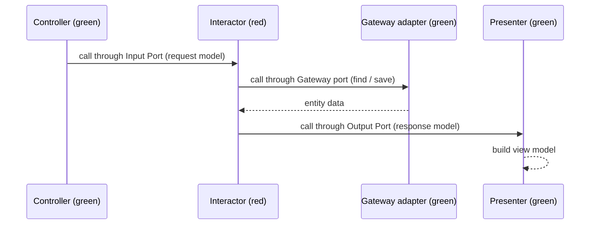

# Clean Architecture, end to end

## Summary
**TL;DR:** Clean Architecture is Robert C. Martin's 2012 synthesis of five earlier styles (Hexagonal, Onion, Screaming, DCI, BCE). It has one rule: source-code dependencies point only inward, toward the business rules. Everything else follows from that rule:
- the concentric circles (layers);
- the input, output and gateway ports;
- dependency inversion at each boundary;
- simple data across boundaries;
- treating the database, web and frameworks as details.

**Use this when:** you need the whole picture: vocabulary and analogies, where the idea came from, what each circle holds, the official diagram and how a request crosses the boundaries step by step, what each port is, what data may cross, how to package the code, which principles sit underneath, what critics say, and how the stack reference measures up.
**Depth:** words used; analogies; origin timeline; the goal; the rule; every circle defined; diagrams of the circles, of source dependencies and of the flow of control; the full boundary-crossing flow; input/output/gateway ports, the interactor, driving vs. driven; the request/response form side by side with the output-port form; data across boundaries, with a real before/after mistake, what the authors say, and Martin's own demo code as a counter-example; Screaming Architecture and the four packaging options (from Simon Brown's own text); "details"; SOLID and the six component principles with a worked instability calculation; the book's mechanism chapters; a comparison with peer styles; criticism; an edge-case matrix; a review of the stack reference (`stacks/typescript-node/reference.md`); self-check questions.

**Dedicated deep dives** for three of the sources: `hexagonal-architecture-deep-dive.md`, `onion-architecture-deep-dive.md`, `screaming-architecture-deep-dive.md`. This doc keeps its own summary of each and links to the dedicated doc for more.

---

## 0. Words used in this document

| Word | Meaning here | Source term |
|---|---|---|
| **circle** (= **layer**) | One band of the concentric diagram, e.g. the "Use Cases" circle. Martin says *circle*, and also calls the next one inward "the next layer". In code, one circle is usually one folder or module | ✅[^1] |
| **inner / outer** | Closer to / farther from Entities at the centre | ✅[^1] |
| **boundary** | The line between two circles. Crossing it inward is free for dependencies; crossing it outward needs inversion (§6) | "crossing boundaries" ✅[^1] |
| **source-code dependency** | What a file *mentions*: an import, a type name, a function name | ✅[^1] |
| **flow of control** | Which code *runs* after which, at run time | ✅[^1] |
| **port** | An interface: a named, technology-free conversation the application offers or needs. "A port identifies a purposeful conversation" | ✅[^3] |
| **adapter** | A class that connects one technology to one port | ✅[^3] |
| **interactor** | The class that *is* one use case (§6.3) | figure label ✅[^1] |

---

## 1. Analogies

Many pictures of the same idea; use whichever sticks.

| # | Analogy | Maps to | From |
|---|---|---|---|
| A1 | **Operating-system ports:** any device that adheres to the port's protocol can be plugged in | Port = the protocol; adapter = the device and its driver | Cockburn ✅[^3] |
| A2 | **Electronics ports:** any device that fits the mechanical and electrical protocol plugs in | Same | Cockburn ✅[^3] |
| A3 | **USB port:** many different devices talk to one computer through USB | Port = the USB socket; adapters = keyboard, disk, phone cable | AWS ✅[^18] |
| A4 | **A building's blueprint:** a house plan screams "house", a library plan screams "library" | Top-level folders should show the use cases | Martin ✅[^2] |
| A5 | **Plugins (Eclipse, Vim, Minecraft):** "the system doesn't know about the plugins; the plugins know about the system" | Database, web and UI are plugins to the business rules | Martin ✅[^19] |
| A6 | **An onion:** all coupling toward the centre | Circles; outer depends on inner | Palermo ✅[^4] |
| A7 | **The database is "merely an IO device"** | Storage is a detail | Martin ✅[^8] |
| A8 | **A greatest-hits album** *(teaching analogy, ours)*: the songs (ports, inward coupling, use-case objects) were already written; Martin put them in one order and named the album | §2 lineage | — |
| A9 | **CEO and job description** *(teaching analogy, ours)*: the CEO (centre) writes the policy and never learns the contractors' names. To get outside work done, she posts a *job description* (an interface), and any contractor who meets it takes the job | Dependency inversion | — |
| A10 | **Wall socket and travel adapter** *(teaching analogy, ours)*: the hotel's wall socket is the port, owned by the building (the application). Your travel adapter is the adapter. The hotel never rewires for your hair-dryer (Postgres, Express) | A1–A3 restated | — |
| A11 | **Restaurant** *(teaching analogy, ours)*: waiter = controller; order slip = request model; head chef = interactor; recipe rules = entities; the "deliver 2 kg tomatoes" form = gateway port; the supplier = gateway adapter; plating = presenter; the plated dish = view model. The chef never learns the supplier's name, only the form | §6 flow | — |

---

## 2. Where it comes from

Clean Architecture is not a new invention. The 2012 post says so: it names five earlier architectures and says "they all have the same objective, which is the separation of concerns" ✅[^1].

| Year | Source | What it added | Status |
|---|---|---|---|
| 1992 | Ivar Jacobson, *Object-Oriented Software Engineering: A Use Case Driven Approach* (BCE / ECB) | Split each use case into **boundary** (talks to actors), **control** (the use-case logic) and **entity** (long-lived business data) objects. Martin also tells readers to "go back and read" this book ✅[^2] | ✅[^11] |
| 2005 | Alistair Cockburn, *Hexagonal Architecture* (Ports and Adapters) | The application has **ports** ("a purposeful conversation") and **adapters** per technology. Users, programs, tests and batch scripts drive it the same way | ✅[^3] |
| 2008 | Jeffrey Palermo, *The Onion Architecture* | "All coupling is toward the center"; "Inner layers define interfaces. Outer layers implement interfaces"; the core can be "compiled and run separate from infrastructure" | ✅[^4][^21] |
| 2009 | Trygve Reenskaug and James O. Coplien, *The DCI Architecture* (Artima, 20 March 2009) | Data, Collaboration, Interaction: separate what objects *are* from what the system *does*; roles capture "what objects do" | ✅[^20] |
| 2011 | Martin, *Screaming Architecture* | The top-level structure should show the use cases, not the framework | ✅[^2] |
| 2012 | Martin, *The Clean Architecture* | The synthesis: concentric circles and the Dependency Rule | ✅[^1] |
| 2014 | Martin, *Clean Micro-service Architecture* | Microservices are "a deployment option, not an architecture" | ✅[^7] |
| 2016 | Martin, *A Little Architecture* | The architect's key decisions are the ones that let you *not* decide on the database yet | ✅[^8] |
| 2016 | Simon Brown, "package by component" article (later a GOTO 2018 talk) | Four ways to package the same design; the compiler can enforce the architecture | ✅[^23] |
| 2017 | Martin, *Clean Architecture* (book, Pearson) | The full argument in 34 chapters plus an appendix ✅[^5][^14]. Brown: "A version of this was also published as 'The missing chapter' in Clean Architecture" ✅[^23] | ✅ |

---

## 3. The goal: five kinds of independence

According to the post, a system built this way is ✅[^1]:

| Property | Plain meaning | Concrete test in the stack reference |
|---|---|---|
| **Independent of frameworks** | The framework is a library you call, not a cage you live in | Delete the `express` import from `src/domain` and `src/application`: nothing breaks, because there is none |
| **Testable** | Business rules can be tested without UI, database or web server | `src/domain/Document.test.ts` runs with no doubles at all |
| **Independent of UI** | The UI can change (web → CLI) without changing business rules | A CLI could call `ReviseDocument.run()` directly, without HTTP |
| **Independent of database** | You can swap the database without touching business rules | `InMemoryDocumentStore` → a SQL store; only the adapter in `infrastructure/` and the composition root change |
| **Independent of any external agency** | Business rules know nothing about the outside world | `Document.revise()` has no imports beyond `Result` |

---

## 4. The one rule

> "Source code dependencies can only point inwards." ✅[^1]

Nothing in an inner circle may *name* anything in an outer circle: no function, class, variable or data format. "No name in an outer circle can be mentioned by an inner circle" ✅[^1].

**Analogy:** A9, the CEO and the job description.

**Artifact:** one import line decides it.

```ts
// src/application/ReviseDocument.ts — inner code names only inner things
import type { DocumentStore } from "@/application/ports/DocumentStore.js"; // ✓ same circle (its own port)
import type { Document } from "@/domain/Document.js";                    // ✓ inward
// import { InMemoryDocumentStore } from "@/infrastructure/...";         // ✗ outward: breaks the rule
```

"Source-code dependency" means *what the code mentions* (an import, a type name), not *what runs when*. The two often point in opposite directions (§6).

---

## 5. The circles (layers)

The post's four circles ✅[^1]. "Only four circles?" No: "the circles are schematic", and you may need more. The Dependency Rule still applies to all of them ✅[^1].

### Diagram 1: the circles (redrawn from Martin's figure ✅[^1])

```text
 ┌──────────────────── Frameworks & Drivers (blue) ────────────────────┐
 │  Web · UI · DB · Devices · External Interfaces                       │
 │  ┌──────────────── Interface Adapters (green) ────────────────────┐  │
 │  │  Controllers · Gateways · Presenters                            │  │
 │  │  ┌───────────── Use Cases (red) ────────────────────────────┐   │  │
 │  │  │  Application Business Rules                               │   │  │
 │  │  │  (interactors + their input/output ports)                 │   │  │
 │  │  │  ┌──────── Entities (yellow) ─────────┐                   │   │  │
 │  │  │  │  Enterprise Business Rules         │                   │   │  │
 │  │  │  └────────────────────────────────────┘                   │   │  │
 │  │  └───────────────────────────────────────────────────────────┘   │  │
 │  └──────────────────────────────────────────────────────────────────┘  │
 └────────────────────────────────────────────────────────────────────────┘
      ──►  ──►  ──►   every source-code arrow points toward Entities
```

| Circle (inside → out) | Holds | Changes when… | May depend on | In the stack reference |
|---|---|---|---|---|
| **Entities** | Enterprise-wide business rules: objects with methods, or data structures plus functions ✅[^1] | The business itself changes, not the app | Nothing outer | `src/domain/` (`Document`, `Result`) |
| **Use Cases** | Application-specific business rules. They "orchestrate the flow of data to and from the entities" ✅[^1] | The app's behaviour changes | Entities | `src/application/` holds two different things: the **use case** `ReviseDocument.ts` (the interactor) and, in `ports/`, the **gateway port** `DocumentStore.ts` (an interface the use case owns, *not* a use case). See §6.7 |
| **Interface Adapters** | "A set of adapters that convert data" between the use cases' form and the outside world's form: controllers, presenters, views, gateways. "No code inward of this circle should know anything at all about the database." ✅[^1] | A delivery or storage format changes | Use cases, entities | `src/interface/` (handler, body schema, error mapper) and the adapter in `src/infrastructure/` |
| **Frameworks & Drivers** | The database, the web framework and other tools: "mostly glue code" ✅[^1] | A tool is upgraded or replaced | Everything inward | `express`, `pino`, `zod` themselves; `src/main.ts` |

**Mapping note.** The framework's four folders (`domain / application / infrastructure / interface`) do not match the circles 1:1. Both `infrastructure/` and `interface/` sit in the Interface Adapters circle; the libraries themselves are the outer circle. The two folders split that circle by Cockburn's driving/driven distinction ✅[^3]:
- `interface/` holds **driving** adapters, the code that **calls into** the application when a request arrives;
- `infrastructure/` holds **driven** adapters, the code the application **calls out to** when it needs storage.

§6.4 explains the two terms.

---

## 6. Crossing a boundary: ports, the interactor, and the full flow

**The problem.** A request comes in from the web, a use case runs, and the result goes back out to the web. The flow of *control* goes in and then **out**. But source dependencies may only go **in**.

**The fix** is the Dependency Inversion Principle: "we usually resolve this apparent contradiction by using the Dependency Inversion Principle" ✅[^1]. "We have the use case call an interface (Shown here as Use Case Output Port) in the inner circle, and have the presenter in the outer circle implement it" ✅[^1]. In the post's example, control "begins in the controller, moves through the use case, and then winds up executing in the presenter" ✅[^1]. "The same technique is used to cross all the boundaries in the architectures" ✅[^1].

### 6.1 The official small diagram (lower right of Martin's figure)

The figure shows five boxes ✅[^1]:
- green, in the Interface Adapters circle: **Controller** and **Presenter**;
- red, in the Use Cases circle: **Use Case Input Port** «I», **Use Case Interactor** and **Use Case Output Port** «I».

«I» marks an interface. A hollow-headed arrow means "implements"; a plain arrow means "uses / calls".

### Diagram 2: who depends on whom (source code), redrawn from the figure



Every arrow starts in green and ends in red, or stays inside red. **Every source dependency points inward.**

### Diagram 3: what runs when (flow of control)



Control goes green → red → green → red → green; the source arrows in Diagram 2 never point red → green. As the post says, "source code dependencies oppose the flow of control at just the right points" ✅[^1].

### 6.2 Step by step (the book/post form, with an output port)

| # | Control is in | Does | Source dependency of this step | Direction |
|---|---|---|---|---|
| 1 | Web framework | Receives HTTP `PUT /documents/42` | framework → controller (glue) | inward ✓ |
| 2 | Controller (adapters) | Parses the body into a plain **request model** and calls the use case's **input port** | controller → input port | inward ✓ |
| 3 | Interactor (use cases) | Loads the entity through a **gateway port** it owns | interactor → its own port | same circle ✓ |
| 4 | Gateway adapter (adapters) | Runs at run time, implementing the port | adapter → port (implements) | inward ✓ |
| 5 | Entity | Applies the business rule (`revise`) | interactor → entity | inward ✓ |
| 6 | Interactor | Builds a plain **response model** and calls the **output port** | interactor → its own output port | same circle ✓ |
| 7 | Presenter (adapters) | Implements the output port and turns the response model into a view model (JSON) | presenter → output port (implements) | inward ✓ |
| 8 | Web framework | Writes the response | — | — |

At steps 4 and 7, **control flows outward while the source dependency points inward**. That opposition is the whole trick.

### 6.3 What each part is

| Part | Is a… | Lives in | Implemented by | Called by | Plain meaning |
|---|---|---|---|---|---|
| **Input port** | interface | Use Cases | the **interactor** | the **controller** | "What you can ask this use case to do": the menu the outside orders from |
| **Interactor** | class | Use Cases | (it *is* the implementation) | through the input port | The use case itself: runs one application rule, directing entities |
| **Output port** | interface | Use Cases | the **presenter** | the **interactor** | "How this use case hands back its result", without knowing who displays it |
| **Gateway port** | interface | Use Cases | the **gateway** adapter | the **interactor** | "What data I need from storage", e.g. `find(id)`, `save(doc)` |

All three ports are *interfaces owned by the inside*; none of them is "the implementation":
- The **input** port is implemented inside (by the interactor) and called from outside.
- The **output** and **gateway** ports are called from inside and implemented outside. Here the inner code states what it needs and does not care how the outside does it.

**Steps 3–4 in plain words.** The interactor `ReviseDocument` needs the current document, so it calls `find(id)` on `DocumentStore`. That is an interface it declared in its own red circle, so this import is allowed ("same circle ✓"). At run time the call lands in `InMemoryDocumentStore` (green), which implements the interface. Its import points green → red, inward ✓. Control went red → green; the dependency went green → red.

The gateway interface must be red because the red interactor may not name anything green ✅[^1]. Onion says the same: "inner layers define interfaces. Outer layers implement interfaces" ✅[^21]. So does Cockburn's code: `TaxCalculator` *uses* `ForGettingTaxRates`, and `FixedTaxRateRepository` *implements* it ✅[^17].

### 6.4 Driving vs. driven (Cockburn's terms)

| | Driving (primary) | Driven (secondary) |
|---|---|---|
| Definition | "A primary actor is an actor that drives the application" ✅[^3] | "A secondary actor is one that the application drives, either to get answers from or to merely notify" ✅[^3] |
| Who starts the conversation | The outside world | The application |
| The port is… | **implemented** by the application, called by the adapter: `TaxCalculator implements ForCalculatingTaxes` ✅[^17] | **used** by the application, implemented by the adapter: `FixedTaxRateRepository implements ForGettingTaxRates` ✅[^17] |
| Clean Architecture name | Input port | Output port, gateway port |
| Examples | HTTP controller, CLI, test harness, message consumer | Database, mail sender, external API, presenter |
| Stack reference | `src/interface/` (`ReviseDocumentHandler`) | `src/infrastructure/` (`InMemoryDocumentStore`) |

Full treatment: `hexagonal-architecture-deep-dive.md`.

### 6.5 One word, three meanings: "output port"

| Source | "Output port" means |
|---|---|
| Martin's figure ✅[^1] | The interface the interactor uses to send its **result to the presenter** |
| AWS hexagonal guide ✅[^18] | Any **driven** interface, including the repository (`RecipientOutputPort` wraps a DynamoDB adapter) |
| Cockburn ✅[^3][^17] | He says **driven port** (or secondary), not "output port" |

### 6.6 The variant the stack reference uses (request/response)

`ReviseDocument.run()` *returns* a `Result` instead of calling an output port, and the handler does the presenting.

**In short:** `run()` returns a `ReviseDocumentOutput` wrapped in a `Result`, and the handler presents it. A return value instead of an output port is allowed, because a `return` never needs to name the caller. The subsections below show the other side (the output-port form), why a `return` names no one, what "presents" means, and what this choice costs.

```ts
// src/domain/Result.ts, line 7 — the wrapper
export type Result<T, E extends string> =
  { readonly ok: true; readonly value: T } | { readonly ok: false; readonly error: E };

// the success value at run time
{ ok: true, value: { id: "42", body: "new text", version: 3 } }
```

**Analysis (ours, derived from [^1]):** inversion is needed only where an inner circle must *call* an outer one. A `return` goes back to the caller without naming it, so no output port is required. The cost: the use case cannot push results to several presenters, or push them asynchronously, without changing its signature. It is a legitimate choice, but it should be recorded (§15 G3).

#### The two forms side by side

"A return value instead of an output port" compares two ways for the use case to hand back its result. Martin's figure uses form A. The stack reference uses form B. Form ✗ is what both of them avoid.

**Form ✗: the use case calls the handler directly (forbidden).**

```ts
// src/application/ReviseDocument.ts
import { ReviseDocumentHandler } from "@/interface/routes/ReviseDocumentHandler.js"; // ✗ red names green

export class ReviseDocument {
  public constructor(private readonly documents: DocumentStore, private readonly handler: ReviseDocumentHandler) {}
  public async run(input: ReviseDocumentInput): Promise<void> {
    // … find, revise, save …
    this.handler.show({ id, body, version });   // a call outward, by name
  }
}
```

Martin: "this call must not be direct because that would violate The Dependency Rule" ✅[^1].

**Form A: the use case calls an output port (Martin's figure).**

```ts
// src/application/ReviseDocumentOutputPort.ts — red: the use case owns this interface
export interface ReviseDocumentOutputPort {
  revised(result: ReviseDocumentOutput): void;
  refused(reason: ReviseDocumentError): void;
}

// src/application/ReviseDocument.ts
public async run(input: ReviseDocumentInput, output: ReviseDocumentOutputPort): Promise<void> {
  // … find, revise, save …
  output.revised({ id, body, version });      // a call outward, but through its own interface
}

// src/interface/routes/ReviseDocumentPresenter.ts — green: implements the red interface
export class ReviseDocumentPresenter implements ReviseDocumentOutputPort {
  public constructor(private readonly res: Response) {}
  public revised(r: ReviseDocumentOutput): void { this.res.json(r); }
  public refused(reason: ReviseDocumentError): void { this.res.status(409).json({ error: reason }); }
}

// the handler: build a presenter, pass it in, and return nothing
await this.reviseDocument.run(input, new ReviseDocumentPresenter(res));
```

"We have the use case call an interface (Shown here as Use Case Output Port) in the inner circle, and have the presenter in the outer circle implement it" ✅[^1].

**Form B: the use case returns its result (the stack reference).**

```ts
// src/application/ReviseDocument.ts, lines 43–58
public async run(input: ReviseDocumentInput): Promise<Result<ReviseDocumentOutput, ReviseDocumentError>> {
  // … find, revise, save …
  return { ok: true, value: { id, body, version } };   // no call outward at all
}

// src/interface/routes/ReviseDocumentHandler.ts, lines 35–41 — the handler presents the value
const result = await this.reviseDocument.run({ id: req.params.id, ...parsed.data });
if (!result.ok) { res.status(this.errors.statusFor(result.error)).json({ error: result.error }); return; }
res.json(result.value);
```

**What the use case file has to name, in each form:**

| Form | Imports or names in `ReviseDocument.ts` | Anything outer (green)? | Allowed? |
|---|---|---|---|
| ✗ Direct call | `ReviseDocumentHandler` | **Yes** | ✗ |
| A Output port | `ReviseDocumentOutputPort` (its own interface) | No | ✓ |
| B Return | nothing extra; `return` has no target | No | ✓ |

#### Why "a return never needs to name the caller"

To **call** a function, your code must write its name, and that name is a source-code dependency (§4). To **return**, your code writes only `return value`. The language delivers the value to whoever called, and your code never says who that is.

**Analogy:** a phone call vs. answering a question. To phone someone you must know their number. When someone asks you a question face to face, you simply answer; you do not need their name.

**Evidence in the reference.** `ReviseDocument.ts` imports only `DocumentStore` and `Result` (lines 1–2); it has no import from `src/interface/`. Yet its result reaches `ReviseDocumentHandler` at line 35. A CLI controller could call the same `run()` and receive the same value, with no change to `ReviseDocument`.

The output port exists only to solve form ✗: inner code that must *call* outward. Form B never calls outward, so there is nothing to invert.

#### What "the handler presents it" means

The handler does not just pass the value through. It decides how each outcome looks over HTTP:

| Outcome of `run()` | Handler line | HTTP answer |
|---|---|---|
| `{ ok: true, value: { id: "42", body: "new text", version: 3 } }` | 41: `res.json(result.value)` | `200` with `{"id":"42","body":"new text","version":3}`, the value as-is |
| `{ ok: false, error: "version-conflict" }` | 37: `res.status(this.errors.statusFor(result.error))` | The status from `HttpErrorMapper`, with `{"error":"version-conflict"}` |
| (the body failed the zod check; `run()` was never called) | 31 | `400` with `{"error":"invalid-request"}` |

Choosing the status code and the JSON shape is the presenter's job (§6.3); in form B the handler does that job.

#### The cost of form B, as code

A `return` gives **one value, once, to one caller**. An output port can be called **any number of times, on any number of presenters, at any time**.

| Need | Form A (output port) | Form B (return) |
|---|---|---|
| Two presenters (HTTP reply and a WebSocket notice) | `output.revised(r)`, where the composition root passes a presenter that forwards to both | Each caller must forward the value itself, and must remember to |
| Progress over time (10%, 50%, done) | `output.progress(10); output.progress(50); output.done(s);` | Change the signature, e.g. `run(): AsyncIterable<Progress \| Done>`, and every caller changes too |

That is what "without changing its signature" means: with form B, the signature allows one result, sent once. The reference needs neither, so form B fits. The trigger for switching is recorded in the reference's `docs/architecture.md` §4 (§15 G3).

#### Who backs form B

| Source | What it shows |
|---|---|
| Cockburn, *Hexagonal Architecture* | The application's method is `public double discount(double amount)`, and the UI adapter shows the returned value: `text3.setText( "" + discount );` ✅[^3] |
| Martin's OpenChat (`openchat-unclebob`) | Use cases return values from `exec(...)`; there is no presenter or output port in the code ✅[^25][^28] |
| Martin's 2012 post | The data is "passed from the controllers to the use cases, and then back from the use cases to the presenters and views". "Back" fits both A and B ✅[^1] |
| The strict reading | Some writers present form A as *the* Clean way and contrast it with "getting a return value from the interactor" ✅[^27]. The post's diagram and its one worked example do use form A ✅[^1] |

So form B is *common and backed by the authors' own code*, but it is not what the 2012 diagram draws. That is why the choice must be recorded.

### 6.7 The three ports in the stack reference, exactly

The easy mix-up: `DocumentStore` is **not** the input port. It is the **gateway** port. The reference has three port *roles*, but only one of them is written as a separate `interface`:

| Port role | In the reference | Written as | Implemented by | Called by |
|---|---|---|---|---|
| **Input port** | The public method `run(input: ReviseDocumentInput)` of `ReviseDocument` (`src/application/ReviseDocument.ts`, line 43) | **No separate interface.** The class's own public signature plays the role; the handler depends on the concrete class | `ReviseDocument` itself | `ReviseDocumentHandler`, line 35: `this.reviseDocument.run({ id: req.params.id, ...parsed.data })` |
| **Gateway port** | `DocumentStore` (`src/application/ports/DocumentStore.ts`): `find(id)` and `save(document, replaces)` | An explicit `interface` | `InMemoryDocumentStore` (`src/infrastructure/`): `implements DocumentStore` | `ReviseDocument`, lines 46 and 54: `this.documents.find(…)`, `this.documents.save(…)` |
| **Output port** | None. The result comes back as the **return value** `Promise<Result<ReviseDocumentOutput, ReviseDocumentError>>`, plain data since 2026-10-26 (§15 G1) | — | — | The handler reads the return value at lines 36–41 and acts as the presenter |

**Restaurant analogy (A11, applied to the ports):**
- The **menu** is the input port. The kitchen (the use case) offers it; waiters (controllers) order from it.
- The **supplier order form** is the gateway port. The kitchen writes the form; any supplier (adapter) can fill it.
- The **serving hatch** is the output port. The kitchen puts dishes there without knowing who carries them out.

In the reference there is no hatch: the waiter waits at the kitchen door and takes the plate directly (the return value).

#### The actors (5, plus the wiring)

- **Express** — its job: receive the HTTP request, via the route table in `src/CompositionRoot.ts` line 38: `app.put("/documents/:id", (req, res) => revise.handle(req, res))`.
- **`ReviseDocumentHandler` (the controller)** — its job: turn HTTP into a plain request model and call the use case, via `run()`.
- **`ReviseDocument` (the interactor, i.e. the use case)** — its job: apply the "revise without overwriting a newer change" rule, via the entity and the `DocumentStore` port.
- **`Document` (the entity)** — its job: decide whether this revision is allowed, via `revise()`.
- **`InMemoryDocumentStore` (the gateway adapter)** — its job: store and look up documents, via `implements DocumentStore`.
- *Wiring:* **`CompositionRoot`** — its job: build the adapter and hand it to the use case, via constructor arguments. It is the only file that names both.

Other controllers could drive the same use case. A CLI controller, for example, would parse `argv` into the same `ReviseDocumentInput` and call the same `run()`. Each is a separate driving adapter.

#### The real artifacts

The request, as it arrives:

```http
PUT /documents/42
Content-Type: application/json

{"body":"new text","expectedVersion":2}
```

The HTTP body schema (`src/interface/routes/ReviseDocumentBody.ts`), a transport detail of the green circle:

```ts
export const ReviseDocumentBody = z
  .object({ body: z.string(), expectedVersion: z.number().int().positive() })
  .strict();
```

The request and output models (`src/application/ReviseDocument.ts`), owned by the use case. Plain data, nothing about HTTP:

```ts
export interface ReviseDocumentInput  { readonly id: string; readonly body: string; readonly expectedVersion: number; }
export interface ReviseDocumentOutput { readonly id: string; readonly body: string; readonly version: number; }
```

#### Step by step, with each boundary crossing marked

1. **Express → handler:** the route table calls `handle(req, res)`.
2. **Handler** (the "parses the body into a plain request model" part):
   - line 29: `ReviseDocumentBody.safeParse(req.body)` checks the HTTP body against the zod schema; a bad body answers 400 and stops here (lines 26–29);
   - line 35: `{ id: req.params.id, ...parsed.data }` builds `{ id: "42", body: "new text", expectedVersion: 2 }`. That object is the **request model** (`ReviseDocumentInput`).
3. **Handler → use case** (the "calls the use case's input port" part): line 35, `this.reviseDocument.run(...)`.
   ══ *crosses green → red; the dependency (handler imports `ReviseDocument`) points inward ✓* ══
4. **Use case → gateway port:** line 46, `this.documents.find(input.id)`. The use case knows only the `DocumentStore` interface, which sits in its own circle.
   ══ *at run time control goes red → green into `InMemoryDocumentStore.find`; the code dependency stays green → red (`implements DocumentStore`)* ══
5. **Use case → entity:** line 49, `current.revise(input.body, input.expectedVersion)` applies the business rule.
6. **Use case → gateway port:** line 54, `this.documents.save(next.value, current.version)`. The adapter checks the version and writes atomically.
7. **Use case:** lines 55–56 copy `id`, `body` and `version` out of the saved entity into a plain `ReviseDocumentOutput` and return it.
   ══ *crosses red → green by `return`, so no inversion is needed (§6.6); the entity stays inside* ══
8. **Handler (acting as presenter):** line 41, `res.json(result.value)` sends `{"id":"42","body":"new text","version":3}`. On a refusal, line 37 maps the reason to a status through `HttpErrorMapper`.

```text
 GREEN (Interface Adapters)          RED (Use Cases)                      GREEN (Interface Adapters)
 ReviseDocumentHandler ──run(input)──► ReviseDocument ──find / save──► «interface» DocumentStore
   (controller)                         (interactor)                         ▲ implements
        ▲                                    │                      InMemoryDocumentStore
        └──── return ReviseDocumentOutput ───┘                      (gateway adapter)
   presents it: res.json(...)                │ revise()
                                             ▼
                                    YELLOW (Entities): Document
 Code dependencies: handler → ReviseDocument ✓ inward · InMemoryDocumentStore → DocumentStore ✓ inward · ReviseDocument → Document ✓ inward
```

#### Common confusions

| Confusion | Answer |
|---|---|
| "`DocumentStore` is the input port" | No. It is the **gateway** port: the use case *calls* it and an adapter *implements* it. The input port is `run()` |
| "`src/application/` (ReviseDocument, port DocumentStore) means the port is a use case" | No. The folder holds two different things: a **use case** (`ReviseDocument.ts`) and a **port** (`ports/DocumentStore.ts`). The port sits there because the use case owns it |
| "§6.3 says the interactor *implements* the input port, but I see no interface" | In Martin's figure the input port is a separate interface that the interactor implements. The reference skips that interface, and the handler depends on the concrete class. The role is the same |
| "So the app creates the implementation directly?" | Yes. `CompositionRoot` does `new ReviseDocument(this.documents)` and passes it to the handler. Only the gateway is reached through an interface |

**Why a port can exist without an `interface` keyword.** Cockburn's book shows the same tax calculator twice: in Java with declared interfaces, and in Ruby, which "shows how dynamic languages create the same system with no interface definitions" ✅[^17]. A port is a *role in the conversation*; a declared interface is one way to write it down. In TypeScript, types are matched by their members ("structural subtyping"), so the handler can depend on the class type `ReviseDocument` ✅[^24]. There is a catch: "if the target type contains a private member, then the source type must also contain a private member that originated from the same class" ✅[^24]. `ReviseDocument` has `private readonly documents`, so only a real `ReviseDocument` (or a subclass) fits that type. A hand-written fake does not.

**Analysis (ours):** that is the practical trigger for extracting an explicit input-port interface: when a second implementation must stand where the use case stands, such as a fake in a controller test, or a decorator that adds logging.

**What the reference would look like with all three ports explicit.** This is an illustration, not code in the repo:

```ts
// src/application/ReviseDocumentInputPort.ts — INPUT port: the use case implements it, the controller calls it
export interface ReviseDocumentInputPort {
  run(input: ReviseDocumentInput, output: ReviseDocumentOutputPort): Promise<void>;
}

// src/application/ReviseDocumentOutputPort.ts — OUTPUT port: the presenter implements it, the use case calls it
export interface ReviseDocumentOutputPort {
  revised(result: ReviseDocumentOutput): void;   // ReviseDocumentOutput = { id, body, version }, plain data
  refused(reason: ReviseDocumentError): void;
}

// src/application/ReviseDocument.ts — the INTERACTOR
export class ReviseDocument implements ReviseDocumentInputPort {
  public constructor(private readonly documents: DocumentStore) {}   // GATEWAY port, unchanged
  public async run(input: ReviseDocumentInput, output: ReviseDocumentOutputPort): Promise<void> {
    const current = await this.documents.find(input.id);
    if (current === undefined) return output.refused("not-found");
    // … revise and save as today …
    output.revised({ id: saved.id, body: saved.body, version: saved.version });
  }
}

// src/interface/routes/ReviseDocumentPresenter.ts — the PRESENTER, built once per HTTP request
export class ReviseDocumentPresenter implements ReviseDocumentOutputPort {
  public constructor(private readonly res: Response, private readonly errors: HttpErrorMapper) {}
  public revised(r: ReviseDocumentOutput): void { this.res.json(r); }
  public refused(reason: ReviseDocumentError): void { this.res.status(this.errors.statusFor(reason)).json({ error: reason }); }
}
```

**Analysis (ours):** the explicit form adds two interfaces and one class per use case, and needs a presenter object per request (it holds `res`). The reference chose the cheaper request/response form (§6.6). Its one real gap was that `run()` returned the entity instead of a plain output. That was fixed on 2026-10-26 with `ReviseDocumentOutput` (§15 G1).

---

## 7. What data may cross a boundary

> "Typically the data that crosses the boundaries is simple data structures." ✅[^1]

- **Allowed:** basic structs, simple DTOs, plain function arguments, even a hashmap or an object ✅[^1].
- **Not allowed:** "We don't want to cheat and pass Entities or Database rows" ✅[^1].
- **Shape:** the data is "always in the form that is most convenient for the inner circle" ✅[^1].
- The book has a section titled "Request and Response Models" in chapter 20 ✅[^14].

**Why.** If an entity crosses outward, the outer code is coupled to the entity's shape, and adding a field to the entity can leak it to clients. If a database row crosses inward, the business rules are coupled to the schema. The post: passing a row structure inward "would force an inner circle to know something about an outer circle" ✅[^1].

**Example (shapes):**

| | Shape | Owner | In the reference |
|---|---|---|---|
| Request model | `{ id: string, body: string, expectedVersion: number }` | use case | `ReviseDocumentInput` ✓ |
| Entity | `Document` with `#id`, `#body`, `#version` and the `revise()` method | Entities | `Document` ✓ |
| Response model | `{ id, body, version }`: plain data, no methods | use case | `ReviseDocumentOutput` ✓. Added 2026-10-26; before that, `run()` returned the `Document` entity itself (§15 G1) |
| View model | JSON `{"id":"42","body":"…","version":3}` | presenter / handler | built in `ReviseDocumentHandler` |

**In short (the answers to two common questions):**
1. *Is returning the entity from a use case good or bad?* It goes against what Martin **wrote**. Returning a plain output model such as `ReviseDocumentOutput` follows it. One honest exception: Martin's own later demo code returns entities (§7.3).
2. *Does `run()` now return the output directly?* Yes: `ReviseDocumentOutput`, wrapped in a `Result`, and the handler presents it. A return value instead of an output port is allowed, because a `return` never needs to name the caller (§6.6).

### 7.1 Worked mistake: the stack reference used to return the entity

This is a real mistake from the stack reference, kept here as a teaching example. It is gap G1 in §15, fixed on 2026-10-26.

**What changed in the code.** The "before" version was never committed: `src/application/ReviseDocument.ts` has one commit, which already contains the fix. The "before" column is rebuilt from the G1 record.

| | Before (rebuilt from G1) ✗ | Now (`ReviseDocument.ts` lines 41–56) ✓ |
|---|---|---|
| Signature | `run(input): Promise<Result<Document, ReviseDocumentError>>` | `run(input): Promise<Result<ReviseDocumentOutput, ReviseDocumentError>>` |
| Last lines | `return saved;` (the `Document` entity) | `const { id, body, version } = saved.value;`<br>`return { ok: true, value: { id, body, version } };` |
| What the handler gets | A live `Document` object, with its `revise()` method | A plain object `{ id, body, version }` |
| Guard test | — | `ReviseDocument.test.ts` line 25: `expect(valueOf(result)).not.toBeInstanceOf(Document);` |
| Rule text (CA-4) | Covered only the inward direction: "persistence models and transport DTOs never leak inward" | "…and entities never leak outward: a use case returns an output model, not an entity" |

**Why "before" was a mistake.**
- It breaks the written rule: "We don't want to cheat and pass Entities or Database rows" ✅[^1].
- The handler was coupled to the entity's shape. A new field on `Document` (say, an internal `lockedBy`) could reach clients without anyone deciding it should (edge case E2).
- The handler held an object with business behaviour (`revise()`), so outer code *could* call business rules directly, skipping the use case.

**How the fix was checked:** the unit test above, plus `pnpm run check` in the reference (§15).

### 7.2 What the authors say about returning an entity (verified)

| Source | Exact words or code | Verdict on returning the entity |
|---|---|---|
| Martin, 2012 post | "Typically the data that crosses the boundaries is simple data structures." ✅[^1] | ✗ An entity is not a simple data structure |
| Martin, 2012 post | "We don't want to cheat and pass Entities or Database rows." ✅[^1] | ✗ This forbids it directly |
| Martin, 2012 post | "…it is always in the form that is most convenient for the inner circle." ✅[^1] | ✓ for `ReviseDocumentOutput`: it is declared in the use-case file, so the inner circle owns its shape |
| Martin, 2012 post | The models are "passed from the controllers to the use cases, and then back from the use cases to the presenters and views." ✅[^1] | Data models go back, not entities |
| Martin, book ch. 20, section "Request and Response Models" | The section exists ✅[^14]. Its text was not available, so its wording is not quoted here | — |
| Martin's own later code (OpenChat, branch `openchat-unclebob`) | `public List<Document> exec(String subscriberName)`, where `Document` lives in the `entities` package ✅[^25]. The API class builds the JSON itself: `"text"` from `doc.text`, `"dateTime"` from `doc.dateTime` ✅[^26] | ⚠ Here Martin **does** return entities; the API layer picks which fields go out |
| Microsoft, Clean Architecture guide | Application Core interfaces work with entities, and "sometimes" with "non-entity types", which are then DTOs ✅[^6] | Concerns the gateway side, not the delivery side (§7.3 nuance) |

### 7.3 The written rule vs. Martin's own demo code

**In one sentence:** in terms of the architecture's principles, as Martin *wrote* them, both the stack reference and this document follow the rule; but Martin's own later demo code returns entities directly.

| | What it says or does | Follows the written rule? |
|---|---|---|
| **The written rule** (2012 post) | "We don't want to cheat and pass Entities or Database rows." ✅[^1] | — (this is the rule) |
| **The stack reference, before 2026-10-26** | `run()` returned `Result<Document, …>`: the entity itself went out to the handler (§15 G1). This old version was never committed; the record is G1 | ✗ |
| **The stack reference, now** | `run()` returns `Result<ReviseDocumentOutput, …>`: the plain object `{ id, body, version }`. A test asserts the value is not a `Document` (`ReviseDocument.test.ts` line 25) | ✓ |
| **This document** | Teaches the written rule (§7 above; edge case E2) | ✓ |
| **Martin's own demo code** (OpenChat, branch `openchat-unclebob`) | The use case is `public List<Document> exec(String subscriberName)`, and `Document` sits in the `entities` package ✅[^25]. The API class then copies the fields into JSON itself: `"text"` from `doc.text`, `"dateTime"` from `doc.dateTime` ✅[^26] | ✗ (it returns entities) |

**How to read the difference (analysis, ours).**
- The rule is strict; the small demo is relaxed. The demo still does not leak new fields by accident, because its API class picks each JSON field by hand.
- The price of the relaxed form: every caller must repeat that field picking, and every caller depends on the entity's shape. Change the entity, and every caller may have to change.
- A reference implementation exists to teach the rule, so it uses the strict form.

**Analogy:** returning the entity is handing the waiter the whole cooking pot. Returning `ReviseDocumentOutput` is handing over a plated dish. The waiter cannot change the recipe through the pot, and if the recipe changes, the plate can still look the same.

**One nuance: entities through the gateway port.** The gateway port `DocumentStore` passes the `Document` entity to and from the storage adapter (`find(id): Promise<Document | undefined>`). Read word for word, "don't pass Entities" could cover that too. The Dependency Rule still holds: the adapter (outer) depends on the entity (inner), which points inward. Martin's OpenChat does the same through its repository ✅[^25]. Microsoft's Clean Architecture guide does too: the Application Core holds "Entities (business model classes that are persisted)" and the interfaces for data access, and Infrastructure implements them as repositories. Only "sometimes" do those interfaces "need to work with non-entity types", which are then DTOs ✅[^6]. So entities crossing a *gateway* boundary is accepted practice. Our reading (analysis, ours): the "don't pass Entities" sentence is applied to the boundary toward the delivery side (controllers, presenters).

### 7.4 Is `ReviseDocumentOutput` correct? A checklist

| Rule (Martin, 2012 ✅[^1]) | `ReviseDocumentOutput` | Pass? |
|---|---|---|
| Simple data structure | `{ readonly id: string; readonly body: string; readonly version: number }`, with no methods | ✓ |
| No dependency that breaks the Dependency Rule | It imports nothing | ✓ |
| In the form most convenient for the inner circle | Declared in `src/application/ReviseDocument.ts`, next to the use case | ✓ |
| No entity passed | Guarded by `ReviseDocument.test.ts` line 25 | ✓ |
| The error is simple data too | `ReviseDocumentError = "not-found" \| "version-conflict" \| "invalid-body"`: plain strings | ✓ |

---

## 8. Screaming Architecture and how to package the code

**The claim.** Look at the top-level folders. They should tell you "health-care system" or "accounting system", not "Rails app". "Your architectures should tell readers about the system, not about the frameworks you used in your system" ✅[^2]. "Frameworks are tools to be used, not architectures to be conformed to" ✅[^2]. "The Web is a delivery mechanism" ✅[^2].

**Four packaging options.** These come from Simon Brown, whose article was published in a version as chapter 34, "The Missing Chapter" ✅[^23]. Brown's running example is an online book store, with a use case to view an order's status ✅[^23]. The chapter's sections are titled Package by Layer, Package by Feature, Ports and Adapters, Package by Component ✅[^14].

| Option | Top level is… | Example tree | Screams? | Brown's description ✅[^23] |
|---|---|---|---|---|
| Package by layer | technical layers | `web/ service/ data/` | No: you see the tech | Code "sliced horizontally into layers"; "a layered architecture doesn't 'scream' anything about the business domain" |
| Package by feature | vertical slices | `orders/ documents/` | Yes | "A 'vertical' slicing, based upon related features, domain concepts, bounded contexts, or aggregate roots"; the top level "now screams something about the business domain" |
| Ports and adapters | inside vs. outside | `domain/ infrastructure/` | Partly: the inside screams | "The 'outside' depends on the 'inside'; never the other way around". The inside is named in the ubiquitous domain language, e.g. `OrdersRepository` becomes just `Orders` |
| Package by component | coarse business components, each hiding its adapters | `orders/` exposes only `OrdersComponent` | Yes | A component is "a grouping of related functionality behind a well-defined interface". Only `OrdersComponent` is public; the rest is package-protected, so the compiler enforces the rule |

**Brown's warning, organisation vs. encapsulation.** "If you make all types in your Java application public, the packages are simply an organisation mechanism". In that case all four options are effectively the same ✅[^23]. His advice: "Consider using your compiler to help you enforce your chosen architectural style" ✅[^23]. C# can do the same with `internal`, at the cost of one assembly per component ✅[^23].

**What this means in TypeScript (analysis, ours).** TypeScript has no package-private keyword. The stack reference therefore uses lint zones (`layerZones`, `noRelativeOutsideFolder`) to get the same enforcement.

**Fowler agrees.** Presentation/domain/data layering is fine inside a module. But for a larger system, "you should split your top level into domain oriented modules", each layered inside ✅[^9].

**Rule of thumb (analysis, ours):** put layers *inside* features once the app has more than a handful of features: `src/documents/{domain,application,infrastructure,interface}/`.

Full treatment: `screaming-architecture-deep-dive.md`.

---

## 9. "Details": database, web, frameworks, deployment

Part VI of the book has chapters titled "The Database Is a Detail", "The Web Is a Detail" and "Frameworks Are Details" ✅[^5]. The blog posts make the same case:

| Detail | Claim | Source |
|---|---|---|
| Database | It is "merely an IO device". A good architecture lets you put off choosing it | ✅[^8] |
| Web | A delivery mechanism; the same core could be a console app or a web service | ✅[^2] |
| Frameworks | Tools to be used, kept at arm's length | ✅[^2] |
| Deployment | "There is no such thing as a micro-service architecture"; treat the deployment model as a detail and leave the options open | ✅[^7] |

**What "detail" does *not* mean (analysis, ours).** It does not mean unimportant. It means **replaceable without touching policy**. A database choice still matters for performance and operations; the business rules just must not know which one you chose.

---

## 10. The principles underneath

### 10.1 SOLID (class level)
Part III of the book has one chapter each on SRP, OCP, LSP, ISP and DIP ✅[^5]. The Dependency Inversion Principle is the mechanism behind every boundary: "details should depend upon abstractions" ✅[^12]. In plugin terms: "make sure that all dependencies inside the plugin, point at the system" ✅[^19].

### 10.2 Component principles (package/module level)
Part IV of the book has the chapters "Components", "Component Cohesion" and "Component Coupling" ✅[^5]. The six principles, with Martin's one-line definitions ✅[^12] (the plain meanings are ours):

| Group | Principle | One line | Plain meaning |
|---|---|---|---|
| Cohesion | REP, Reuse/Release Equivalence | "The granule of reuse is the same as the granule of release." | Whatever you version and release together is what others reuse |
| Cohesion | CCP, Common Closure | "Classes that change together, belong together." | Single Responsibility for modules: group things by the reason they change |
| Cohesion | CRP, Common Reuse | "Classes that aren't reused together should not be grouped together." | Don't make users depend on things they don't use |
| Coupling | ADP, Acyclic Dependencies | "The dependency structure for released components must be a directed acyclic graph." | No cycles between modules (CA-8 and FF-2 enforce this) |
| Coupling | SDP, Stable Dependencies | "Dependencies between released categories must run in the direction of stability." | Depend on things that change less often than you do |
| Coupling | SAP, Stable Abstractions | "The more stable a class category is, the more it must consist of abstract classes." | Stable modules should be mostly interfaces, so they can still be extended |

**Instability metric.** I = Ce / (Ca + Ce) ✅[^13]:
- **Ce** (efferent): outside classes this module depends on.
- **Ca** (afferent): outside classes that depend on this module.
- I = 0 means maximally stable (only depended upon); I = 1 means maximally unstable (only depends on others).

**Worked example (the stack reference; analysis, ours):**

| Module | Ca (who uses it) | Ce (what it uses) | I | Reading |
|---|---|---|---|---|
| `domain` | `application`, `infrastructure`, `interface` (3) | 0 | 0 / 3 = **0.00** | Most stable: must be safe to depend on |
| `application` | `infrastructure`, `interface`, composition root (3) | `domain` (1) | 1 / 4 = **0.25** | Stable; holds the ports (abstract), so SAP holds |
| `interface` | composition root (1) | `application`, `domain`, `express`, `zod` (4) | 4 / 5 = **0.80** | Unstable, which is fine for an adapter |

(Counted at module level for illustration; the formal metric counts classes.)

Dependencies run from high I to low I, which is SDP. **This is why the Dependency Rule works:** the circles are SDP and SAP drawn as a picture. The centre is the most stable part, and through its ports also the most abstract.

---

## 11. The book's mechanism chapters

Section titles are from the detailed table of contents ✅[^14]. The "Verified related idea" column cites other sources; the book's own text inside these sections was not available.

| Chapter | Sections | Verified related idea | Reference example |
|---|---|---|---|
| 20 Business Rules | Entities · Use Cases · Request and Response Models | Simple data across boundaries ✅[^1] | `ReviseDocumentInput` |
| 22 The Clean Architecture | The Dependency Rule · A Typical Scenario | §4–§6 ✅[^1] | — |
| 23 Presenters and Humble Objects | The Humble Object Pattern · Presenters and Views · Testing and Architecture · Database Gateways · Data Mappers · Service Listeners | Humble Object: move logic "out of the hard-to-test element and into other more friendly parts of the code base". The pattern is Meszaros's; the word "humble" is from Feathers ✅[^10] | Handler logic is thin; the status table lives in `HttpErrorMapper` |
| 24 Partial Boundaries | Skip the Last Step · One-Dimensional Boundaries · Facades | Boundaries cost indirection; small components may collapse layers (`clean-architecture.md` foundation) | All layers in one package |
| 26 The Main Component | The Ultimate Detail | `main` as the **configurator**: "Main acts as both the configurator and…the driving actor" ✅[^17]; the **composition root** wires implementations to interfaces ✅[^6] | `src/main.ts` + `src/CompositionRoot.ts` |
| 27 Services: Great and Small | Service Architecture? · Service Benefits? · The Kitty Problem · Objects to the Rescue · Component-Based Services · Cross-Cutting Concerns | Microservices are "a deployment option, not an architecture" ✅[^7] | — |
| 28 The Test Boundary | Tests as System Components · Design for Testability · The Testing API | Tests as one more driving actor: test harnesses are adapters on the same port ✅[^3] | Integration tests via HTTP; unit tests via `run()` |

---

## 12. How it relates to its peers

| Style | Centre | Key move | What Clean adds or changes | Source |
|---|---|---|---|---|
| Traditional N-layer (UI → BLL → DAL) | Data access, at the bottom | Each layer calls the one below it | Inverts the BLL → DAL dependency. In N-layer, the BLL "is dependent on data access implementation details" | ✅[^6] |
| Hexagonal | The application | Ports per purposeful conversation; adapters per technology; driving vs. driven sides | Adds circles *inside* the hexagon (entities vs. use cases) | ✅[^3]; `hexagonal-architecture-deep-dive.md` |
| Onion | The domain model | Coupling toward the centre; interfaces inside, implementations outside | Almost the same; Clean names the use-case circle explicitly | ✅[^4][^21]; `onion-architecture-deep-dive.md` |
| BCE | Use cases (controls) | Boundary / control / entity per use case | Clean's circles map to it: entities = entity, use cases = control, adapters = boundary | ✅[^11] |
| DCI | Use-case interactions | Data vs. role-based interactions per use case | Shares the "use case as a first-class object" idea | ✅[^20] |
| Functional core / imperative shell | Pure functions | Push impure code to the edges | The same shape reached from FP: "Good Functional design is equivalent to the Ports and Adapters architecture" | ✅[^15] |

Microsoft's .NET architecture guide treats Hexagonal, Ports-and-Adapters, Onion and Clean as names for one architecture, the shape that DIP and DDD applications "tend to arrive at" ✅[^6]. It names the **composition root** as the single place where implementations are wired to interfaces ✅[^6].

---

## 13. Criticism and when not to use it

| Critique | From | Fair point | Answer within this framework |
|---|---|---|---|
| Layers cut across features; rigid rules create needless abstractions and heavy mocking | Jimmy Bogard, *Vertical Slice Architecture* (2018) ✅[^16] | Yes, for CRUD-heavy apps a Controller → Service → Repository chain per entity is ceremony | `clean-architecture.md` "Acceptable simplifications": CRUD may drop the domain layer; record it |
| "Minimize coupling between slices, and maximize coupling in a slice" | Bogard ✅[^16] | Fits Screaming Architecture and CCP | Package by feature (§8), with layers inside each slice |
| Layer-first top-level folders hide the domain in larger systems | Fowler ✅[^9]; Brown ✅[^23] | Yes | Domain modules first, layers inside |
| Extra adapter code is "justified only if" there are several input sources and output destinations, or they change over time; otherwise it is "maintenance overhead", and the extra layer "might result in latency" | AWS ✅[^18] | Yes, for small components | Partial boundaries (§11); a request/response use case (§6.6) |
| "Not appropriate for small websites"; suited to "long-lived business applications" and complex behaviour | Palermo, on Onion ✅[^4] | Same scope applies here | Same |

**When it pays off (analysis, ours).**
- Pays off when the business rules outlive their tools, several delivery mechanisms (HTTP, CLI, queue) drive one core, or you need fast tests of the rules.
- Does not pay off for scripts, thin CRUD over one table, or throwaway prototypes. Even then, keep I/O at the edges.

---

## 14. Edge cases and failure matrix

| # | Situation | What breaks | Which rule | Fix |
|---|---|---|---|---|
| E1 | Entity imports a framework type (`Request`) | The entity can't be tested or reused without the framework | Dependency Rule ✅[^1] | Pass plain data in |
| E2 | Use case returns the entity to the controller | The outer circle couples to the entity's shape; new fields can leak to clients | Data across boundaries ✅[^1] | Return a response model. Real case: §7.1 |
| E3 | Gateway returns an ORM row to the use case | The schema leaks into the business rules | "We don't want to pass that row structure inwards" ✅[^1] | The adapter maps row ↔ entity |
| E4 | Controller calls the repository directly | It skips the use case and any authorization in it (fail-open) | CA-10; the application is the hub ✅[^3] | Go through the input port |
| E5 | Two adapters in the same circle call each other | The Dependency Rule alone does not catch it (same circle) | CA-10 | Only the composition root names both |
| E6 | Gateway port declared in the infrastructure folder | The inner circle would have to import outward to use it | Dependency Rule ✅[^1]; Onion: interfaces inside ✅[^21] | Move the port next to its consumer (TSN-2) |
| E7 | Cycle `application ↔ interface` via a shared type | ADP is broken; the build order is undefined | ADP ✅[^12] | Move the shared type inward |
| E8 | An alias import (`@/infrastructure/x`) inside `domain` | A path-pattern lint misses it if the resolver is wrong | Dependency Rule; TSN-17 | Resolved-path zones (the reference does this) |
| E9 | Five circles needed (e.g. a separate domain-services layer) | Nothing; allowed | "The circles are schematic" ✅[^1] | Record the extra circle in `docs/architecture.md` |
| E10 | Splitting into microservices to "get" the architecture | Boundaries are not created by deployment | ✅[^7] | Draw the boundaries in code first |
| E11 | Every type is exported / public | Packaging stops enforcing anything; all four options become the same | ✅[^23] | Let the compiler or lint enforce the boundaries |

---

## 15. The stack reference, reviewed against the sources

Target: [conanjs/agentic-sdlc-reference-typescript-node @ v1.2.0](https://github.com/conanjs/agentic-sdlc-reference-typescript-node/tree/a8e776660fe686a716fc1f80550f2671c972cc7b). Until 2026-10-27 this code lived in-tree at `copilot/frameworks/agentic-sdlc/stacks/typescript-node/reference/`; it moved unchanged (same files and line numbers) to its own repo, pinned by `stacks/typescript-node/reference.md`. v1.1.0 added `@param` notes and rewrote three summaries (CMT-6, CMT-13), so line numbers below are those of v1.1.0; v1.2.0 changed only the adapter's doc comments and lint, so they still hold. Every line number in this doc was re-checked against v1.2.0 on 2026-10-28; some in §6 still carried pre-v1.1.0 numbers and were corrected. From v1.3.0 / v2.1.0 a refusal is an RFC 9457 problem body instead of `{"error": …}` (EXP-8); the links here stay on v1.2.0, so the code quoted matches them.

| Aspect | Verdict | Evidence |
|---|---|---|
| Dependency Rule | ✓ | `layerZones` lint on resolved paths; seeded violations were caught |
| Ports owned by the inside | ✓ | `src/application/ports/DocumentStore.ts` |
| Request model | ✓ | `ReviseDocumentInput` is plain data |
| Main component / composition root | ✓ | `main.ts` + `CompositionRoot.ts`, the only importer of adapters |
| Entities testable alone | ✓ | `Document.test.ts` has no doubles |
| Frameworks at the edges | ✓ | `express` only in `interface/` and the root; `zod` only in `interface/` and `infrastructure/config.ts` |
| Boundaries enforced by tools | ✓ | Lint zones play the role Brown gives the compiler ✅[^23] |
| **G1: the entity crosses outward (response model missing)** | ✗ → ✓ fixed 2026-10-26 | **Was:** `ReviseDocument.run()` returned `Result<Document, …>`, and the handler destructured the entity. The post forbids passing entities across boundaries ✅[^1]. CA-4 only covered the *inward* direction ("persistence models and transport DTOs never leak inward"), so the rule text had the gap too. **Now:** `run()` returns `Result<ReviseDocumentOutput, …>`; the handler does `res.json(result.value)`; a unit test asserts the value is not a `Document`. CA-4 reads "…and entities never leak outward: a use case returns an output model, not an entity". Worked as a teaching example in §7.1 |
| **G2: top level does not scream** | ~ → ✓ rule adopted 2026-10-27 | **Was:** `src/domain/ application/ …` is layer-first, which is fine for one feature. At scale it goes against Screaming Architecture ✅[^2], Fowler ✅[^9] and Brown ✅[^23]. The reference did not say when to switch to feature-first. **Now:** MOD-9 in `foundations/design/module-boundaries.md` makes feature-first (modules at the top, the same layers inside each) the default for every new repo, so the top level screams from day one. Layer-first is an explicit, recorded opt-in for one bounded context with at most three feature areas, switching to feature-first at the fourth area or the second bounded context. The reference keeps layer-first on branch `layout/layer-first` (v1.x); a feature-first `main` (v2.0.0) follows (`proposals/agentic-sdlc-reference-feature-first.md`) |
| G3: no output port / presenter | ~ → ✓ recorded 2026-10-26 | The request/response variant (§6.6). `docs/architecture.md` §4 now lists the port roles, the no-output-port choice, and when to extract explicit ports |
| G4: the handler names Express types | ✓ under CA-6 | Under the strict circle reading, framework types belong in the outer circle; the foundation deliberately allows them in adapters (CA-6) |

**Proposed fixes:**
- **CA-4** — *applied 2026-10-26:* "plain structures cross in **both** directions; entities, persistence rows and transport DTOs never cross". Now in `foundations/design/clean-architecture.md`.
- **Reference** — *applied 2026-10-26:* add `ReviseDocumentOutput`, map entity → output in the use case, and record G3 in `docs/architecture.md`. `pnpm run check` passes.
- **Packaging rule** — *applied 2026-10-27, as MOD-9 in `foundations/design/module-boundaries.md` rather than in the CA foundation, since packaging is a module-boundary concern:* "feature-first top level, layers inside, once more than ~3 features".

---

## 16. Check your understanding

1. In step 7 of §6.2, which way does control flow, and which way does the source dependency point? *(Out; in.)*
2. In Diagram 2, which box implements the input port, and which one calls it? *(The interactor implements it; the controller calls it.)*
3. Why must the gateway *interface* be in the red circle? *(The interactor calls it, and red may not name green.)*
4. Is `InMemoryDocumentStore` a driving or a driven adapter? *(Driven: the application calls it.)*
5. What does the AWS guide mean by "output port", and how does that differ from Martin? *(AWS: any driven interface, including repositories. Martin: the presenter interface.)*
6. Why is `application` allowed I = 0.25 when `domain` should be 0? *(SDP: the domain is depended on by everything and depends on nothing.)*
7. A teammate puts `DocumentStore` in `src/infrastructure/`. Which edge case is this? *(E6.)*
8. Name two things Clean Architecture took from BCE. *(The use-case-centred control object; boundary objects as adapters.)*
9. Bogard and Martin both say "organize by use case". Where do they actually disagree? *(Bogard: shared layers inside the app are mostly needless. Martin: the circles stay, but you can package by feature.)*
10. Brown says all four packaging options can be "exactly the same". When? *(When every type is public, so packages only organise and do not encapsulate.)*

---

## Verification status
- Every factual claim carries ✅ and a footnote. Rows or lines marked "teaching analogy, ours" or "analysis, ours" are reasoning built on cited facts.
- The book's body text was not available. Book-specific statements are limited to its table of contents ([^5], [^14]) and to Brown's own published version of chapter 34 ([^23]).
- Last verified: 2026-10-27.

**How the claims in §6.6 and §7 were checked:**

| Claim | How it was checked |
|---|---|
| Martin forbids passing entities across boundaries | ✅ Read the 2012 post text [^1] |
| The output port exists to avoid a direct call outward | ✅ Read the 2012 post text [^1] |
| Martin's OpenChat returns entities and has no presenter | ✅ Read the OpenChat source [^25][^26] |
| Cockburn's driving port returns a value | ✅ Read Cockburn's article [^3] |
| Entities through gateway ports are accepted practice | ✅ Microsoft's guide [^6] and OpenChat [^25] |
| The old reference code returned `Document` | Taken from the §15 G1 record; that version is not in git |
| The exact text of the book's ch. 20 | Not checked: the text was not available. Only the section title is used [^14] |
| The several-presenters and progress costs of form B | Analysis, ours: follows from how `return` works |

## References
- [^1]: [The Clean Architecture](https://blog.cleancoder.com/uncle-bob/2012/08/13/the-clean-architecture.html) — Robert C. Martin, 2012 (text and figure). Backs: §0, §2–§7 (incl. §6.6 side-by-side forms, §7.1), §14.
- [^2]: [Screaming Architecture](https://blog.cleancoder.com/uncle-bob/2011/09/30/Screaming-Architecture.html) — Robert C. Martin, 2011. Backs: A4, §2, §8, §9.
- [^3]: [Hexagonal Architecture](https://alistair.cockburn.us/hexagonal-architecture/) — Alistair Cockburn, 2005. Backs: §0, A1, A2, §2, §5 mapping note, §6.4, §6.5, §6.6 "Who backs form B", §11, E4.
- [^4]: [The Onion Architecture, part 1](https://jeffreypalermo.com/2008/07/the-onion-architecture-part-1/) — Jeffrey Palermo, 2008. Backs: A6, §2, §12, §13.
- [^5]: [Clean Architecture (publisher page)](https://www.pearson.com/en-us/subject-catalog/p/clean-architecture-a-craftsmans-guide-to-software-structure-and-design/P200000009528/9780134494166) — Robert C. Martin, Pearson, 2017. Backs: §2, §9, §10.
- [^6]: [Common web application architectures](https://learn.microsoft.com/en-us/dotnet/architecture/modern-web-apps-azure/common-web-application-architectures) — Microsoft, living. Backs: §7.1 (gateway nuance), §11, §12.
- [^7]: [Clean Micro-service Architecture](https://blog.cleancoder.com/uncle-bob/2014/10/01/CleanMicroserviceArchitecture.html) — Robert C. Martin, 2014. Backs: §2, §9, §11, E10.
- [^8]: [A Little Architecture](https://blog.cleancoder.com/uncle-bob/2016/01/04/ALittleArchitecture.html) — Robert C. Martin, 2016. Backs: A7, §2, §9.
- [^9]: [Presentation Domain Data Layering](https://martinfowler.com/bliki/PresentationDomainDataLayering.html) — Martin Fowler, 2015. Backs: §8, §13, G2.
- [^10]: [Humble Object](https://martinfowler.com/bliki/HumbleObject.html) — Martin Fowler, 2020 (pattern by Gerard Meszaros). Backs: §11.
- [^11]: [Entity-control-boundary](https://en.wikipedia.org/wiki/Entity-control-boundary) — Wikipedia (tertiary), living. Backs: §2, §12.
- [^12]: [SE450: Martin's principles](https://condor.depaul.edu/mwright1/se450/lectures/class-07-004.html) — DePaul University course notes quoting Martin's "Design Principles and Design Patterns" (2000). Backs: §10, E7.
- [^13]: [On the Relationship Between Modularity and Stability in Software Packages](https://arxiv.org/pdf/1812.01061) — arXiv, 2018. Backs: §10 formula.
- [^14]: [Clean Architecture, detailed contents](https://www.informit.com/store/clean-architecture-a-craftsmans-guide-to-software-9780134494166) — InformIT (Pearson). Backs: §2, §7, §8, §11.
- [^15]: [Functional architecture is Ports and Adapters](https://blog.ploeh.dk/2016/03/18/functional-architecture-is-ports-and-adapters/) — Mark Seemann, 2016. Backs: §12.
- [^16]: [Vertical Slice Architecture](https://www.jimmybogard.com/vertical-slice-architecture/) — Jimmy Bogard, 2018. Backs: §13.
- [^17]: [Hexagonal Architecture Explained, code preview v0.9a (PDF)](https://alistaircockburn.com/code%20hexarch%20book%20v0.9a.pdf) — Alistair Cockburn and Juan Manuel Garrido de Paz, 2024. Backs: §6.3, §6.4, §11.
- [^18]: [Hexagonal architecture pattern](https://docs.aws.amazon.com/prescriptive-guidance/latest/cloud-design-patterns/hexagonal-architecture.html) — AWS Prescriptive Guidance, living. Backs: A3, §6.5, §13.
- [^19]: [The Open Closed Principle](https://blog.cleancoder.com/uncle-bob/2014/05/12/TheOpenClosedPrinciple.html) — Robert C. Martin, 2014. Backs: A5, §10.
- [^20]: [The DCI Architecture: A New Vision of Object-Oriented Programming](https://www.artima.com/articles/the-dci-architecture-a-new-vision-of-object-oriented-programming) — Trygve Reenskaug and James O. Coplien, 2009. Backs: §2, §12.
- [^21]: [The Onion Architecture, part 3](https://jeffreypalermo.com/2008/08/the-onion-architecture-part-3/) — Jeffrey Palermo, 2008. Backs: §2, §6.3, §12, E6.
- [^22]: [Clean Architecture, ch. 34 "The Missing Chapter"](https://www.oreilly.com/library/view/clean-architecture-a/9780134494272/ch34.xhtml) — O'Reilly (subscription; blocks automated fetching). Listed for readers with access; facts here come from [^23].
- [^23]: [Modular monolith and "package by component"](https://simonbrown.je/modular-monolith) — Simon Brown, originally 2016 (the version published as chapter 34). Backs: §2, §8, §13, §15, E11.
- [^24]: [Type Compatibility](https://www.typescriptlang.org/docs/handbook/type-compatibility.html) — TypeScript Handbook, living. Backs: §6.7 (compatibility is structural, so a class's public shape works as an interface).
- [^25]: [OpenChat `GetSubscribedDocuments.java`, branch `openchat-unclebob`](https://github.com/sandromancuso/cleancoders_openchat/blob/openchat-unclebob/src/main/java/org/openchat/usecases/GetSubscribedDocuments.java) — Cleancoders OpenChat repository; `Document` is in [`org/openchat/entities`](https://github.com/sandromancuso/cleancoders_openchat/tree/openchat-unclebob/src/main/java/org/openchat/entities). Backs: §6.6 "Who backs form B", §7.1.
- [^26]: [OpenChat `GetSubscribedDocumentsAPI.java`, branch `openchat-unclebob`](https://github.com/sandromancuso/cleancoders_openchat/blob/openchat-unclebob/src/main/java/org/openchat/api/GetSubscribedDocumentsAPI.java) — the API class that turns the returned entities into JSON. Backs: §7.1.
- [^27]: [Implementing Clean Architecture – Of controllers and presenters](http://www.plainionist.net/Implementing-Clean-Architecture-Controller-Presenter/) — Plainionist, 2018 (updated 2023). Backs: §6.6 "Who backs form B" (the strict reading).
- [^28]: [techexcellenceio community discussion #3](https://github.com/techexcellenceio/community/discussions/3) — community discussion that identifies the `openchat-unclebob` branch as Uncle Bob's version, using "use case handlers WITHOUT presenters". Backs: §6.6 "Who backs form B".
- `copilot/frameworks/agentic-sdlc/foundations/design/clean-architecture.md` — the CA rules (§14, §15).
- [conanjs/agentic-sdlc-reference-typescript-node @ v1.2.0](https://github.com/conanjs/agentic-sdlc-reference-typescript-node/tree/a8e776660fe686a716fc1f80550f2671c972cc7b) — the code reviewed in §15 (the stack reference, pinned by `copilot/frameworks/agentic-sdlc/stacks/typescript-node/reference.md`). The same code in the default feature-first layout (MOD-9): [@ v2.0.0](https://github.com/conanjs/agentic-sdlc-reference-typescript-node/tree/171c3ba548fd5b00913f8c6a62acdd591f278c91) (`src/documents/`, `src/shared/`).

## Related
- `software-design/architecture-styles/hexagonal-architecture-deep-dive.md`
- `software-design/architecture-styles/onion-architecture-deep-dive.md`
- `software-design/architecture-styles/screaming-architecture-deep-dive.md`
- `software-design/architecture-styles/clean-architecture.md` — the short typed concept doc.
- `software-design/architecture-styles/combining-styles.md`
- `software-design/design-principles/dependency-inversion.md`
- `software-design/functional-modeling/functional-core.md`
