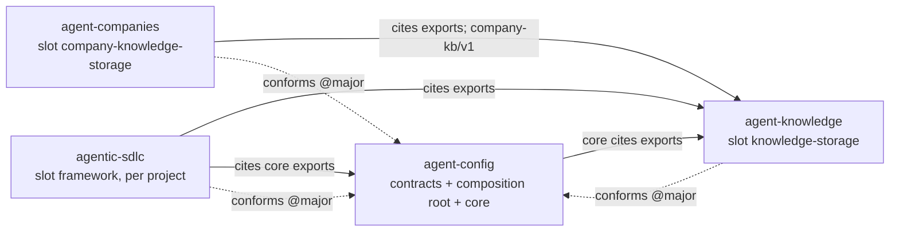

# Architecture: agent-config

## 1. Overview

agent-config is V's agent configuration: the instructions, knowledge, frameworks, skills, agents and hooks that Claude Code, Copilot CLI and VS Code, and Codex load, plus the installer that places them. Spec 022 turns it into a **motherboard**: a compact repo that holds the **contracts** every part plugs into and the **composition root** (the installer, the component lists and the renderer), while every other part is a replaceable **component** in its own repo, used only through its `component.yaml`. Analogy: the motherboard defines the sockets and the bus; the cards (knowledge base, company knowledge, the SDLC framework) can be swapped without touching it. Until each phase moves a folder, the content still lives here; §3 maps every folder to the component it becomes. The only user is V (spec A-1). **Risk tier: HIGH** (`specs/022-repo-split/research.md` DR-001): the installer decides which code and always-loaded text every agent runs with V's rights.

## 2. System context

```yaml
system: { kb: "none: no Company KB system catalog covers these repos; the context map lives in specs/022-repo-split/research.md", ref: n/a, service_id: agent-config, contracts_provided: [slots/v1, component/v1, components-list/v1, components-lock/v1, knowledge-provider/v1, rendered-copy/v1, routes/v1, skill-source/v1, agent-source/v1, adapter-fields/v1, build/v1, repo-layout/v1, hooks/v1, variables/v1, framework/v1], contracts_consumed: [company-kb/v1] }
```

Four repos after spec 022: agent-config (this one, public), agent-knowledge (knowledge base, knowledge framework, company-KB framework), agent-companies (company KB instances, public) and agentic-sdlc (the SDLC framework, enabled per project). Every component conforms to agent-config's contracts at a pinned major; only the composition root names providers, in `components.yaml`, the local list and the lock. agent-config consumes `company-kb/v1` because its `init-repo-kb` procedure follows the company-KB schemas.



Forbidden edges: agent-knowledge → any component; core → agentic-sdlc; core → agent-companies; agent-companies → agentic-sdlc; contracts → any component.

## 3. Components

Today's folders, each with the component it becomes (`target`) and the phase that moves it. Document folders use `kind: datastore` because the schema has no kind for agent-read documents (DR-309). Planned folders that do not exist yet (`contracts/`, `installers/core/`, `home/`, `adapters/`, `agents/`) are described in §4's second block and appear here when their phase merges.

```yaml
components:
  - { name: core-instructions, path: copilot/instructions/, kind: datastore, target: core, moves: "phase 8 to home/instructions/", decisions: [DR-302, DR-308] }
  - { name: core-patterns, path: copilot/patterns/, kind: datastore, target: core, moves: "phase 8 to home/patterns/", decisions: [DR-308] }
  - { name: core-references, path: copilot/references/, kind: datastore, target: core, moves: "phase 8 to home/references/", decisions: [DR-308] }
  - { name: core-prompts, path: copilot/prompts/, kind: datastore, target: core, moves: "phase 8 to home/prompts/", decisions: [DR-308] }
  - { name: core-procedures, path: copilot/procedures/, kind: script, stack: typescript-node, target: core, moves: "4 SDLC procedures to agentic-sdlc in phase 4 (DR-405); the rest to home/ in phase 8", decisions: [DR-101, DR-109, DR-405] }
  - { name: atlas, path: copilot/atlas/, kind: script, stack: typescript-node, target: core, decisions: [DR-101, DR-109] }
  - { name: tracker, path: copilot/tracker/, kind: script, stack: typescript-node, target: core, decisions: [DR-101, DR-109] }
  - { name: agent-hooks, path: copilot/hooks/, kind: script, stack: typescript-node, target: core, moves: "workflow-graph.json to agentic-sdlc (DR-413); hook files become hooks/v1 entries in phase 5", decisions: [DR-101, DR-413] }
  - { name: efficiency-audit, path: copilot/efficiency-audit/, kind: script, stack: typescript-node, target: core, decisions: [DR-101, DR-109] }
  - { name: agent-foundry, path: copilot/frameworks/agent-foundry/, kind: script, stack: typescript-node, target: core, decisions: [DR-101, DR-109] }
  - { name: templates, path: templates/, kind: datastore, target: core, moves: "phase 8 to home/templates/", decisions: [DR-308] }
  - { name: knowledge, path: copilot/knowledge/, kind: datastore, target: agent-knowledge, moves: "phase 6", decisions: [DR-404] }
  - { name: knowledge-framework, path: copilot/frameworks/knowledge/, kind: script, stack: typescript-node, target: agent-knowledge, moves: "phase 6", decisions: [DR-109, DR-404] }
  - { name: company-kb-framework, path: copilot/frameworks/company-kb/, kind: datastore, target: agent-knowledge, moves: "phase 6", decisions: [DR-405] }
  - { name: companies, path: copilot/companies/, kind: datastore, target: agent-companies, moves: "phase 3", decisions: [DR-405, DR-407] }
  - { name: agentic-sdlc, path: copilot/frameworks/agentic-sdlc/, kind: library, stack: typescript-node, target: agentic-sdlc, moves: "phase 7", decisions: [DR-109, DR-415] }
  - { name: workflow-graph, path: copilot/frameworks/agentic-sdlc/tools/workflow-graph/, kind: script, stack: typescript-node, target: agentic-sdlc, moves: "phase 7, with agentic-sdlc", decisions: [DR-108, DR-109] }
  - { name: copilot-agent-files, path: copilot/agents/, kind: datastore, target: "built output", moves: "replaced by agent-source/v1 builds in phase 4", decisions: [DR-409] }
  - { name: claude-adapter, path: claude/, kind: datastore, target: "adapters/claude", moves: "phase 4 (agents built), phase 8 (folder)", decisions: [DR-409, DR-410] }
  - { name: codex-adapter, path: codex/, kind: datastore, target: "adapters/codex", moves: "phase 4 (agents built), phase 8 (folder)", decisions: [DR-409, DR-410] }
  - { name: skills, path: skills/, kind: datastore, target: "skill sources", moves: "phase 4 to skill-source/v1", decisions: [DR-408] }
  - { name: installers, path: installers/, kind: script, stack: typescript-node, target: composition-root, moves: "phase 2 adds installers/core/ (Node) and installers/legacy/; the shell scripts become shims", decisions: [DR-101, DR-105, DR-107, DR-303] }
  - { name: scripts, path: scripts/, kind: script, stack: typescript-node, target: checks, decisions: [DR-108, DR-109] }
  - { name: tests, path: tests/, kind: script, stack: typescript-node, target: checks, decisions: [DR-108, DR-501] }
  - { name: spec-kit-state, path: .specify/, kind: datastore, target: "repo tooling", decisions: [DR-308] }
```

`workflow-graph` sits inside `agentic-sdlc`'s folder and is its own component because it is the one package with its own `package.json`, `tsconfig.json` and lint config; the nested path wins for its folder. Not components: `specs/`, `proposals/` (design documents), `.github/`, `.githooks/`, `.claude/` (this repo's own CI, git hooks and Claude Code project settings).

**Slots** (`contracts/slots.yaml` from phase 0, DR-401): `core` (reserved, agent-config itself; locations `core`, `instructions`, `patterns`, `procedures`, `references`, `atlas`, `tracker`, `frameworks/agent-foundry`), `knowledge-storage` (`knowledge-provider/v1`, at most one, self-contained; locations `knowledge`, `frameworks/knowledge`, `frameworks/company-kb`), `company-knowledge-storage` (`company-kb/v1` and `knowledge-provider/v1`, several; shared location `companies`), `framework` (`framework/v1`, several, per project; location `frameworks/<component>`).

## 4. Layers & dependency rules

Repo-level tiers today, one block per target component with a representative folder (the `members` list names every folder in the tier). These are the allowed edges that the fitness checks FF-1 and FF-2 read; today's violations are recorded baselines that may only fall (§9).

```yaml
layers:
  - { name: agent-knowledge, path: copilot/knowledge/, members: [copilot/knowledge/, copilot/frameworks/knowledge/, copilot/frameworks/company-kb/], may-depend-on: [] }
  - { name: core, path: copilot/instructions/, members: [copilot/instructions/, copilot/patterns/, copilot/procedures/, copilot/references/, copilot/prompts/, copilot/atlas/, copilot/tracker/, copilot/hooks/, copilot/efficiency-audit/, copilot/frameworks/agent-foundry/, templates/], may-depend-on: [agent-knowledge] }
  - { name: agent-companies, path: copilot/companies/, members: [copilot/companies/], may-depend-on: [agent-knowledge] }
  - { name: agentic-sdlc, path: copilot/frameworks/agentic-sdlc/, members: [copilot/frameworks/agentic-sdlc/], may-depend-on: [agent-knowledge, core] }
  - { name: platform-files, path: claude/, members: [claude/, codex/, copilot/agents/, skills/], may-depend-on: [core, agentic-sdlc] }
  - { name: composition-root, path: installers/, members: [installers/, mapping.yaml, global-variables.md], may-depend-on: [agent-knowledge, core, agent-companies, agentic-sdlc, platform-files] }
  - { name: checks, path: tests/, members: [tests/, scripts/, cucumber.mjs], may-depend-on: [agent-knowledge, core, agent-companies, agentic-sdlc, platform-files, composition-root] }
```

agentic-sdlc → agent-companies is allowed only as an optional slot dependency with no doc citations, so it is not an edge above.

**Planned structure (spec 022; not on disk yet, so not in the validated block; P7 of each phase moves the part that exists into the block above).** The motherboard gets four code tiers in one direction (DR-302): `contracts/` depends on nothing else in the repo; `installers/` (composition root) depends on `contracts/` and reads every component, core included, only through its `component.yaml` and declared locations; `adapters/<name>/fields.yaml` is data the build tool reads; `tests/` and `scripts/` may depend on everything and nothing depends on them. Inside the installer core (DR-303), feature-first modules, each with the four layers, wired by one composition root and one composer per module (MOD-9, MOD-11 W2):

```yaml
# planned: installers/core/src/ (phase 2 onward)
layers:
  - { name: domain, path: domain/, may-depend-on: [] }                       # pure; may import contracts/lib (pure published language)
  - { name: application, path: application/, may-depend-on: [domain] }       # one folder per use case; owns the ports
  - { name: infrastructure, path: infrastructure/, may-depend-on: [application, domain] }   # port adapters: file system, links, git, clock, terminal
  - { name: interface, path: interface/, may-depend-on: [application] }      # CLI handlers, text and JSON presenters
modules:
  - { name: manifests, path: installers/core/src/modules/manifests/, may-depend-on: [shared], public: [application/**] }
  - { name: sources, path: installers/core/src/modules/sources/, may-depend-on: [manifests, shared], public: [application/**] }
  - { name: resolution, path: installers/core/src/modules/resolution/, may-depend-on: [manifests, shared], public: [application/**] }
  - { name: variables, path: installers/core/src/modules/variables/, may-depend-on: [shared], public: [application/**] }
  - { name: rendering, path: installers/core/src/modules/rendering/, may-depend-on: [manifests, variables, shared], public: [application/**] }
  - { name: wiring, path: installers/core/src/modules/wiring/, may-depend-on: [manifests, shared], public: [application/**] }
  - { name: state, path: installers/core/src/modules/state/, may-depend-on: [shared], public: [application/**] }
  - { name: commands, path: installers/core/src/modules/commands/, may-depend-on: [manifests, sources, resolution, variables, rendering, wiring, state, shared], public: [interface/**] }
  - { name: shared, path: installers/core/src/modules/shared/, may-depend-on: [], public: [domain/**, application/**] }
```

Rules on top of the table: only `src/CompositionRoot.mjs` imports adapters and composers; no composer imports an adapter; no layer imports a composer (MOD-11). Domain and application never touch the file system, network, clock or process environment; they reach them through ports (`FileSystem`, `Links`, `Git`, `Clock`, `Environment`, `Terminal`, `Runtime`, `HomeLock`) (CA-2, CA-7, DR-305). The pure planner returns one `Plan` that `plan`, `apply`, the journal, the consent check and dry runs all use (DR-306). Shared pure rules (render rules, citation classifier, manifest reader, character counter, the one `yaml` wrapper and its vendored copy) live in `contracts/lib/` and are imported by both the installer and the build tool (DR-304).

## 5. Data

| Store | Kind | Owned entities | Notes |
|---|---|---|---|
| `components.yaml`, `component.yaml` (repo root, from phase 2) | YAML files in git | Default component list; core's manifest | Public; changed by pull request |
| `{{AGENT_HOME}}/components.local.yaml`, `variables.local.yaml` | YAML files | V's extra components, source overrides, variable values | Never tracked (AC-3.8); backed up before each rewrite |
| `{{AGENT_HOME}}/components.lock`, `install-state.json`, `install-state.pending.json` | JSON files | Locked versions; every placed path with class and hash; the switch journal | Installer only; temp file + rename (DR-104, DR-202) |
| `{{AGENT_HOME}}/store/<name>@<id>/` | Immutable folders | One tree per component version (checked out, rendered or built) | Current + previous kept |
| `{{AGENT_HOME}}/generated/` | Files and links | Rendered copies (`generated/<component>`), routes, `global-variables.md`, `index.md`, Codex `AGENTS.md` and `hooks.json` | Rebuilt each install; never committed |
| `{{AGENT_HOME}}/install-log.jsonl`, `install.lock` | JSON Lines, lock file | Who installed what when; one writer at a time | Rotated at 1 MB |
| `~/.agent-config-backups/<timestamp>/` | Folders with `backup-manifest.json` | Anything the installer replaced | Owner-only; never deleted by a command |

**Delivery classes** (FR-015): every file the installer places is one of **linked** (a link into a store tree or a `path` source; the knowledge base, whose links are already relative, so edits show at once), **rendered** (a read-only copy of a component that cites another, under `generated/<component>/`, with each citation's text the real absolute path and its target relative; agents load these paths, DR-307), **generated** (machine-specific files: routes, `global-variables.md`, Codex `AGENTS.md`, merged hook entries), or **compat** (a link at an old `~/.copilot/…` path, kept for one release, DR-204). Whether a component is rendered follows from its citations, not from a flag (DR-406).

## 6. External dependencies

| Dependency | Kind | Used for | Doc |
|---|---|---|---|
| GitHub (git over `https` or `ssh`) | git remote | Fetching `git` sources; citation targets; CI | _none yet: phase 2 adds docs/integrations/github.md_ |
| `git` program ≥ 2.50.1 | local program | Clone, fetch, `rev-parse` for `git` sources | _none yet: phase 2 adds docs/integrations/git.md_ |
| Node.js ≥ 18 | runtime | Installer core, build tool, validators | none |
| Claude Code user folder (`~/.claude/`) | agent configuration files | Import lines in `CLAUDE.md`, merged hooks in `settings.json`, skills and agents | _none yet: phase 5 adds docs/integrations/claude-code.md_ |
| Copilot CLI and VS Code (`~/.copilot/`, `~/.agents/skills/`) | agent configuration files | Instruction links, routes file, hook file, agents, skills | _none yet: phase 5 adds docs/integrations/copilot.md_ |
| Codex (`~/.codex/`) | agent configuration files | `AGENTS.md`, `hooks.json`, agents | _none yet: phase 5 adds docs/integrations/codex.md_ |
| `yaml` 2.9.1 (vendored) | library | Reading and editing YAML with comments kept | none |

## 7. Cross-cutting concerns

- **Authentication:** none of its own; `git` uses V's credential helper or `ssh-agent`; source URLs may not carry credentials, and every report redacts them (M-07).
- **Authorization and consent:** only V at an interactive terminal confirms the home and approves new or changed privileged entries (hooks, services, status line, routes, skill and agent text); agents driving the installer get exit 10 (M-01, M-11; spec AC-2.1, AC-4.5).
- **Containment:** names are allow-listed and every component path is relative and checked against its root before each read or write; symlinks leaving a component fail it (M-03, M-04).
- **Audit:** `install-log.jsonl` records each run; `install-state.json` records every placed path (M-16; spec AC-7.5).
- **Observability:** `doctor` and `doctor --json` are the health signal; `plan` shows every change before it happens (spec AC-7.4, AC-7.5).
- **Configuration:** each component declares the variables its docs use; values live in `variables.local.yaml`; the home is `~/.agent-config` or `AGENT_CONFIG_HOME` (spec FR-013, FR-025).
- **Secrets:** none in any repo or generated file; variables are public values (M-08).
- **Concurrency and atomicity:** one home-wide lock; staged trees validated before a journaled link switch (DR-202, M-12).

## 8. Key decisions

| Id | Topic | Where |
|---|---|---|
| DR-001 | Risk tier HIGH | `specs/022-repo-split/research.md` (a different DR-001 exists in specs/001 and specs/009) |
| DR-101 | Runtime language and Node 18 floor | `specs/022-repo-split/research.md` |
| DR-102 | Vendored YAML library | `specs/022-repo-split/research.md` |
| DR-105 | Source adapters and links | `specs/022-repo-split/research.md` |
| DR-107 | Installer shims | `specs/022-repo-split/research.md` |
| DR-108 | Toolchain | `specs/022-repo-split/research.md` |
| DR-109 | Check command and CI per repo | `specs/022-repo-split/research.md` |
| DR-202 | Home, store and atomic switch | `specs/022-repo-split/research.md` |
| DR-204 | Compatibility links | `specs/022-repo-split/research.md` |
| DR-301 | Architecture pattern | `specs/022-repo-split/research.md` |
| DR-302 | Motherboard tiers and direction | `specs/022-repo-split/research.md` |
| DR-303 | Installer core modules and wiring | `specs/022-repo-split/research.md` |
| DR-304 | Shared pure rules in `contracts/lib` | `specs/022-repo-split/research.md` |
| DR-305 | Ports and the report model | `specs/022-repo-split/research.md` |
| DR-306 | The plan is data | `specs/022-repo-split/research.md` |
| DR-307 | Load paths of rendered copies | `specs/022-repo-split/research.md` |
| DR-308 | Target root set | `specs/022-repo-split/research.md` |
| DR-309 | Shape of this file | `specs/022-repo-split/research.md` |
| DR-401 | `slots/v1` | `specs/022-repo-split/research.md` |
| DR-404 | `knowledge-provider/v1` and self-containment | `specs/022-repo-split/research.md` |
| DR-405 | `company-kb/v1`; SDLC procedures move | `specs/022-repo-split/research.md` |
| DR-406 | `rendered-copy/v1` | `specs/022-repo-split/research.md` |
| DR-413 | `hooks/v1` | `specs/022-repo-split/research.md` |
| DR-415 | `framework/v1` | `specs/022-repo-split/research.md` |
| DR-501 | Test depth | `specs/022-repo-split/research.md` |

## 9. Verification status

| Check | Last run | Result |
|---|---|---|
| `validate-project.mjs .` (this file and specs/022) | 2026-11-13 | See the P4 report; lint-baseline failures for `typescript-node` components without an ESLint config are expected until phase 0 (research C-14) |
| Fitness: knowledge mentions of `agentic-sdlc` | not yet automated | Baseline 109 lines in 67 files (spec) or 123 in 73 (DR-404); to 0 in phase 1 |
| Fitness: core → agentic-sdlc citations | not yet automated | Baseline 20; to 0 by the end of phase 4 |
| Fitness: core → agent-companies citations | not yet automated | Baseline 1; to 0 by the end of phase 3 |
| Golden plans of the old installers | not yet recorded | First task of phase 0 |

## 10. Known gaps / out of scope

- `contracts/`, `installers/core/`, `home/`, `adapters/`, `agents/` do not exist yet; §4's planned block describes them (DR-309).
- The `.mjs` tools have no format, lint or typecheck configuration; DR-108 adds it for new code in phase 0, and the stack's lint baseline versus legacy tools is G3 question 1 (research C-14).
- `installers/` is bash and PowerShell today; its `stack` records the decided Node core (DR-101).
- Integration docs for GitHub, git and the three agents are written in phases 2 and 5 (§6).
- Paradigm for `installers/core` is not chosen yet (engineering, research U-2); the constitution default is `none`.
- Out of scope (spec): `archive` sources, an MCP server for the KB, a database-only knowledge store, multi-user publishing, splitting agent-foundry or `contracts/` into their own repos.
