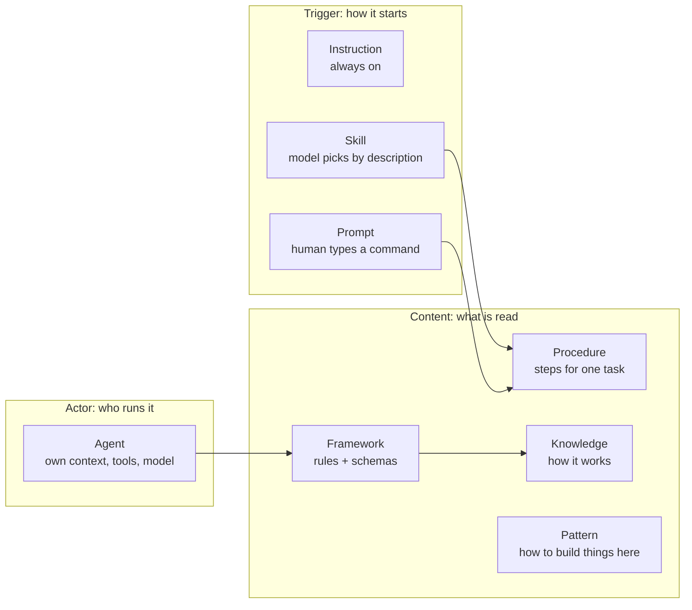

# Agent artifacts: where skills live, how to group them, and what each artifact type is

> Status: proposal (not implemented). Evidence gathered 2026-10-24 from this repo and the vendors' docs (sources at the end).

## Q1. Should `skills/` move inside `copilot/`?

**Yes, safe and cheap.** `mapping.yaml` already decouples *source* from *target*, so only the `source:` of two lines changes; deployed paths (`~/.claude/skills`, `~/.agents/skills`) stay the same.

Caveats found:
- The folder name `copilot/` is a misnomer: it is really the tool-neutral store (deployed to `~/.copilot` because Copilot reads that natively). Renaming is a separate, bigger job (`{{AGENT_HOME}}` is used in hundreds of paths). Not recommended now.
- Update these references: `README.md` (2 places), `mapping.yaml` (3 lines), `agentic-sdlc/tools/validate.mjs` (`path.join(repo, 'skills', ...)`, lines ~469-479), the `skill-wrapper` schema and `_system.md` registry, `index.md` §checks, and the pattern doc.
- Stray folder: `skills/synced/` is **untracked, empty, created today 14:29** by something else (not this repo's tooling). Ignore it or add to `.gitignore`; do not move it.

```text
BEFORE                       AFTER
agent-config/                agent-config/
├── skills/        ◄── odd   └── copilot/
└── copilot/                     ├── skills/        ◄── same level as agents/, prompts/
    ├── agents/                  ├── agents/
    └── ...                      └── ...
```

## Q2. How to group skills without breaking tools?

**Finding: no tool documents nested skill folders.** Every documented layout is exactly `<skills-dir>/<skill-name>/SKILL.md`.

| Tool | Documented personal location | Nested grouping documented? |
|---|---|---|
| Claude Code | `~/.claude/skills/<name>/SKILL.md` | No (only `.claude/commands/` has namespaces, not skills) |
| GitHub Copilot CLI | `~/.copilot/skills/` or `~/.agents/skills/` | No (searched; found nothing on recursion) |
| Codex | `$HOME/.agents/skills` | Not stated |
| Open standard (agentskills.io) | `name` must equal the parent directory name | Not specified |

So **deployed layout must stay flat**. Group in the **source**, flatten at **install**:

```text
SOURCE (grouped, for humans)                DEPLOYED (flat, for tools)
copilot/skills/                             ~/.claude/skills/  and  ~/.agents/skills/
├── sdlc/                                   ├── agentic-sdlc  ─► link
│   ├── agentic-sdlc/SKILL.md      ───────► ├── sdlc-qa-preset ─► link
│   ├── presets/sdlc-qa-preset/            ├── sdlc-stack-go  ─► link
│   ├── stacks/sdlc-stack-go/              └── ...
│   └── paradigms/...
└── <future-pack>/…
```

Two layers of organisation (use both):
1. **Name prefix = namespace** (already in use: `sdlc-*`). This survives flattening and shows up in every tool's skill list. Keep it.
2. **Folder = pack** in the source tree (`sdlc/`, later `docs/`, `ops/`…). Purely for humans.

Installer change needed: a new `mapping.yaml` strategy, e.g. `symlink-leaves` (link every directory that contains a `SKILL.md`). On Windows this links **directories**, which can fall back to junctions with no privilege (see `knowledge/windows/symlinks-privilege.md`), so it stays robust. Name clashes across packs must fail the install.

Do **not** group until you have more than about 20 skills; today there are 15 and every one is `sdlc-*`. The prefix alone is enough now.

## Q3. Are agents, skills and instructions agnostic?

| Artifact | Is the *format* agnostic? | How this repo handles it | Gap found |
|---|---|---|---|
| **Skill** | **Yes**: open standard (agentskills.io), all three tools follow it | One copy, linked twice | Bodies hard-code `~/.copilot/...` paths (fine, but path-coupled) |
| **Agent** | **No**: Claude/Copilot use Markdown+YAML, Codex uses TOML | Neutral source `frameworks/agentic-sdlc/agents/<role>.md` + 3 thin wrappers | Claude wrapper has Claude-only keys (`model`, `skills`, `disallowedTools`); expected, it is glue |
| **Instruction** | **Partly**: `.instructions.md` with `applyTo` is Copilot's format | Copilot reads it natively; `CLAUDE.md` `@import`s it; `AGENTS.md` points to it | The neutral source is in Copilot's dialect; acceptable, content is plain prose |

Rule that already works (`patterns/shared-procedure-thin-wrapper.pattern.md`): **content once, in plain prose; wrapper only where a tool needs its own format.** Skills are the only type that needs no wrapper.

Portability checklist for any new artifact: plain Markdown body; no tool names in the body; frontmatter limited to the standard (`name`, `description`, optional `license`, `compatibility`, `metadata`, `allowed-tools`); paths via `{{AGENT_HOME}}`.

## Q4. Procedure vs prompt vs skill vs agent vs instruction: how to tell them apart

Key insight: they are **not the same kind of thing**. They sit on three axes.



| Type | One-line definition | Loaded when | Example in this repo |
|---|---|---|---|
| **Instruction** | A preference that applies to every request | Every session, automatically | `personal-defaults.instructions.md` |
| **Skill** | A capability the model finds by its `description` | When the description matches the task | `sdlc-stack-go` |
| **Prompt** | A shortcut a human invokes, with arguments | When the user types it | `init-repo-kb.prompt.md` |
| **Agent** | A persona with its own context, tools and model | When delegated to | `sdlc-qa` |
| **Procedure** | The ordered steps of one repeatable task; **no trigger of its own** | When a skill or prompt points at it | `init-repo-kb.procedure.md` |
| **Framework** | Rules and schemas for a domain | When a role or procedure cites it | `frameworks/agentic-sdlc` |
| **Knowledge** | Explanations, not orders | When cited | `knowledge/grpc/...` |
| **Pattern** | A named way to build things in this repo | When designing a new artifact | `shared-procedure-thin-wrapper` |

Decision questions, ask in order:
1. Should it apply to **every** request? → Instruction.
2. Does it need **its own context, tool limits or model**? → Agent.
3. Will a **human type a command with arguments**? → Prompt (thin wrapper).
4. Should the **model find it by description**? → Skill.
5. Otherwise it is the **steps of a task** → Procedure.

### The honest overlap: procedure vs skill

A skill is, structurally, a procedure plus a trigger. The repo's own pattern doc already says a `skills/init-repo-kb/SKILL.md` wrapper is "now possible". Two consistent options:

| Option | Rule | Cost |
|---|---|---|
| **A. Keep `procedure` (recommended)** | Procedure = neutral body. Skill and prompt = triggers that point to it. | Two files per capability, but matches the existing pattern and keeps prompts working |
| B. Collapse into skills | Write new tasks as skills with `references/`; retire `procedures/` over time | One file, but Copilot prompts' argument templating still needs a prompt wrapper, and old procedures need migration |

Recommendation: **A now**, and add a rule to `patterns/index.md`: *trigger = skill or prompt, content = procedure; a skill never restates the procedure.* Revisit B only if most procedures end up with a skill wrapper anyway.

## Q5. Suggested next steps (small, reversible)

1. `git mv skills copilot/skills`; update the references listed in Q1; run `node copilot/frameworks/agentic-sdlc/tools/validate.mjs`.
2. Add this taxonomy table to `copilot/patterns/index.md` as a new pattern, "Artifact Types".
3. Defer grouping and the `symlink-leaves` strategy until the skill count passes about 20.

## Not verified

- Whether Copilot CLI or Codex scan nested skill folders at runtime: docs are silent, so the plan assumes they do not. A quick test (put one skill two levels deep, run `/skills reload` in Copilot) would settle it.
- I did not run the validators or move any files.

## Sources

- Claude Code skills: https://code.claude.com/docs/en/skills.md
- Agent Skills specification: https://agentskills.io/specification
- Codex skills: https://learn.chatgpt.com/docs/build-skills
- Copilot CLI add skills: https://docs.github.com/en/enterprise-cloud@latest/copilot/how-tos/copilot-cli/customize-copilot/add-skills
- Local: `copilot/patterns/shared-procedure-thin-wrapper.pattern.md`, `mapping.yaml`, `copilot/knowledge/windows/symlinks-privilege.md`
