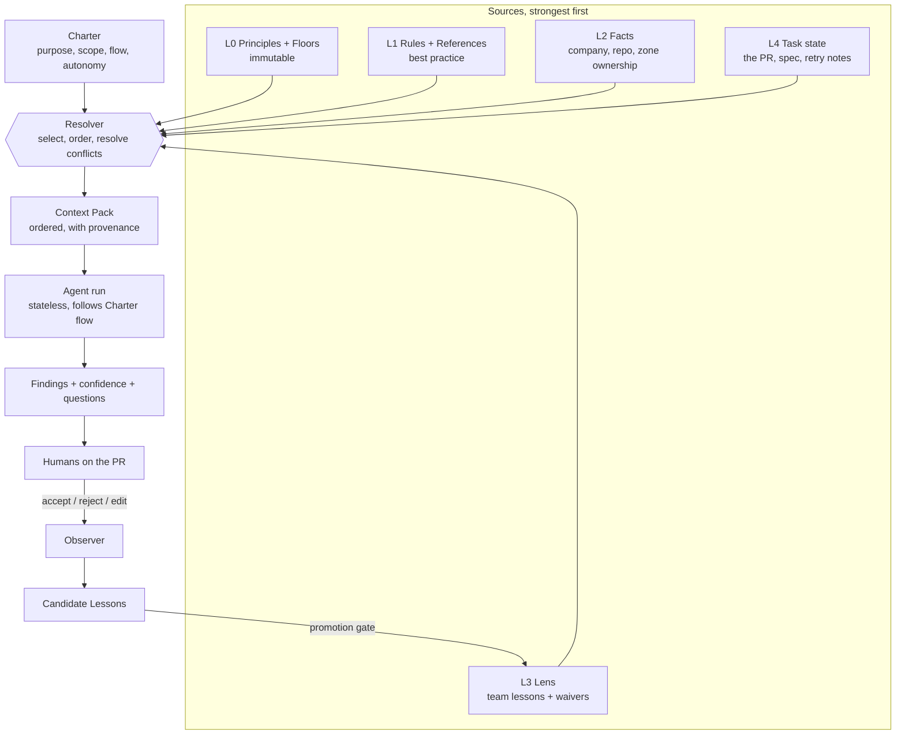
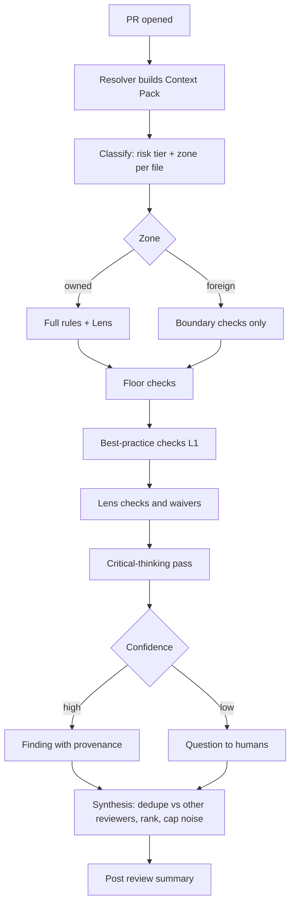
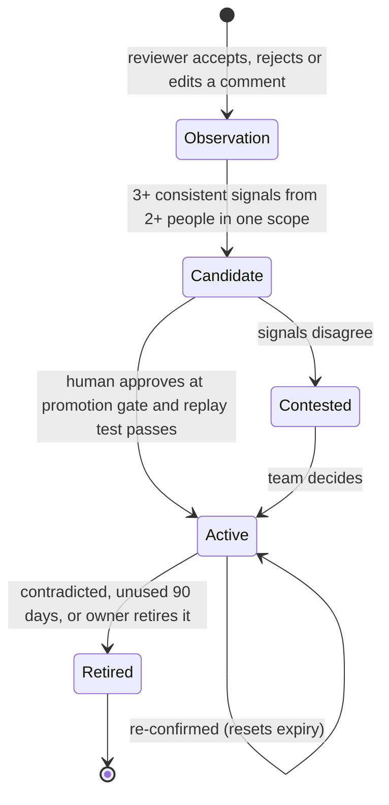

# Agent Foundry: a framework that builds scoped, learning agents

> Status: architecture proposal (nothing implemented). Evidence gathered 2026-10-24 from this repo; external claims are cited at the end.
> Builds on: [loose-coupling-backplane.md](loose-coupling-backplane.md) (components and ports) and [agent-artifact-taxonomy.md](agent-artifact-taxonomy.md) (artifact types).

## 1. Names (proposed)

| Thing you described | Proposed name | Why |
|---|---|---|
| The whole agent-building framework | **Agent Foundry** | It casts agents from a spec |
| The spec you give it ("build me a PR reviewer") | **Charter** | "Blueprint" and "Constitution" are already taken in agentic-sdlc |
| The "resolution system" (decides which knowledge wins) | **Resolver** | One job: turn many sources into one ordered Context Pack |
| The learned, team-scoped memory | **Lens** | The same code looks different through each team's lens |
| A reviewable thing the agent learned | **Lesson** | Has scope, evidence, confidence and a lifecycle |
| Accepted legacy you must not fix | **Waiver** in a **Foreign Zone** | Explicit, owned, with a reason |

## 2. What already exists vs. what is new

Verified in the repo:

| Need | Already in `agent-config` | Evidence | Gap |
|---|---|---|---|
| Role definition | `agent-role/v2`: Identity, Does NOT do, Preset knowledge, Runtime inputs, Trees owned, Modes, Review rubric, Escalate when, Output | `agents/*.md`, checked by `validate.mjs` | No scope for learned memory, no eval set |
| Decision flow | Decision trees: every node has `Default` and `Escalate when` | `schemas/tree.schema.md` | None |
| Best-practice knowledge | Rules (A), references (B), facts (C/D) | `frameworks/*`, `knowledge/*` | None |
| Loading and precedence | ① Preset, ② Profiles, ③ State; State > Paradigm > Stack > Preset on form, Preset wins on intent | `conventions.md` §3 | Not a named, testable component |
| Severity and verdicts | blocker / major / minor / nit; `review-fail` rules | `foundations/review/review-rubrics.md` | No notion of "accepted here" |
| Auditable decisions | Decision record with `Rejected`, `Confidence`, `Supersedes` | `schemas/decision-record.schema.md` | Reusable as the Lesson shape |
| **Learning** | **None.** `conventions.md` §2.4: "Instances remember nothing." | `conventions.md` | **The core new part** |

Design consequence: agents stay stateless; the Lens is external memory loaded as state. That keeps rule §2.4 intact.

## 3. Core principles

1. **Evidence over opinion.** Every finding cites the rule, fact or lesson that produced it.
2. **Floors are not tunable.** Security, data integrity and contract breaks cannot be waived or "learned away". Teams tune everything above the floor.
3. **Learn slowly, forget explicitly.** Memory changes only through a human-approved promotion, and every lesson can expire.
4. **Scope first.** A lesson with no scope (team, repo, path) is rejected.
5. **Contain legacy, don't fight it.** In code you do not own, check the boundary your team writes, not the legacy inside.
6. **State confidence and ask.** Low confidence produces a question, not a verdict.
7. **Stateless agent, stateful memory.** The agent is rebuilt per run; the Lens is the only thing that persists.
8. **Learn about decisions, not people.** See the privacy note in §9.

## 4. Architecture



Mapping to the Backplane: Foundry adds one component, **LENS**, to RULES / REFS / FACTS. It uses the same read ports (Resolve, Query, Cite) plus a write port, **Record** (`observe`, `propose`, `promote`, `retire`). Storage is the implementer's choice: files in the repo or Company KB, or a database.

## 5. The Resolver

Input: the Charter, the task, and the zone of each touched file. Output: one **Context Pack** where every item carries `source`, `layer`, `scope` and `why-selected`.

Resolution rules, in order:

| # | Rule | Effect |
|---|---|---|
| R1 | Floors (L0) always apply and cannot be overridden | Security, data integrity, contract and spec violations stay `blocker` |
| R2 | Narrower scope beats wider scope within a layer | A path-level lesson beats a team-level lesson |
| R3 | Lens may **adjust severity down one step, add checks, or add waivers** on L1 rules; it may **not** touch L0 | "Team accepts long functions in `legacy/`" is allowed; "ignore SQL injection" is not |
| R4 | Facts beat opinions | A recorded fact (owner, contract) overrides a lesson that disagrees |
| R5 | Conflicting lessons of equal scope become `contested` | Neither applies silently; the agent asks |
| R6 | Expired or unconfirmed lessons are dropped from the pack | No stale taste |
| R7 | Pack is size-bounded; drop order is Lens then L1 detail, never L0 | Keeps context small |

This is the existing State > Paradigm > Stack > Preset precedence, made explicit and extended with Lens.

## 6. Charter: what "build me an agent" produces

A Charter is `agent-role/v2` plus three sections. The Foundry's builder agent interviews you, drafts the Charter, a Checker validates it, then thin wrappers are generated per tool (see the taxonomy pattern).

```yaml
charter: 1
id: pr-reviewer
purpose: "First-pass review of a PR, synthesised for human reviewers"
does_not: [merge, approve, edit code, rewrite legacy]
mode: review
inputs: [diff, spec?, repo_facts, zone_map]
knowledge:                     # existing stores, by name (see Backplane)
  rules: [RUB, CA, ERR, DDD]
  refs:  [ref:software-design/*]
  facts: [repo, system]
lens:                          # NEW
  scopes: [team:payments, repo:ne-shipment-api]
  may_adjust: [severity, add_check, waiver]
  may_not: [floors]
flow: trees/pr-review.tree.md  # decision flow, with Default + Escalate when
autonomy: suggest-only         # suggest-only | comment | request-changes (earned by eval)
output: message/v2
eval: evals/pr-reviewer/       # NEW golden set (see section 8)
escalate_when: [low-confidence blocker, contested lesson, unknown zone]
```

## 7. Use case: PR review with many reviewers

### 7.1 Decision flow



**Critical-thinking pass** (a fixed checklist, not free reflection): What assumption does this change make? What would break it? Is there a simpler design? Does it contradict a recorded decision? What would a reviewer from this team ask? Which finding am I least sure of?

### 7.2 Legacy and foreign code

You cannot refactor it, but you still call it. Zones make that explicit:

| Zone | Meaning | Review behaviour |
|---|---|---|
| `owned` | Your team can change it | Full rules + Lens |
| `adopted` | Yours, but known debt | Full rules, debt findings downgraded to `minor`, linked to a waiver |
| `foreign` | Another team, vendor, or untouchable legacy | Do not flag inside it. Check **your side of the boundary**: wrapper/adapter present, timeouts, retries, error translation, no leaking foreign types into your domain (an anti-corruption layer) |

A **Waiver** records why: `{ zone, rule, reason, owner, review-by date }`. Waivers expire, so "temporary" debt gets re-examined.

### 7.3 What a finding looks like (provenance is the point)

```yaml
- rule: ERR-2
  severity: minor            # base: major, lowered one step by LS-014
  provenance: [L1:ERR-2, L3:LS-014 (team:payments), L2:zone=adopted]
  location: orders/app/place_order:48
  detail: "Repository error swallowed. Team accepts this in the legacy adapter (LS-014); translate it in new code."
  confidence: high
```

Humans can always see **why** the agent said or softened something.

### 7.4 Many reviewers

The agent is a first-pass synthesiser, never the approver. It dedupes against existing comments, groups by theme, caps low-value comments, and labels each comment by layer (floor / best practice / team lesson). Disagreements between reviewers become `contested` lessons, not silent averages.

## 8. How it learns (ML-like behaviour without ML)

No model weights change. "Learning" is **curated, evidence-backed memory plus evaluation**: auditable, reversible and diffable in git.



Lesson shape (reuses the decision-record discipline):

```markdown
## LS-014: Accept swallowed repository errors in legacy adapter
- **Scope:** team:payments · path: `src/legacy/**`
- **Polarity:** accept   (prefer | avoid | accept)
- **Adjusts:** ERR-2 severity major → minor
- **Evidence:** PR #412 (accepted by 2 reviewers), #431, #455
- **Rejected alternative:** refactor adapter now: owned by another team
- **Confidence:** medium · **Expires:** 2027-01-24
- **Supersedes:** none
```

Observation signals: comment resolved vs dismissed, reviewer reply ("won't fix, legacy"), human edits to the agent's suggestion, merged-without-change. Raw observations are cheap and short-lived; only candidates are kept.

### Evaluation (what makes it trustworthy)

| Mechanism | Purpose |
|---|---|
| **Golden set** of past PRs with the human outcome | Measures precision and misses |
| **Replay on promotion** | A new lesson must not drop recall on floor-level findings in the golden set |
| **Metrics** | Acceptance rate of comments, noise rate, missed blockers, contested count |
| **Autonomy ladder** | `suggest-only` → `comment` → `request-changes`, each step earned by the metrics |

## 9. Risks and honest caveats

- **Do not profile individuals.** Storing personalities or "mindsets" of named people risks bias, privacy and HR problems. Store preferences about *decisions and code* at team, repo or path scope. If you want reviewer styles, let people opt in to a declared lens (e.g. "security-minded") rather than inferring one.
- **Drift and echo.** A team can teach the agent its own bad habits. The floors, expiry and the replay test are the counter-measures.
- **Small data.** Three signals is a heuristic, not statistics. Tune it using the golden set.
- **Prior art exists but is vendor-reported.** CodeRabbit documents "learnings" stored per repo or organisation, built from chat replies, editable in a dashboard, and kept separate from formal standards. I rely on their docs only as evidence the approach is viable, not for design details.
- **Not verified by running anything.** No code or schema was created. The 90-day expiry, the 3-signal threshold and the autonomy ladder are starting values.
- **Unsolved:** how Observation events are collected per platform (GitHub, Azure DevOps, etc.). Likely one adapter per host behind the Record port.

## 10. Phased plan (smallest useful first)

| Phase | Deliverable | Proves |
|---|---|---|
| 0 | Charter schema = `agent-role/v2` + `lens`, `autonomy`, `eval`; add to validator | Agents can be specified, checked |
| 1 | `pr-review.tree.md` + zone map + **static** Lens (hand-written lessons and waivers) | Resolver and provenance work without any learning |
| 2 | Resolver as a script that emits the Context Pack; golden set of 20 past PRs | Repeatable, measurable review |
| 3 | Observer + candidate lessons + promotion gate (human approves a PR to the Lens folder) | Learning loop, fully auditable |
| 4 | Builder agent that drafts Charters from an interview | "Ask an agent to build the agent" |

Phases 0 to 2 deliver most of the value with no learning machinery.

## Corrections (2026-10-24)

- **Charter** is a new `charter/v1` schema in the Foundry that reuses `agent-role/v2` section names; `agent-role/v2` is not edited. See [agent-foundry-charter-and-floors.md](agent-foundry-charter-and-floors.md).
- **L0 vs L1** is not two folders: floors are a tag on foundation rules, kept in a `floors.md` registry. Treat L0 and L1 as one "Rules" layer.
- **Severity** belongs to the reviewer's rubric, not to the rule table.

## Sources

- CodeRabbit learnings: https://docs.coderabbit.ai/knowledge-base/learnings
- Local: `copilot/frameworks/agentic-sdlc/conventions.md` (§2.4 stateless, §3 loading), `schemas/tree.schema.md`, `schemas/decision-record.schema.md`, `schemas/message.schema.md`, `foundations/review/review-rubrics.md`, `foundations/review/fitness-functions.md`
