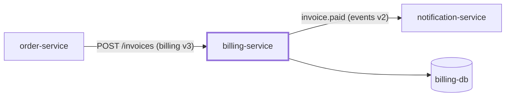

# Proposal: AI-Native Hierarchical Multi-Agent, Spec-Driven Engineering Architecture

**Status:** Implemented as v0 at `copilot/frameworks/agentic-sdlc/` (2026-10-03): roles, principles, trees, bindings, schemas, validator, per-tool wrappers and `mapping.yaml` wiring all exist. Not yet proven by a real P0–P7 pilot (section 11). This document stays as the design rationale; the framework's own `index.md` and `conventions.md` are now the operating source of truth, and win if the two ever disagree.

This is the tracked, living design doc for the objective: an AI-native, spec-driven engineering architecture using a hierarchical multi-agent system to handle full-lifecycle software development across any tech stack. It merges the original architecture drafted directly from the objective with a refinement pass done externally with Gemini (section 2) on how to organize accumulating domain knowledge so it scales instead of collapsing into one monolith file.

**Reading order:** sections 1–3 are the big picture; section 6 is the end-to-end workflow (start there if you only read one section); sections 7–9 are the detailed contracts (knowledge layout, decision trees, Spec Kit hooks).

## 0. Introspection — what's already here to build on

Three things in this environment are directly reusable, not theoretical:

1. **Subagent dispatch already exists in every CLI this repo targets.** Claude Code (`Agent` tool), Copilot (`task` / `runSubagent`) and Codex (subagents) each let one main session dispatch work to custom agents defined in files, and all three support Agent Skills (`SKILL.md`). Claude Code alone can preload skills into an agent (`skills:` frontmatter). Nesting (a subagent dispatching its own subagents) is supported unevenly across tools, so the default runtime is flat and the hierarchy is expressed as *ownership and review* (section 5).
2. **Spec Kit already has the proactive pattern.** `/speckit-specify` makes informed guesses, documents them in an Assumptions section, and caps `[NEEDS CLARIFICATION]` at 3, prioritized by scope > security > UX. That's the Anticipatory Workflow primitive — generalize it rather than inventing a new one.
3. **This repo already has the right shape for "framework."** `copilot/frameworks/company-kb/` is a worked example: `index.md` (overview) + `conventions.md` (rules) + `schemas/` (typed templates), with task procedures held separately in `copilot/procedures/`. Reuse that shape (section 10).

## 1. Objective (restated, cleaned up)

Design a system where:
1. **Hierarchical agents** — an Orchestrator plus Executive/Department Agents (Product/Spec, System Architecture, Architecture, Tech Stack Selection, Engineering, QA, Security, DevOps) each own a domain, delegating execution to task-specific **Workers**.
2. **Proactive, not reactive** — the system evaluates context and proposes a complete execution blueprint (scope, stack, architecture, flow) instead of waiting for step-by-step prompting.
3. **Spec-driven by construction** — the hierarchy hooks directly into Spec-Driven Development (GitHub Spec Kit: constitution → specify → plan → tasks → implement), not alongside it.
4. **Language/framework-agnostic core** — engineering principles are stored separately from language-specific syntax; switching stacks means loading a different binding module into the same domain agent, not rewriting the agent.
5. **Decision tree / trade-off engine** — technology, architecture-pattern, and toolchain choices are made via explicit, inspectable decision trees before code generation begins, and every choice is recorded with the alternatives it beat.

## 2. What the Gemini pass added

An external refinement pass (Gemini, user-provided PDF, not committed) answered one question: *how should the shared principles store be organized so it doesn't degrade into a single-file dump as it grows?* It proposed three taxonomies:

| Strategy | Groups knowledge by | Best for |
|---|---|---|
| **ISO/IEC 25010 Quality Model** | Quality attribute (maintainability, security, reliability, …) | QA/Security gatekeeping |
| **Epistemological Layering** | Knowledge type: `declarative/` (what's true), `procedural/` (how), `contextual/` (when/trade-offs), `meta/` (self-evaluation) | Decision-tree engines, agent reasoning |
| **Abstraction Ladder** | Axioms → paradigms → patterns → mechanisms → stack bindings | Supporting many languages from one core |

…plus a consumption mechanism: a **manifest** (`taxonomy.yaml`), a **router** (folded into the Orchestrator here), and **dynamic context injection** (each agent's prompt is assembled from only the selected files). None of the three taxonomies wins alone — section 7 composes all three into one tree.

## 3. Layered Architecture (big picture)

```
TIER 0 -- ORCHESTRATOR (main CLI session)
  Owns: intake, context loading, taxonomy.yaml routing, all dispatch,
  human gates, conflict resolution, escalation.
                               |
             dispatches subagents with injected context (flat runtime, section 5)
   ------------+------------+-----------+-----------+-----------+-----------+-----------+-----------
   |            |            |           |           |           |           |           |
 TIER 1 -- DEPARTMENT ROLES (decide + review; never launch anything themselves)
 Product/    System        Architecture Tech Stack  Engineering  QA         Security    DevOps
 Spec        Architecture  (one repo)   Selection   (code std.)
 (cross-repo)
   |            |            |           |           |           |           |           |
   v            v            v           v           v           v           v           v
TIER 2 -- WORKERS (ephemeral, one per task): LLM subagent OR deterministic script
  e.g. "implement POST /roles" (LLM), "run lint+tests" (script), "wire CI job" (LLM)

---- Knowledge axis (cuts across every Tier 1 role, section 7) ----
  agent-config repo:  principles/ (stack-agnostic)  +  bindings/<stack>/ (swappable)
---- State axis (section 4) ----
  system repo (cross-repo architecture)  +  project repo(s) (per-repo state)
```

Two axes cut across the tiers rather than being tiers themselves:
- **Knowledge** — *who the agents are and how they work*, stored once in this repo, shared by every project.
- **State** — *what the system and each project currently are*, stored in the projects' own repos.

## 4. Where context lives — knowledge vs. state

**Agents remember nothing between sessions.** Every session rebuilds context by re-reading files. "Persistent agent" in this design means *a persistent definition plus persistent project state on disk*, never in-model memory. There are three stores:

| Store | Holds | Owned by | Lives in |
|---|---|---|---|
| **Knowledge** | Agent role definitions, principles, decision trees, stack bindings | Framework maintainer | `agent-config` (this repo), installed via `mapping.yaml` |
| **System state** *(multi-repo only)* | Service catalog, context map, inter-service contracts, cross-service decisions, system constitution | System Architecture role | A dedicated **system repo** (e.g. `org/platform-architecture`) |
| **Project state** | Constitution, specs, plans, decisions, tasks, current architecture, code, history | Each project's roles | That **project's own repo** |

### 4.1 Project state — this matches Spec Kit's intended practice

Spec Kit's model is that specs are committed, version-controlled source of truth inside the project repo. This design keeps that unchanged and adds one file:

```
<project-repo>/
├── .specify/memory/constitution.md   # Spec Kit: project-wide non-negotiables
├── specs/
│   ├── 001-user-auth/                # Spec Kit: one folder per feature
│   │   ├── blueprint.md              # NEW: the P1 preview, saved for traceability
│   │   ├── spec.md                   # Spec Kit: user stories, acceptance criteria
│   │   ├── plan.md                   # Spec Kit: technical approach
│   │   ├── research.md               # Spec Kit: decisions -> now holds decision records (8.5)
│   │   ├── data-model.md, contracts/ # Spec Kit
│   │   └── tasks.md                  # Spec Kit: task list (+ [Dept] [Exec] tags, 9.2)
│   └── 002-.../
├── docs/architecture.md              # NEW: living "current state" of this repo
└── src/ ...
```

**Why `docs/architecture.md` is added:** Spec Kit organizes everything *per feature*. After 20 features, "what is this repo's stack and structure today?" is scattered across 20 `plan.md` files and nothing keeps a single current answer. `docs/architecture.md` is that answer, updated by the Architecture role at every close-out (P7).

### 4.2 Blueprint vs. architecture — two different documents

| | `blueprint.md` | `docs/architecture.md` |
|---|---|---|
| **Answers** | "What do we *intend* to do in *this* change?" | "What *is* this repo, right now?" |
| **Scope** | One mission (one feature, one fix, or a new project) | The whole repo |
| **Lifetime** | Snapshot — written once at P1, never updated, kept for traceability | Living — rewritten at every P7 close-out |
| **Status** | Non-binding preview; P3/P4 make the real decisions | Authoritative description of merged reality |
| **Contains** | Proposed scope, stack, architecture, test depth, deploy impact, ≤3 open questions | Stack, module layout, layering, data stores, external dependencies, links to the decision records that produced them |

Relationship: P0 *reads* `architecture.md` → P1 *proposes* a blueprint against it → P3/P4 *finalize* → P6 *builds* → P7 *updates* `architecture.md` to reflect the result.

### 4.3 System state — multi-repo / microservice architectures

Per-repo `architecture.md` describes one service's internals. It cannot describe how services connect. That wiring lives in a **system repo**, which is itself a Spec Kit–initialized repo:

```
platform-architecture/                 # the system repo
├── .specify/memory/constitution.md    # SYSTEM constitution: cross-service non-negotiables
│                                      #  (e.g. "all inter-service calls authenticated",
│                                      #   "async events are versioned", "one owner per data entity")
├── docs/
│   ├── system-architecture.md         # context map: services, boundaries, sync/async edges
│   └── service-catalog.yaml           # every service: repo URL, owner, stack, contracts it provides/consumes
├── contracts/                         # the integration source of truth
│   ├── billing.openapi.yaml           #  sync APIs (OpenAPI / protobuf)
│   └── order-events.asyncapi.yaml     #  async events (AsyncAPI)
└── specs/
    └── 014-checkout-v2/               # a CROSS-REPO feature
        ├── spec.md                    #  system-level user stories
        ├── plan.md                    #  which services change, which contracts change, rollout order
        ├── research.md                #  cross-service decision records
        └── tasks.md                   #  one task per affected repo, e.g.
                                       #  "T003 [Slice] billing-service: implement contract v3"
```

Each service repo points back to its system in its own `docs/architecture.md` (full section with summary and diagram: 4.5):

```yaml
system:
  repo: org/platform-architecture
  service_id: billing-service
  contracts_provided: [billing.openapi.yaml@v3]
  contracts_consumed: [order-events.asyncapi.yaml@v2]
```

**Rules:**
- **Contracts are owned by the system repo**, not by whichever service implements them. A service repo may never change a contract locally; it proposes the change through a system-level spec.
- **Contract-first ordering:** a cross-repo feature merges the contract change in the system repo *before* any provider/consumer repo implements it.
- **Precedence:** system constitution > project constitution. A project constitution can add stricter rules, never loosen system ones.

**Cross-repo feature flow:** P0 detects the mission touches >1 service (via `service-catalog.yaml`) → P1–P5 run **in the system repo** (system-level blueprint, spec, plan, contract changes, one "slice" task per repo) → each slice becomes a normal feature in its own repo, whose `spec.md` links to the parent system spec → P3–P7 run per repo → the system repo's P7 updates `system-architecture.md` and `service-catalog.yaml`.

**Monorepo variant:** same model with paths instead of repos — system-level files at the root (`docs/system-architecture.md`, `contracts/`), per-service state under each service folder.

**Relation to `company-kb`:** `copilot/companies/<company>/` (e.g. `ots/flows/`, `ots/repos/`) is this agent's *reading notes* about systems that already exist. For a system this framework builds, the system repo is the authoritative source; a company-kb entry may point to it but should not duplicate it.

**Why a dedicated repo, and not somewhere else:**

| Option | Verdict | Why |
|---|---|---|
| **Dedicated system repo** | **Recommended for polyrepo systems** | Neutral ownership: no single service "owns" the contracts. Contract changes get their own PR review, history and version tags. Spec Kit runs in it unchanged, because it's just a repo |
| Inside one service repo (e.g. the gateway) | Rejected | That service becomes the gatekeeper for everyone else's contracts, and its release cadence couples to unrelated changes |
| Inside `agent-config` / `company-kb` | Rejected | Personal agent config, not shared with the team; the team's source of truth can't live in one person's dotfiles |
| Monorepo root | Use when the system is already a monorepo | Same model with paths instead of repos (above) |

The system repo is small: docs, contracts and specs only, no runtime code.

### 4.4 Local workspace layout (clone layout)

Reuses the Company KB Framework's existing rule (`frameworks/company-kb/schemas/_system.md` → "Recommended on-disk clone layout"): clone the repos the same way the knowledge is organized, under one per-machine root variable in `global-variables.md`.

```
{{ACME_REPOS_ROOT}}/                      # flat layout (default) -- one system per root
├── platform-architecture/                # the system repo, cloned first
├── billing-service/
├── order-service/
└── web-frontend/

{{ACME_REPOS_ROOT}}/                      # grouped layout -- several systems under one root
├── checkout/                             #   one folder per system
│   ├── platform-architecture/
│   ├── billing-service/
│   └── order-service/
└── logistics/
    ├── platform-architecture/
    └── ...
```

- **The system repo declares the layout** (`workspace_layout: flat | grouped` in `docs/system-architecture.md`), and `service-catalog.yaml` lists each repo's clone name. A procedure can therefore clone the whole system into the right shape from the catalog alone.
- **Why it matters for agents:** P0 resolves a service's `system.repo` to a local path without searching: system repo = sibling folder `platform-architecture/` (flat) or `../platform-architecture/` within the same system folder (grouped). Cross-repo work becomes "open the sibling folder", not "find and clone".
- **company-kb tie-in:** if the company also has a KB instance, its `index.md` repo table uses the same root variable, and gets a "Systems" row pointing to the system repo.

### 4.5 System context inside each service repo

Every service repo's `docs/architecture.md` opens with a **System context** section, so an agent (or human) inside one repo sees where it sits without opening the system repo:

````markdown
## System context

```yaml
system:
  repo: org/platform-architecture
  ref: v12                          # system repo tag/commit this section was written against
  service_id: billing-service
  contracts_provided: [billing.openapi.yaml@v3]
  contracts_consumed: [order-events.asyncapi.yaml@v2]
```

**Summary:** Billing owns invoices and payment state for the checkout system. It is called
synchronously by order-service and publishes `invoice.*` events. Full map:
`platform-architecture/docs/system-architecture.md`.


````

**Drift control — the section is a pinned, partial copy, so it has three rules:**
1. **Neighbours only.** The diagram shows this service plus its *direct* providers/consumers, never the whole system. The full map exists once, in the system repo.
2. **Pinned.** `ref` records which system-repo version it was copied from. P0 compares `ref` with the system repo's current tag and flags the section as stale instead of trusting it.
3. **Updated by the system flow.** When a system-level change merges (system repo P7), System Architecture updates the System context section in every repo whose neighbours changed, as one slice task per repo.

**Per-change view:** a cross-repo `blueprint.md` gets the same kind of diagram, scoped to the change: only the services and contracts the mission touches, with changed edges marked.

## 5. Runtime model — hierarchy in logic, flat at runtime

### 5.1 The rule

**Only the Orchestrator ever launches anything.** "A department owns a worker" means:
1. the department's routed principles + the project's binding are **injected into the worker's prompt**, and
2. the department **reviews the worker's output** before the task counts as done.

It does *not* mean the department process starts the worker process. This is a **portability choice, not a hard limit**. Nesting support is uneven (5.3): Claude Code and Copilot CLI allow it, VS Code allows it only behind an off-by-default setting, and neither Copilot's cloud agent nor Codex documents a depth limit. A flat runtime works the same everywhere and keeps every gate visible to the Orchestrator. Where nesting is available it may be enabled later as an optimization; the logical model doesn't change.

### 5.1a Definition vs. instance, and how an agent is "equipped"

- **Definition** — a file declaring the agent: metadata (name, description, tools, model, and in Claude Code, skills) + instructions (become the agent's system prompt). In Claude Code and Copilot that's markdown with frontmatter; in Codex it's a TOML file with a `developer_instructions` field. The role content is written once in this repo; each tool gets a thin wrapper installed via `mapping.yaml` (10.1).
- **Instance** — one running copy of that definition, launched for one task. In Claude Code it starts with a fresh context: its system prompt, the task message from the Orchestrator, preloaded skills, and project `CLAUDE.md` — not the parent's conversation. (Copilot CLI subagents don't receive repository instruction files by default either, so the task message must carry what they need.)
- **Equipping ≠ nesting.** Giving the Engineering worker TypeScript, framework, and design-pattern knowledge is *equipping* (skills + injected context), and works at a single level. *Nesting* is only about whether a running instance can launch another instance.

Equipping mechanism per layer:

| Knowledge | Packaged as | Loaded how |
|---|---|---|
| Role identity, responsibilities, review rubric | Agent definition body (`agents/engineering.md`) | Always — it's the system prompt |
| Stack-agnostic principles (`declarative/`, `procedural/`) | Skills (one per topic), or routed files | Preloaded via `skills:` for core ones; others routed by `taxonomy.yaml` |
| Stack binding (`bindings/<stack>/`) | One skill per binding (e.g. `binding-typescript-node`) | Chosen per task by component map (7.1); named in the task prompt so the matching skill is invoked |

**Why bindings are not hard-coded in `skills:`:** frontmatter is static per file. Hard-coding `binding-go` into `engineering.md` would force one agent file per stack (`engineering-ts.md`, `engineering-go.md`, …) — the duplication section 7 exists to avoid. One generic role definition + a per-task binding skill keeps "switch stack = swap one module" true.

**Native fit:** all three tools support Agent Skills (`SKILL.md`) with progressive loading — only the name and description are visible until the skill is used, then the body loads. That is the same idea as `taxonomy.yaml` + dynamic injection (section 2), provided by the tool. So `taxonomy.yaml` mainly decides *which skill to name in the task prompt*.

**Only Claude Code can preload** a skill into an agent definition (`skills:`). Copilot has no such field, and Codex's `[[skills.config]]` only enables/disables skills. That's another reason not to depend on preloading: naming the skill in the task prompt (or, as a fallback, injecting the file contents) works in every tool.

### 5.2 Workers — two executor types

| Executor | Use for | Why |
|---|---|---|
| `llm` — subagent | Anything needing judgment: implementing a story, writing tests, designing a migration | Needs reasoning |
| `script` — plain command | Anything mechanical: lint, format, type-check, test run, build, scaffold from template | Deterministic, cheaper, can't hallucinate |

Commands for `script` workers always come from the active binding's `index.md` (section 7.3), never improvised.

### 5.3 Per-tool mapping

All cells checked against official docs on 2026-10-03.

| Concept | Claude Code | Copilot (CLI / VS Code / cloud agent) | Codex |
|---|---|---|---|
| Orchestrator | Main session | Main session | Main session |
| Agent definition file | Markdown + frontmatter: `.claude/agents/` (project), `~/.claude/agents/` (user) | Markdown + frontmatter (`*.md` or `*.agent.md`): `.github/agents/` (project), `~/.copilot/agents/` (user); CLI and VS Code also read `.claude/agents/` | TOML, one file per agent, required `name`, `description`, `developer_instructions`: `.codex/agents/` (project), `~/.codex/agents/` (user) |
| Launch a role / LLM worker | `Agent` tool | CLI: `task` tool · VS Code: `runSubagent` (the `agent` tool set) · cloud agent: `agent` tool alias | Subagents (built-ins: `default`, `worker`, `explorer`, plus custom agents) |
| Agent Skills (`SKILL.md`) locations | `.claude/skills/`, `~/.claude/skills/` | `.github/skills/`, `.claude/skills/`, `.agents/skills/` · user: `~/.copilot/skills/`, `~/.agents/skills/` (VS Code also `~/.claude/skills/`) | `.agents/skills/` (cwd up to repo root), `~/.agents/skills/`, `/etc/codex/skills/` |
| Preload a skill into an agent | **Yes** — `skills:` frontmatter | No documented field | No — `[[skills.config]]` only enables/disables |
| Subagent may spawn subagents? | **Yes**, default max 3 levels (`CLAUDE_CODE_MAX_SUBAGENT_SPAWN_DEPTH`) | CLI: **yes**, depth-limited — the docs page gives two different defaults (limits table: 6, max 256; `COPILOT_SUBAGENT_MAX_DEPTH`: 4, range 1–128) · VS Code: only with `chat.subagents.allowInvocationsFromSubagents` (off by default), max depth 5 · cloud agent: can invoke custom agents, depth not documented | Not documented |
| Script worker | Bash/PowerShell tool | Shell tool | Shell tool |

Sources: [Claude Code subagents](https://code.claude.com/docs/en/sub-agents.md), [Claude Code skills](https://code.claude.com/docs/en/skills.md); [Copilot custom agents config](https://docs.github.com/en/copilot/reference/custom-agents-configuration), [Copilot CLI reference](https://docs.github.com/en/copilot/reference/copilot-cli-reference/cli-command-reference), [Copilot agent skills](https://docs.github.com/en/copilot/concepts/agents/about-agent-skills), [VS Code subagents](https://code.visualstudio.com/docs/copilot/agents/subagents); [Codex subagents](https://developers.openai.com/codex/subagents), [Codex skills](https://developers.openai.com/codex/skills).

## 6. End-to-end workflow

### 6.1 Actors

1. **Human** — its job: approve direction at each gate, via replying to the gate summary.
2. **Orchestrator** — its job: run the flow and launch every worker, via the main CLI session and its subagent tool.
3. **Department roles** — its job: decide within their domain and review results, via subagents launched with their role file.
4. **Workers** — its job: execute one task, via an LLM subagent or a script.
5. **Spec Kit** — its job: provide phases and templates, via `/speckit-*` commands and `.specify/templates/`.
6. **agent-config repo** — its job: supply knowledge, via `principles/`, `bindings/`, `agents/`.
7. **System repo / project repo** — its job: hold state, via the files in section 4.
8. **Toolchain/CI** — its job: verify mechanically, via binding commands and the CI pipeline.

### 6.2 The lifecycle at a glance

```
          ┌─────────────── agent-config repo (KNOWLEDGE) ───────────────┐
          │ agents/*.md   principles/   bindings/<stack>/   taxonomy.yaml│
          └──────────────────────────────┬──────────────────────────────┘
                                         │ read every session
                                         ▼
 Human ─▶ P0 INTAKE ─▶ P1 BLUEPRINT ─▶ P2 CONSTITUTION ─▶ P3 SPECIFY ─▶ P4 PLAN ─▶ P5 TASKS ─▶ P6 IMPLEMENT ─▶ P7 CLOSE-OUT
          load state   preview         new project only   what/why      how        breakdown    loop per task    PR + docs
                         │                 │                 │            │           │            │                │
                       GATE 0            GATE 1            GATE 2       GATE 3      GATE 4     auto gates        GATE 5
                                         │                 │            │           │            │                │
                                         ▼                 ▼            ▼           ▼            ▼                ▼
          ┌──────────── system repo + project repo(s) (STATE) ───────────────────────────────────────────────┐
          │ constitution.md   specs/NNN/{blueprint,spec,plan,research,tasks}.md   src/   docs/architecture.md │
          └─────────────────────────────────────────────────────────────────────────────────────────────────────┘
                                         ▲
                ◀──── P6 loops back to P3/P4 (re-gated) when implementation proves the spec/plan wrong ────
```

Legend used below: **🧑 GATE** = flow stops until the human replies. **💾** = written to a repo (outlives the session).

### 6.3 Phase by phase

**P0 — Intake (every session)**
1. **Orchestrator** loads knowledge:
   - its own role, via `agents/orchestrator.md` (installed from agent-config);
   - the routing index, via `principles/taxonomy.yaml`.
2. **Orchestrator** loads state:
   - rules, via `.specify/memory/constitution.md` (+ the system constitution if `docs/architecture.md` declares a `system:`);
   - current shape, via `docs/architecture.md` (+ `system-architecture.md` / `service-catalog.yaml` if multi-repo);
   - history, via listing `specs/` and `git log`;
   - stack detection, via a **script** reading `package.json` / `go.mod` / `pyproject.toml` / `Cargo.toml`.
3. **Orchestrator** classifies the mission:
   ```
   Touches >1 service?           → run P1–P5 in the SYSTEM repo, then per-repo slices (4.3)
   New project?                  → P1 → P2 → P3 → …   (full path)
   New feature?                  → P1 → P3 → …        (constitution exists)
   Fix that changes behaviour?   → amend existing spec.md at P3, then P4 → P7
   Fix, no behaviour change?     → fast path (6.9): single task straight to P6 (new; not a Spec Kit flow)
   ```

**P1 — Blueprint (preview, non-binding)**
1. **Orchestrator** routes knowledge per role, via `taxonomy.yaml` (7.2) filtered by role + phase + stack.
2. **Orchestrator** launches the relevant department roles **in parallel**, one subagent each; each prompt = mission + P0 state + that role's routed files.
3. **Each role** replies with a proposal message (6.4).
4. **Orchestrator** merges replies into one blueprint (schema 6.5), deduplicates questions, keeps the top 3 by impact.
5. **🧑 GATE 0** — human sees one summary and confirms direction or corrects it. Nothing is final.
6. **💾** saved as `specs/NNN-feature/blueprint.md` once P3 creates the folder.

**P2 — Constitution (new project, or amendment)**
1. **Orchestrator** runs `/speckit-constitution`.
2. **Architecture, Engineering, QA, Security** each contribute their non-negotiables as principles (e.g. Security's veto, QA's minimum test bar, Engineering's lint-clean rule).
3. **🧑 GATE 1** — approve. **💾** `.specify/memory/constitution.md`

**P3 — Specify (what/why — no stack talk)**
1. **Product/Spec** runs `/speckit-specify` seeded with the blueprint's scope (assumptions documented, ≤3 `[NEEDS CLARIFICATION]`).
2. **Product/Spec** runs `/speckit-clarify` to resolve those markers.
3. **🧑 GATE 2** — approve stories + acceptance criteria. **💾** `spec.md`

**P4 — Plan (how — stack and architecture become final here)**
1. **Tech Stack + Architecture** run `/speckit-plan`, walking the decision trees (section 8) node by node.
2. **Security** runs the risk-tier tree; high tier → threat-model section added to `plan.md`.
3. **Each decision** is written as a decision record (8.5) in `research.md`.
4. **🧑 GATE 3** — approve; differences from the blueprint are highlighted, not buried. **💾** `plan.md`, `research.md`, `data-model.md`, `contracts/`

**P5 — Tasks**
1. **Orchestrator** runs `/speckit-tasks` → standard lines, e.g. `- [ ] T020 [P] [US2] Implement POST /roles in src/routes/roles.ts`
2. **Orchestrator** runs the tagging post-process (9.2) → `- [ ] T020 [P] [US2] [Eng] [llm] Implement POST /roles in src/routes/roles.ts`
3. **QA** runs `/speckit-analyze` for spec ↔ plan ↔ tasks consistency.
4. **🧑 GATE 4** — approve. **💾** `tasks.md`

**P6 — Implement (loop per task; `[P]` tasks run in parallel)**

```
Orchestrator ── launches ──▶ WORKER ([llm] subagent or [script] command)
   │                          prompt = task + owning dept's routed principles + bindings/<stack>/
   │                            │
   │                            ▼  writes code/tests 💾 working tree
   │                       MECHANICAL CHECK (script: format/lint/typecheck/test from binding)
   │                    pass? ──┼── no ─▶ retry worker (max 2) ─▶ still failing ─▶ 🧑 escalate
   │                            ▼ yes
   │                       DEPARTMENT REVIEW (owning role subagent; + Security if risk tier high)
   │                    pass? ──┼── no ─▶ review feedback to worker, retry
   │                            │    └── "spec/plan is wrong" ─▶ back to P3/P4, re-gated
   │                            ▼ yes
   └────────────────────── mark [X] in tasks.md, commit 💾
```

**P7 — Close-out**
1. **Architecture** updates `docs/architecture.md` (and **System Architecture** updates the system repo, if multi-repo). **💾**
2. **DevOps** opens the PR; **CI** reruns the same mechanical checks remotely.
3. **🧑 GATE 5** — human reviews and merges.

### 6.4 Message shape (minimum viable contract)

```yaml
from: <role-id>
to: <role-id | orchestrator>
type: proposal | question | status | artifact | review-pass | review-fail | veto
payload:
  summary: <1-2 lines>
  confidence: high | medium | low
  rationale: <why, citing a decision-tree node id, e.g. TS-Q3>
  open_questions: []   # max 3, ranked by impact -- same cap as speckit-specify
```

A `low` confidence proposal automatically becomes an open question at the next gate — that's the bound on "proactive."

### 6.5 Blueprint schema

```markdown
# Blueprint: <mission title>
mission_type: new-project | new-feature | fix-behaviour | fix-no-behaviour | cross-repo
affected: [<repo or service ids>]
based_on: docs/architecture.md@<commit>      # the state this preview was made against

## Proposals
| Area | Proposal | Confidence | Tree path |
|---|---|---|---|
| Scope | ... | high | SCOPE-Q2 |
| Stack | inherit TypeScript/Node | high | TS-Q2 |
| Architecture | new module in modular monolith | medium | AP-Q2 |
| Test depth | unit + integration | high | TD-Q3 |
| Deploy impact | none / new env var / new service | high | DT-Q1 |
| Security tier | high (touches authz) | high | RT-Q1 |

## Assumptions
- ...

## Open questions (max 3, ranked)
1. ...
```

### 6.6 Why proactive, not step-by-step

The anti-pattern avoided: "what language?" → "what framework?" → "what DB?" as separate human round-trips. Roles answer **in parallel** at P1, and only unresolvable questions surface, deduplicated and ranked. "Proactive" is bounded: a role infers whenever it can derive an answer from the mission + state + its routed principles, and escalates the moment a question has no safe default rather than guessing silently.

### 6.7 Conflict resolution (precedence, not negotiation loops)

| Conflict | Rule |
|---|---|
| System Architecture vs. Architecture | System owns **between** services (contracts, boundaries, data ownership); Architecture owns **inside** one repo |
| Architecture vs. Engineering | Architecture owns **structure** (modules, layers, dependency direction); Engineering owns **code within** those boundaries (idioms, naming, error handling) |
| Architecture vs. DevOps | Architecture owns internal structure; DevOps owns deployment topology — declared non-overlapping up front |
| Security vs. anything | Security can **block** any fail-open design. Only the human can lift a block, and the override is recorded as a decision record |
| QA vs. Tech Stack | QA's minimum bar (constitution) is fixed; Tech Stack must pick tooling that satisfies it |
| Anything else | Escalate to Orchestrator → human. Never loop negotiating |

### 6.8 Agent roster

**Tier 0 — Orchestrator**

| Field | Content |
|---|---|
| **Responsibility** | Intake, context loading, routing via `taxonomy.yaml`, launching every subagent and script, merging the blueprint, running all human gates, applying 6.7 |
| **Does NOT do** | Write code, choose a library, or decide an architecture question — it routes, aggregates, and gates |
| **Escalates when** | No safe default exists, a retry budget is exhausted, or 6.7 has no rule |

**Tier 1 — Department roles** (each a definition file under `agents/`, re-read every session)

| Role | Domain knowledge | Responsibilities | Decision trees owned | Review gate it runs |
|---|---|---|---|---|
| **Product/Spec** | User-story structure, requirement completeness, prioritization | P3: `/speckit-specify`, `/speckit-clarify`; owns Assumptions | Scope-boundary (SCOPE) | Acceptance criteria met? |
| **System Architecture** *(multi-repo only)* | Context mapping, contract design, data ownership, versioning, distributed failure modes | System repo: context map, service catalog, contracts, cross-service plans | Service-split (part of AP), contract-change | Contract compliance across repos |
| **Architecture** | Clean Architecture, DDD, modularity, coupling/cohesion | P4 structure half; owns `docs/architecture.md` | Architecture-pattern (AP) | Boundaries and dependency direction respected? |
| **Tech Stack Selection** | Language/framework/DB/tooling trade-offs, ecosystem signals | P4 Technical Context | Tech-stack (TS), toolchain (TC) | — (decides, doesn't review code) |
| **Engineering** | Clean code, idioms, refactoring, readability, error handling — via `procedural/engineering/` + the binding's idioms | Owns most implementation tasks (`[Eng]`); sets coding standards in the constitution | — | Code review: principles + binding idioms followed? |
| **QA** | Test pyramid, coverage policy, static analysis, definition-of-done | Testing bar in constitution; owns test tasks; runs `/speckit-analyze` | Test-strategy-depth (TD) | Tests present, meaningful, green? |
| **Security** | Threat modeling (STRIDE-lite), secrets, authn/authz, dependency risk | Reviews spec/plan; blocks fail-open designs | Risk-tier (RT) | No fail-open, no secrets, deps acceptable? |
| **DevOps** | CI/CD, IaC, environments, observability, release/rollback | Pipelines, Polish-phase tasks, PR at P7 | Deployment-topology (DT) | Pipeline green, rollback path exists? |

**Why Engineering is a separate role:** without it, ordinary feature code ("implement POST /roles") has no natural owner — Architecture owns structure, QA owns tests, but nobody owns *how the code itself is written*. Engineering is that owner: it carries the coding standards and best practices, and its review gate is what enforces them on every LLM worker's output.

**Tier 2 — Workers:** ephemeral, one per `tasks.md` row, `llm` or `script` (5.2). No knowledge of their own — everything they need is injected.

### 6.9 Fix fast path (not a Spec Kit flow)

Spec Kit is organized around features; running specify → plan → tasks for a one-line bug fix is overhead with no review value. The fast path skips P1–P5 for fixes that provably don't change specified behaviour.

**Eligible only if all are true** (checked by the Orchestrator at P0; any NO → normal path):
1. No acceptance criterion in any `spec.md` changes — the fix restores specified behaviour, it doesn't redefine it.
2. No contract change (no edit under `contracts/`, no API/event shape change).
3. Risk tier (8.6) is LOW.
4. No new dependency, no deployment change (DT-Q1 = NO).

**Flow:** P0 → one `[Eng] [llm]` task → P6 loop (mechanical check + Engineering review) → P7 (PR, Gate 5). Gates 0–4 are skipped; Gate 5 is not.

**Minimum record** — what replaces the skipped artifacts:
- **A regression test** that fails before the fix and passes after (for bugs; for non-bug fixes such as a typo, state why none applies in the PR).
- **A structured commit message:**
  ```
  fix(roles): reject empty role name on POST /roles

  Fast-path: yes
  Restores: specs/003-roles/spec.md AC-2
  Root cause: validation skipped when body was {}
  ```
- **A fix-log line** appended to the restored feature's `research.md` (`Fix log` section), so the next P0 sees the history next to the original decisions.

If the Engineering review finds the fix actually changes behaviour, the task is stopped and rerouted to "fix that changes behaviour" (amend `spec.md` at P3).

### 6.10 Budgets and model tiers

**Retry budgets** (defaults; a project can override in its constitution):

| Loop | Budget | When exhausted |
|---|---|---|
| Worker retry after a failed mechanical check | 2 | Escalate to human with the failing output |
| Worker retry after `review-fail` | 2 | Escalate to human with the review feedback |
| Rework loop back to P3/P4 per feature | 1 automatic | Further rework needs explicit human request |
| Parallel `[P]` workers in flight | 4 | Queue the rest |

**Token/cost budgets:** not fixed numbers yet — there's no data to calibrate them. The mechanism is fixed now, the numbers come from the pilot pass (section 11):
- each phase has a soft budget recorded in the project's constitution;
- the Orchestrator reports spend-so-far at every gate;
- exceeding a soft budget is an escalation, not a silent stop.

**Model tiers per role.** Use tier names in the framework, map them to concrete models per tool (in Claude Code via each agent definition's `model:` field):

| Tier | Roles | Why |
|---|---|---|
| **Top** (Claude Code: `opus`) | Orchestrator, System Architecture, Architecture, Security | Few calls, highest cost of a wrong decision |
| **Mid** (Claude Code: `sonnet`) | Product/Spec, Tech Stack, Engineering, QA, DevOps; all `llm` workers | Bulk of the volume; strong enough for implementation and review |
| **Fast** (Claude Code: `haiku`) | Task-tagging post-process (9.2), summarizing script output for escalations | Mechanical classification |
| **None** | `script` workers | No model involved |

## 7. Knowledge layer — principles, taxonomy, bindings

### 7.1 Layout

```
copilot/frameworks/agentic-sdlc/principles/
├── taxonomy.yaml                  # manifest -- the Orchestrator routes from this (7.2)
├── declarative/                   # WHAT IS TRUE -- axioms, invariants, quality contracts
│   ├── axioms/                    #   design-patterns.md, clean-architecture.md, ...
│   └── quality/                   #   ISO/IEC 25010: maintainability.md, security.md, reliability.md, ...
├── procedural/                    # HOW TO EXECUTE -- per role
│   ├── engineering/               #   coding-standards.md, refactoring.md, error-handling.md
│   ├── architecture/
│   ├── qa/                        #   testing-strategy.md
│   └── devops/                    #   release-pipeline-flow.md
├── contextual/                    # WHEN TO APPLY -- decision trees (section 8)
│   ├── tech-stack-selection.tree.md
│   ├── toolchain-selection.tree.md
│   ├── architecture-pattern-selection.tree.md
│   ├── test-strategy-depth.tree.md
│   ├── risk-tier.tree.md
│   └── deployment-topology.tree.md
├── meta/                          # HOW TO SELF-EVALUATE -- review rubrics, fitness functions
│   └── review-rubrics.md
└── bindings/                      # STACK-SPECIFIC -- swappable (7.3)
    ├── typescript-node/   {index.md, idioms.md}
    ├── go/                {index.md, idioms.md}
    ├── python/
    └── rust/
```

Mapping back to section 2: `declarative/axioms` + `bindings/` = the abstraction ladder; `declarative/quality` = ISO/IEC 25010; the four top-level folders = epistemological layering.

**Rule:** a role reads `declarative/` + `procedural/` first (what must be true, how to do it), then the active `bindings/<stack>/` (how to express it in this language). A concept is written once in `principles/`, never restated per language.

**Mixed-stack projects:** bindings are chosen **per component**, not per project — declared in `docs/architecture.md` (e.g. `components: {web: typescript-node, api: go}`). The Orchestrator injects the binding matching the task's file paths.

### 7.2 `taxonomy.yaml` schema (sketch)

```yaml
version: 1
entries:
  - id: ax.clean-architecture
    path: declarative/axioms/clean-architecture.md
    kind: declarative            # declarative | procedural | contextual | meta | binding
    owners: [architecture, engineering]
    phases: [P2, P4, P6-review]
    stack: any                   # any | <binding id>
    tags: [layering, boundaries, dependency-direction]

  - id: tree.tech-stack
    path: contextual/tech-stack-selection.tree.md
    kind: contextual
    owners: [tech-stack]
    phases: [P1, P4]
    stack: any
    nodes: [TS-Q0, TS-Q1, TS-Q2, TS-Q3, TS-Q4]   # node ids citable in rationale fields

  - id: bind.go
    path: bindings/go/index.md
    kind: binding
    owners: [engineering, qa, devops]
    phases: [P4, P6, P6-review]
    stack: go

routing:
  max_files_per_role: 8          # hard budget against context bloat
```

**Routing rule:** for a given role and phase, inject entries where `role ∈ owners` AND `phase ∈ phases` AND (`stack == any` OR `stack` matches the task's component). If the result exceeds `max_files_per_role`, prefer `contextual` > `declarative` > `procedural` > `meta` and log what was dropped.

### 7.3 Binding contract — what every `bindings/<stack>/index.md` must provide

This fixed slot list *is* the abstraction layer: roles and script workers reference slots, never tool names, so swapping stacks swaps only the slot values.

| Slot | Example (`typescript-node`) | Example (`go`) | Used by |
|---|---|---|---|
| `language_version` | Node 22, TS 5.x | Go 1.23 | Tech Stack |
| `package_manager` | pnpm | go modules | script workers |
| `project_layout` | `src/{domain,app,infra}` | `cmd/`, `internal/{domain,app,infra}` | Architecture, Engineering |
| `cmd.format` | `pnpm prettier --check .` | `gofmt -l .` | mechanical check |
| `cmd.lint` | `pnpm eslint .` | `golangci-lint run` | mechanical check |
| `cmd.typecheck` | `pnpm tsc --noEmit` | *(compiler)* `go build ./...` | mechanical check |
| `cmd.test_unit` | `pnpm vitest run` | `go test ./...` | mechanical check, QA |
| `cmd.test_integration` | `pnpm vitest run -c vitest.int.ts` | `go test -tags=integration ./...` | mechanical check, QA |
| `cmd.build` | `pnpm build` | `go build ./cmd/...` | DevOps |
| `idiom.errors` | typed errors / Result pattern | wrapped errors with `%w` | Engineering |
| `idiom.concurrency` | async/await, no floating promises | goroutines + context cancellation | Engineering |
| `idiom.di` | constructor injection via modules | interfaces at consumer side | Architecture, Engineering |
| `ci_template` | GitHub Actions job snippet | GitHub Actions job snippet | DevOps |

A binding missing any required slot fails validation and can't be loaded. `idioms.md` holds the longer-form explanation behind the `idiom.*` slots.

### 7.4 Validation rules

These are the rules a validator script must enforce. The script itself is implementation work (section 11). Each rule exists to stop one specific way the knowledge layer rots:

| # | Rule | Prevents |
|---|---|---|
| V1 | Every `taxonomy.yaml` entry's `path` exists | Routing to a deleted file |
| V2 | Every file under `principles/` appears in exactly one entry | Orphan files that no agent ever loads; double-routing |
| V3 | Entry `id`s are unique; `owners` ⊆ the role list in 6.8; `phases` ⊆ {P0…P7, P6-review} | Typos that silently route nothing |
| V4 | Every `nodes:` id exists as a heading in its tree file, and every `rationale` citation in examples resolves | Decision records citing nodes that don't exist |
| V5 | Every `bindings/<stack>/index.md` fills every slot in 7.3 | "Swap one module" breaking at P6 because a command is missing |
| V6 | No file outside `bindings/` names a stack-specific tool (checked against a deny-list built from all bindings' slot values, e.g. `eslint`, `gofmt`, `pytest`) | Language-specific detail leaking into the stack-agnostic core |
| V7 | For every (role, phase) pair, default routing selects ≤ `max_files_per_role` | Context bloat creeping back as the tree grows |
| V8 | Every tree node has a default and an escalation trigger (8, format rule) | Trees that can't be applied proactively |

## 8. Decision tree & trade-off engine

Every tree (`contextual/*.tree.md`) uses the same node format: **id**, **criteria**, **trade-off table** where relevant, **default** (for proactive assumption), **tie-breaker** (when more than one branch fits), and **escalation trigger** (when the default isn't safe). Plain markdown so any model can apply it and a human can amend it without touching agent logic.

### 8.1 Tech Stack Selection (TS)

```
TS-Q0: Do org standards fix the stack? (company-kb / system constitution / service-catalog)
├─ YES → use them; deviation requires escalation. (skip to TS-Q4)
└─ NO  → TS-Q1: Does the mission state a stack explicitly?
          ├─ YES → use it. (skip to TS-Q4)
          └─ NO  → TS-Q2: Extending an existing codebase/system?
                    ├─ YES → inherit. Escalate only if it can't satisfy a stated constraint.
                    └─ NO  → TS-Q3: Greenfield -- classify by dominant constraint:
                              ├─ I/O-bound API service          → Node/TS | Go
                              ├─ CPU-bound / data processing    → Go | Rust | Python+native
                              ├─ ML / data-science heavy        → Python
                              ├─ Systems / embedded / perf      → Rust | Go
                              └─ No dominant constraint         → TypeScript/Node
```

**TS-Q3 tie-breaker** (applied in order whenever a branch lists more than one option):
1. Language already used elsewhere in the same system (service-catalog) — fewer stacks to operate.
2. Team familiarity stated in the constitution.
3. Required libraries exist and are maintained for that ecosystem.
4. Still tied → first option listed, recorded with `confidence: low` (so it surfaces at the gate).

**TS-Q4 — data store:**

| Need | Default | Escalation trigger |
|---|---|---|
| Relational, ACID | PostgreSQL | Multi-region active-active or >10k writes/sec stated |
| Document / flexible schema | Stack-dependent (e.g. MongoDB) | Strong cross-document consistency required |
| Cache / queue | Redis | Durability requirements exceed Redis's guarantees |

### 8.2 Toolchain Selection (TC)

```
TC-Q1: Does the repo already have tool config (.eslintrc, golangci.yml, pyproject [tool.*], CI files)?
├─ YES → inherit as-is. Never replace a working toolchain as a side effect of a feature.
└─ NO  → TC-Q2: Does the org/system constitution mandate tools?
          ├─ YES → use them.
          └─ NO  → use the binding's defaults (7.3 slots).
Escalate when: the constitution's QA bar needs a capability the chosen tool lacks
(e.g. coverage thresholds, contract testing) -- QA's bar wins (6.7).
```

### 8.3 Architecture Pattern (AP)

```
AP-Q1: Team size / deployment independence needed?
├─ Single team, single deploy cadence → AP-Q2
└─ Multiple teams, independent deploy → microservices (escalate: adds operational
                                          cost; confirm with human, never default silently;
                                          triggers System Architecture role + system repo, 4.3)
AP-Q2: Expected complexity growth?
├─ Demo / prototype / low growth   → single project, layered
├─ Moderate, modular growth        → modular monolith (bounded contexts as internal modules)
└─ High, clear domain seams        → consider microservices only if AP-Q1 also supports it

Default (no signal): modular monolith -- simplest structure that doesn't foreclose splitting later.
```

### 8.4 Test-Strategy-Depth (TD)

```
TD-Q1: Does the constitution fix a testing bar?
├─ YES → use it.
└─ NO  → TD-Q2: Authorization / security / payment logic?
          ├─ YES → unit tests mandatory + Security review
          └─ NO  → TD-Q3: Crosses a process/network boundary?
                    ├─ YES → unit + integration (+ contract tests if multi-repo)
                    └─ NO  → unit tests
```

The risk-tier (RT) and deployment-topology (DT) trees are in 8.6 and 8.7, after the decision-record format they both feed.

### 8.5 Decision record format

Every tree walk ends in a record in the feature's `research.md` (or the system repo's, for cross-service decisions). Rejected alternatives are mandatory — they are what makes the decision auditable.

```markdown
## DR-003: Primary data store
- Tree path: TS-Q0 (no) → TS-Q1 (no) → TS-Q2 (yes, inherit) → TS-Q4 row 1
- Criteria: ACID transactions, single region, <1k writes/sec
- Options considered: PostgreSQL | MySQL | MongoDB
- Chosen: PostgreSQL — already used by the existing codebase
- Rejected: MySQL — no advantage over the existing PostgreSQL; MongoDB — cross-document consistency needed
- Confidence: high
- Decided by: tech-stack · Approved at: GATE 3 (2026-10-03)
```

### 8.6 Risk Tier (RT) — Security role

Run at P1 (preview) and P4 (final), per feature; re-run at P6 if a task touches a path the tree didn't anticipate. **Default is fail-closed:** when the answer to a question is unknown, take the YES branch.

```
RT-Q1: Does it touch authn/authz, payments, secrets/keys, cryptography, or personal data (PII)?
├─ YES → HIGH
└─ NO  → RT-Q2: Does it change infrastructure exposure (IAM/permissions, network rules,
          public endpoints, CORS, new cloud resources)?
          ├─ YES → HIGH
          └─ NO  → RT-Q3: Does it add a new untrusted-input surface (public or webhook endpoint,
                    file upload, deserialization, user-supplied query/template) or a new
                    third-party dependency with network/filesystem access?
                    ├─ YES → MEDIUM
                    └─ NO  → LOW
```

| Tier | What it switches on |
|---|---|
| **LOW** | Mechanical checks only: dependency audit + secret scan added to the P6 script worker |
| **MEDIUM** | LOW + Security review of every P6 task touching the new surface; input-validation checklist from `declarative/quality/security.md` |
| **HIGH** | MEDIUM + STRIDE-lite threat-model table in `plan.md` before Gate 3; TD-Q2 forced (unit tests mandatory); Security review on every task in the feature; Security sign-off before Gate 5 |

**Escalation trigger:** the feature handles a regulated data class (health, payment card, government ID) or the constitution names a compliance regime — Security cannot self-certify; human review required.

### 8.7 Deployment Topology (DT) — DevOps role

```
DT-Q1: Does the change alter deployment at all? (new service, new env var/secret,
       new infra resource, schema migration, new scheduled job, new external integration)
├─ NO  → no deploy change; existing pipeline runs as-is. Done.
└─ YES → DT-Q2: Does a deployment topology already exist (pipelines, environments)?
          ├─ YES → inherit; add only the minimum new step/resource. → DT-Q4
          └─ NO  → DT-Q3: Who uses it?
                    ├─ Demo / internal prototype → single environment, deploy on merge to main
                    └─ Real users                → staging + production, manual promotion gate
                                                    between them → DT-Q4
DT-Q4: How is this change rolled back?
├─ Stateless code change        → redeploy previous version
├─ Schema / data migration      → expand-then-contract: backward-compatible migration ships
│                                  first, destructive step only in a later release
└─ Risky user-facing behaviour  → behind a feature flag, default off
DT-Q5 (multi-repo only): Does it change a contract?
├─ YES → provider deploys before consumers; old contract version stays live until every
│        consumer in service-catalog.yaml has migrated
└─ NO  → deploy independently
```

**Escalation triggers:** an irreversible production data migration; a new cloud account, paid service, or recurring cost; any step needing credentials the agent doesn't have. DevOps never creates or requests credentials itself.

## 9. Spec-driven integration points

### 9.1 Phase mapping

| Spec Kit command | Phase | Owning role(s) | What changes vs. vanilla Spec Kit |
|---|---|---|---|
| — | P1 | Orchestrator + all roles | **New:** non-binding blueprint preview before specify |
| `/speckit-constitution` | P2 | Architecture + Engineering + QA + Security | Each contributes its non-negotiables; Security's block rule becomes a constitution clause |
| `/speckit-specify` | P3 | Product/Spec | Seeded with blueprint scope; otherwise unchanged |
| `/speckit-clarify` | P3 | Product/Spec | Used to resolve `[NEEDS CLARIFICATION]` before Gate 2 |
| `/speckit-plan` | P4 | Architecture + Tech Stack (+ Security) | **New:** trees walked explicitly; decision records (8.5) in `research.md` |
| `/speckit-tasks` | P5 | Orchestrator | **New:** tagging post-process (9.2) |
| `/speckit-analyze` | P5 | QA | Cross-artifact consistency check before Gate 4 |
| `/speckit-implement` | P6 | Workers, gated by owning role | **New:** a task is done only after mechanical check + department review pass |

### 9.2 Task tagging without forking Spec Kit

This repo's Spec Kit procedure deliberately doesn't vendor Spec Kit's templates. So instead of editing the `tasks.md` template, the Orchestrator runs a **post-process** after `/speckit-tasks` that appends two tags to each line:

```
before: - [ ] T020 [P] [US2] Implement POST /roles in src/routes/roles.ts
after:  - [ ] T020 [P] [US2] [Eng] [llm] Implement POST /roles in src/routes/roles.ts
```

- `[Dept]` — owning role: `Spec | SysArch | Arch | Stack | Eng | QA | Sec | DevOps`
- `[Exec]` — executor: `llm | script`

Tags are inferred from the task text and file paths (test files → `QA`, CI files → `DevOps`, everything else in `src/` → `Eng`) and confirmed at Gate 4. The binding is not tagged — it's derived from the task's file paths via the component map (7.1).

### 9.3 Rework loop

When a department review returns `review-fail` with reason "spec/plan is wrong", the Orchestrator stops the P6 loop for affected tasks, amends `spec.md` or `plan.md` through the normal phase, and re-runs that phase's gate. Code is never allowed to silently diverge from the spec.

**Net effect:** Spec Kit's artifacts stay the canonical source of truth. This architecture defines **who** fills each section and **how** (named trees, named gates), consistent with Spec Kit's "don't skip a phase" discipline.

## 10. Formalization proposal

Following this repo's own conventions, the eventual home is:

```
copilot/frameworks/agentic-sdlc/
├── index.md                  # overview (like company-kb/index.md)
├── conventions.md            # workflow, message shape, precedence rules, runtime model (sections 5-6)
├── schemas/                  # blueprint, decision-record, binding-contract, taxonomy entry
├── agents/
│   └── orchestrator.md, product-spec.md, system-architecture.md, architecture.md,
│       tech-stack.md, engineering.md, qa.md, security.md, devops.md
└── principles/               # section 7
```

…plus `copilot/procedures/bootstrap-agentic-sdlc.procedure.md` wiring it into `spec-driven-development.procedure.md` (section 9 becomes that procedure's content), and a `patterns/index.md` entry if the Blueprint/Gate protocol proves reusable beyond this framework.

### 10.1 Tool-native wiring (decided: yes, via `mapping.yaml`)

Follows `copilot/patterns/shared-procedure-thin-wrapper.pattern.md`: the content above stays the single tool-neutral source; each tool gets the thinnest native wrapper that points at it.

**Agents — one thin wrapper per role per tool** (formats differ, so each tool needs its own file; the body is always just "read and follow `~/.copilot/frameworks/agentic-sdlc/agents/<role>.md`"):

| Tool | Source folder in this repo | Wrapper format | Tool-specific glue it carries |
|---|---|---|---|
| Claude Code | `claude/agents/<role>.md` *(new)* | Markdown + frontmatter | `model`, `tools`, `skills: [<role>-principles]` |
| Copilot | `copilot/agents/<role>.agent.md` *(folder already mapped)* | Markdown + frontmatter | `model`, `tools`, `user-invocable: false` for roles only the Orchestrator should launch |
| Codex | `codex/agents/<role>.toml` *(new)* | TOML | `name`, `description`, `developer_instructions` (the pointer), `model` |

The Orchestrator gets **no** agent wrapper: it is the main session, never a subagent. It's started by the `agentic-sdlc` skill (all three tools) or the `agentic-sdlc` Copilot prompt. Role wrappers are named `sdlc-<role>` so they can't collide with other user or plugin agents.

**Skills — one shared folder, not one per tool.** `SKILL.md` is the same format in all three tools, so a skill doesn't need per-tool wrappers. One source folder is linked into each tool's user-level skills location:

```
skills/                                    # new top-level folder; tool-neutral
├── binding-typescript-node/SKILL.md       # frontmatter: name + description only (portable subset)
├── binding-go/SKILL.md                    # body: Read ~/.copilot/frameworks/agentic-sdlc/principles/bindings/go/index.md
└── engineering-principles/SKILL.md
```

`~/.agents/skills/` is read by **both** Copilot and Codex, so two links cover all three tools. Keep `SKILL.md` frontmatter to `name` + `description`, which every tool supports. Tool-specific fields would break portability.

```yaml
# lines added to mapping.yaml (2026-10-03)
- { source: claude/agents,                   target: ~/.claude/agents,                   strategy: symlink }
- { source: codex/agents,                    target: ~/.codex/agents,                    strategy: symlink }
- { source: skills,                          target: ~/.claude/skills,                   strategy: symlink }
- { source: skills,                          target: ~/.agents/skills,                   strategy: symlink }
```

Checked 2026-10-03 on this machine: `~/.claude/agents`, `~/.claude/skills`, `~/.codex/agents`, `~/.agents/` and `~/.copilot/skills` don't exist, so the installer's backup step has nothing to move. Re-check on any other machine before installing.
- **One source, two targets:** both installers process each `mapping.yaml` line independently, so this works. One edge case was fixed: if both targets held real content, both backups would have landed on the same path. Backups now get a `.2`, `.3`… suffix (tested in a sandbox HOME for `install.sh` and `install.ps1` libraries).
- **`~/.copilot/agents` doesn't exist on this machine** even though `copilot/agents` was already mapped, so the installer hasn't been run since that line was added. Running it once links everything, old and new.

**Duplicate-agent caveat:** Copilot also reads `.claude/agents/` (CLI and VS Code), and VS Code reads `~/.claude/agents/`. So in VS Code each role could appear twice, once from the Claude wrapper and once from the Copilot wrapper. Copilot de-duplicates by file name, so the wrappers must share a base name (`engineering.md` / `engineering.agent.md`). Check which one wins before relying on Copilot-specific glue.

**Pattern doc is out of date:** `shared-procedure-thin-wrapper.pattern.md` records "no verified global Skills mechanism" for Claude Code. User-level skills (`~/.claude/skills/`) and the subagent `skills:` field are now documented ([skills](https://code.claude.com/docs/en/skills.md), [subagents](https://code.claude.com/docs/en/sub-agents.md)), so that row needs updating when this wiring lands.

## 11. Open questions / next steps

**Resolved in this document:**
- [x] Per-tool facts in 5.3 verified against official docs (2026-10-03).
- [x] Bindings ship as shared Agent Skills, named per task rather than preloaded (5.1a); per-tool wiring defined (10.1).
- [x] Fix fast path defined: eligibility, flow, minimum record (6.9).
- [x] Risk-tier and deployment-topology trees drafted (8.6, 8.7).
- [x] Validator rules specified (7.4).
- [x] Retry budgets and model tiers set; token/cost budget mechanism defined (6.10).

**Still open — documentation gaps (can't be closed from docs today):**
- [ ] Copilot CLI's default nesting depth (its own docs page gives 6 and 4). Doesn't affect the flat-runtime default.
- [ ] Copilot cloud agent and Codex nesting depth (not documented). Doesn't affect the flat-runtime default.

**Implemented (v0, 2026-10-03):**
- [x] All 9 role definitions, all principles, all 8 trees (adds SCOPE and CC), 4 bindings (typescript-node, go, python, rust), schemas, `taxonomy.yaml`.
- [x] Validator `tools/validate.mjs` (rules 7.4, Node, no dependencies).
- [x] Wrappers per 10.1, `mapping.yaml` lines, installer backup-collision guard.
- [x] Procedures: `bootstrap-agentic-sdlc`, `init-system-workspace` (sections 4.3–4.5), with Copilot prompt wrappers.
- [x] `shared-procedure-thin-wrapper.pattern.md` Claude Code row updated.

**Still open — needs real use:**
- [ ] Run the installer on this machine (nothing is linked into `~/.claude`, `~/.codex`, `~/.agents` until then).
- [ ] Run one full P0–P7 pilot on a small real feature; calibrate token/cost budgets (6.10) from it.
- [ ] Verify the Codex wrappers against a real Codex session (Codex wiring is documented but untested here, like `codex/AGENTS.md`).

## References

**Local artifacts:**
- `copilot/procedures/spec-driven-development.procedure.md` — the Spec Kit workflow this architecture hooks into (section 9).
- `copilot/frameworks/company-kb/index.md` — the framework-definition + instance split this proposal follows when it graduates (section 10).
- `copilot/companies/ots/` — example of agent-side notes about an existing multi-repo system (section 4.3).
- `copilot/patterns/index.md` — "one authoritative home per concept," which section 7's layout is built to satisfy.
- `copilot/patterns/explaining-mechanisms.pattern.md` — the format section 6 follows.

**External authoritative sources:**
- [github/spec-kit](https://github.com/github/spec-kit) — the Spec-Driven Development tooling referenced throughout.
- ISO/IEC 25010 — the software quality model behind `declarative/quality/`.
- [OpenAPI](https://www.openapis.org/), [AsyncAPI](https://www.asyncapi.com/) — contract formats used in the system repo (section 4.3).

## Related

- `proposals/` — this folder; further design docs go here before graduating to `copilot/frameworks/`.
