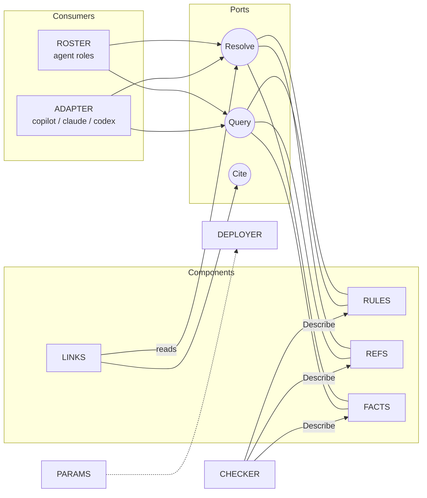

# Loose-coupling the three frameworks: the "Backplane" architecture

> Status: proposal (not implemented). Evidence gathered 2026-10-24 from this repo at branch `feat/implement-hierarchical-multi-agent-sdlc-framework`.

## Q1. Are `agentic-sdlc`, `company-kb` and `knowledge` tightly coupled?

**Yes, but unevenly.** Measured, not guessed:

| Link | Evidence | Strength |
|---|---|---|
| A (agentic-sdlc) → B (knowledge) | 48 rule rows cite `knowledge/...` in a `Source` cell; 21 files in A mention B; `tools/validate.mjs` `resolveKnowledge()` hardcodes the `knowledge/` folder and walks it | **Tight** |
| B → A | B's `validate-knowledge.mjs` takes `--sdlc` and scans A's whole tree to check "Used by" backlinks (KD-4); B's `_system.md` reuses A's meta-schema | **Tight, and circular** (A↔B) |
| A → C (company-kb) | 8 files in A; `company-kb:` is a front-matter key in `repo-architecture` and `integration` schemas; `system-architecture` agent reads C schemas | Medium |
| C → A / B | Only 2 prose mentions; no paths, no tooling | **Already loose** |
| All three → physical layout | Identity of a doc = its path under `{{AGENT_HOME}}`; `mapping.yaml` symlinks all folders into one root | Tight (path-as-identity) |

Root causes: (1) **path is identity**, (2) **links are authored on both ends** (rule → doc, and doc → "Used by"), (3) **validators know each other's folder layout**.

```text
TODAY                                   TARGET
  A ◄──── Source: path ────► B           A ──► [Reference port]  ◄── B impl
  A ──── company-kb: path ─► C           A ──► [Fact port]       ◄── C impl
  B ──── scans A's tree (KD-4)           (backlinks computed by a Link Index, never authored)
  all share {{AGENT_HOME}} folder tree   each impl chooses its own storage
```

## Q2. Do I understand the goal?

Yes. Think of a computer: CPU, RAM, disk and GPU are defined by **specs and sockets** (PCIe, DDR5), not by who made them. You can swap an SSD for a network drive and nothing else changes. You want the same for the agent system:

1. Define **abstract components** (what each part is *for*).
2. Give each a **name** and a **port contract** (the socket).
3. Allow **any implementation** (files, DB, API, channel) behind a port.
4. Assemble the **whole picture** from a wiring file.

## Q3. Proposed name: **Agent Backplane** (AB)

A backplane is the board with standard slots that components plug into. Alternatives: *Agent Chassis*, *Agent Bus*. Use "Backplane" if it suits you; it fits the electrical metaphor best.

### Abstract components (the "chips")

| Name | Job (one sentence) | Today's implementation | Possible others |
|---|---|---|---|
| **RULES** | Says what must hold; every rule has an id | `agentic-sdlc/foundations`, `stacks`, `paradigms` | DB table, policy-as-code repo |
| **REFS** | Explains how things work | `copilot/knowledge/**` | wiki, vector DB, Confluence |
| **FACTS** | States what is true for a company/repo | `copilot/companies/**`, repo `docs/` | service catalog API, graph DB |
| **ROSTER** | Lists agent roles, modes, owned decision trees | `agentic-sdlc/agents`, `trees` | any registry |
| **LINKS** | Computes who cites what (backlinks, staleness) | none (hand-written "Used by") | generated index file/DB |
| **CHECKER** | Validates a component against its schema | the two `validate*.mjs` | CI job, service |
| **PARAMS** | Holds machine/user variables | `global-variables.md` | env vars, secret store |
| **DEPLOYER** | Places components where a tool can read them | `mapping.yaml` + installers | package manager |
| **ADAPTER** | Presents the above to one agent runtime | `copilot/`, `claude/`, `codex/` wrappers | MCP server |

### Interfaces (the "pins")

Only four small contracts. Consumers depend on these, never on paths.

| Port | Operations | Used by |
|---|---|---|
| **Resolve** | `get(urn) → doc`, `exists(urn)` | everyone |
| **Query** | `list(scope)`, `search(text)` | ROSTER, ADAPTER |
| **Describe** | `schema(kind)`, `version()` | CHECKER |
| **Cite** | `cites(urn) → [urn]` (read-only, derived) | LINKS |

**Identity change (the key move):** replace path citations with stable URNs.

```text
before:  | PDM-class-modeled-R1 | ... | {{AGENT_HOME}}/knowledge/software-design/oop/encapsulation.md |
after:   | PDM-class-modeled-R1 | ... | ref:software-design/oop/encapsulation |
```

The wiring file maps a URN prefix to an implementation:

```yaml
# backplane.yaml  (the "motherboard layout")
backplane: 1
slots:
  rules: { impl: files,  root: "{{AGENT_HOME}}/frameworks/agentic-sdlc" }
  refs:  { impl: files,  root: "{{AGENT_HOME}}/knowledge" }          # swap to: { impl: http, url: ... }
  facts: { impl: files,  root: "{{AGENT_HOME}}/companies" }
  links: { impl: generated, out: "{{AGENT_HOME}}/.index/links.json" }
```

### Wiring picture



Rule of the board: **a component may only talk through a port, and never name another component's folder.**

## Q4. Migration, smallest safe steps

1. Add `backplane.yaml` plus a tiny resolver (`resolve(urn)`), with **files** as the only impl. No behaviour change.
2. Teach both validators to use the resolver. This removes A's hardcoded `knowledge/` and B's `--sdlc` tree scan.
3. Introduce `ref:` URNs in new rules; keep old paths working (the resolver accepts both). Do not retrofit, matching B's existing no-retrofit rule.
4. Generate **LINKS** (backlinks) and stop hand-writing "Used by". This removes the A↔B cycle.
5. Make `company-kb:` front-matter a `fact:` URN.
6. Only then prove it: swap REFS to a second implementation (e.g. a single SQLite file) and run both validators unchanged.

## Q5. Honest caveats

- The wording of the Jensen Huang line is **unverified**. Search found his remark that engineers prefer "building agents" over writing code, quoted differently by different outlets. It does not change the design.
- "Ask an agent to build the agent" only works if the **contracts are machine-checkable**. That is why the Backplane keeps schemas plus CHECKER: an agent can generate a new component, and CHECKER decides if it fits the socket.
- YAGNI warning (your own DP-8): do not build the http/DB impls until a second implementation is actually needed. Steps 1–4 already buy the loose coupling.
- Not verified by running: the counts come from `grep`; I did not run either validator.
