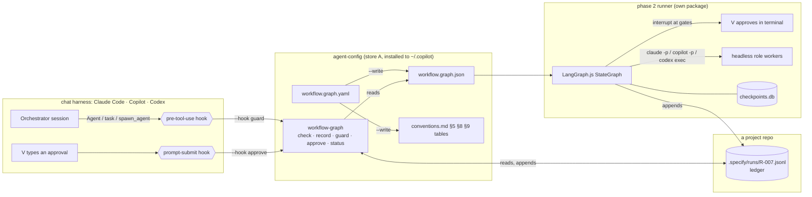
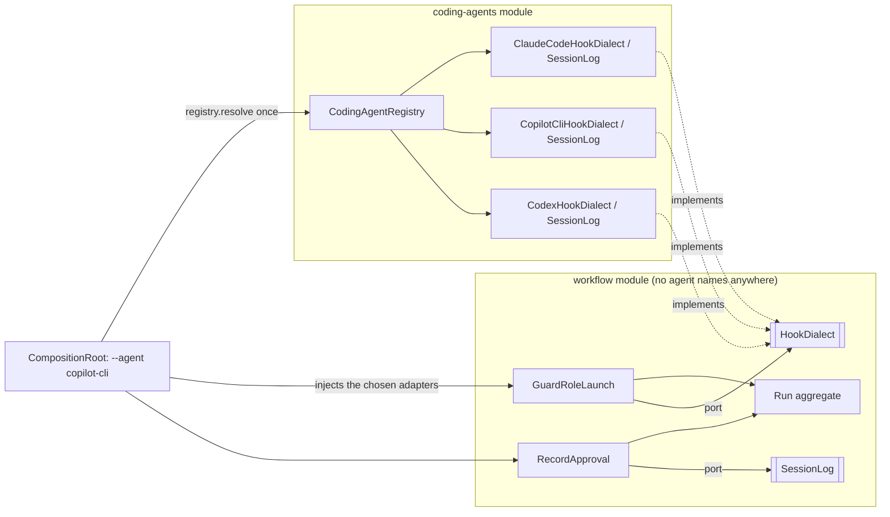

# Implementation Plan: The agentic-sdlc workflow as an enforced graph

**Branch**: `feat/workflow-graph` | **Date**: 2026-11-03 | **Spec**: [spec.md](spec.md)

**Input**: Feature specification from `specs/019-workflow-graph/spec.md`, plus V (2026-11-03): "Design it first, the constitutions get involved, such as, technologies, libs, tools, frameworks, architecture design so we can conclude the ability, capabilities before the actual build."

**Scope of this plan:** phase 1 (this spec) in full; phase 2 (the LangGraph.js runner, its own spec) far enough to prove it can be built on the same files. Nothing is built yet: the code in `research.md` §Capability spikes was throwaway, run in a scratch folder.

## Summary

The agentic-sdlc workflow (phases, gates, retry budgets) moves from prose tables into one data file, `workflow.graph.yaml`. Three things then read that file:

1. **A checker** (`workflow-graph`) rejects a broken graph and a run that broke the graph.
2. **Hooks in Claude Code, Copilot and Codex** refuse a role launch that the graph does not allow at that point of the run. A second hook records the human's gate approvals from the human's own message, so the agent cannot approve its own gate.
3. **Phase 2:** a LangGraph.js runner executes the same graph headless: checkpoints in SQLite, gates as `interrupt()` pauses, roles as headless agent runs.

All three write and read the same **run ledger**: an append-only, hash-chained JSON Lines file per run.

## Technical Context

**Language/Version**: **TypeScript** (current stable, 7.0.2 on 2026-11-03, pinned), `strict`, run **directly by Node.js 24** through its built-in type stripping (stable since Node 24.12.0; tested on 24.22.1): no build step, no `dist/`, so the hooks run the `.ts` files from `~/.copilot` as they are. Typechecked with `tsc --noEmit`. This replaces the earlier plain-JavaScript choice because V chose the class-modeled paradigm on 2026-11-03, and that paradigm supports only the `typescript-node` stack (`research.md` D15).

**Code style**: the `typescript-node` stack with the `class-modeled@1` overlay, the foundations it maps (clean architecture, module boundaries MOD-1…MOD-11, naming NAM-7/NAM-8, error handling), and one recorded form deviation: injected collaborators are `readonly #field`s assigned in the constructor, not `private readonly` constructor parameters, because Node's type stripping rejects parameter properties (`ERR_UNSUPPORTED_TYPESCRIPT_SYNTAX`, tested) and the flag that allowed them is removed in Node 26 (`research.md` D15, PDM record).

**Primary Dependencies**:

| Part | Runtime dependencies | Why |
|---|---|---|
| Phase 1 checker and hooks | **none** (Node built-ins only: `fs`, `path`, `crypto`, `child_process`) | Hooks run from `~/.copilot/...` in every project and must start fast with no `node_modules`; same rule as every tool in `copilot/` today |
| Phase 1 development only | `typescript` 7.0.2, `eslint` 10.14.0 with `typescript-eslint` 8.72.1 and `eslint-plugin-import-x` 4.17.1 (the overlay's R1/R3/R4/R7/R9 selectors and the module-boundary zones), `vitest` 5.1.0 (class-level unit tests with fakes), `prettier` 3.9.10 | The stack's `cmd.typecheck`, `cmd.lint`, `cmd.test_unit`, `cmd.format` slots (TC-Q3 fills the slots the repo lacks) |
| Phase 1 graph compile (`--write`) | `yaml` 2.9.1 (devDependency, eemeli/yaml) | Parses the YAML source once at authoring time and writes `workflow.graph.json`; the hooks read only the JSON |
| Phase 2 runner (own `package.json`) | `@langchain/langgraph` 1.6.0, `@langchain/core` 1.3.2, `@langchain/langgraph-checkpoint-sqlite` 1.1.0 (brings `better-sqlite3` 12.x, a native module with prebuilt binaries), `zod` 4 (peer) | The graph runtime; tested together in the spike |
| Phase 2, optional | `@opentelemetry/api` 1.10.0, `@opentelemetry/sdk-node` 0.300.0 | Export ledger lines as spans; only if V wants a trace viewer |

**Storage**: files only.
- `copilot/frameworks/agentic-sdlc/workflow.graph.yaml`: the source.
- `workflow.graph.json`: generated beside it and drift-checked.
- `<project>/.specify/runs/<run>.jsonl`: the ledger, committed with the feature.
- Phase 2: `<project>/.specify/runs/<run>.checkpoints.db`, a SQLite file, git-ignored, rebuildable from the ledger.

**Testing**:
- **Scenarios:** Cucumber.js 13.3 scenarios in `tests/workflow-graph/` (constitution principle IV); fixtures are made-up graphs, ledgers and *recorded real* hook payloads (`research.md` §Capability spikes).
- **Sabotage:** each WG rule is broken on purpose to prove a scenario catches it.
- **Live checks:** one per tool in `quickstart.md`.

**Target Platform**: macOS now. Windows and Linux through the existing installers: hooks get a `powershell` entry, as the turn token report has. Claude Code 2.1.129 is on PATH (the desktop app runs its own build); Copilot CLI 1.0.105; Codex CLI 0.164.0-alpha.11.1 (bundled in the ChatGPT app, not on PATH).

**Project Type**: a command-line tool plus hook adapters inside the agentic-sdlc framework (store A); phase 2 adds a separate runner package.

**Performance Goals**:
- **Hook speed:** under 300 ms per call on a 1,000-line ledger. It runs before every subagent launch, and Copilot kills a hook at its `timeoutSec`.
- **Checker speed:** `--check-run` under 1 s.

**Constraints**:
- **Erasable TypeScript only:** `erasableSyntaxOnly: true`, so no parameter properties, `enum`, runtime `namespace` or decorators. Relative imports carry the `.ts` extension, and there are no tsconfig `paths` aliases (Node ignores `tsconfig.json`).
- **Fail closed:** the guard denies on its own error, but only for launches that carry a `run:`.
- **Unit size:** every function ≤ 50 lines and ≤ 10 cyclomatic complexity (constitution, "Agentic SDLC: defaults").
- **No secrets in the ledger:** no file contents and no prompt text, except the human's quoted approval.
- **One source of truth:** the conventions tables are generated from the graph.

**Scale/Scope**: one person, about 10 runs per month, at most a few hundred ledger lines per feature, 8 phases, 6 gates, at most 4 parallel tasks.

## Constitution Check

*Gate: must pass before Phase 0; re-checked after Phase 1 design (below).*

| Principle | What it demands here | Design answer | Result |
|---|---|---|---|
| I. One source of truth | The workflow lives in one file; wrappers are thin | `workflow.graph.yaml` is the only source. `conventions.md` §5/§8/§9 tables and `workflow.graph.json` are generated and drift-checked (like atlas AT-5). Hook files per tool only call the shared `workflow-graph` (Shared Procedure + Thin Wrapper) | Pass |
| II. Typed and validated documents | New documents follow a schema; `check-docs.sh` passes | New schema `workflow-graph/v1` (graph file, ledger line, hook decisions); `check-docs.sh` runs `--check-graph` | Pass |
| III. Verified, cited facts | Tool behaviour cited or marked unconfirmed; tested behaviour recorded in knowledge | Every hook field and runtime capability below is from the docs or a spike run on 2026-11-03 (`research.md`); the findings go into `copilot/knowledge/ai-agents/` in this change | Pass |
| IV. Tools have requirements and tests (non-negotiable) | Every check has a rule id, a scenario and a test; scenarios first; characterization before changing an untested tool | WG rules each get scenarios written before the code. `validate-project.mjs` already has scenarios (specs 007, 010); the `requires:` checks add scenarios there first | Pass |
| V. Options, not overwrites | Keep alternatives with trade-offs; back up before replacing | Every choice in `research.md` lists rejected options. The installers already back up before linking. Claude Code dynamic workflows stays recorded as the phase 2 alternative | Pass |
| Workflow: PRs, `validate-docs` required | Changes reach `main` by PR | One PR for phase 1; phase 2 is its own spec and PR | Pass |
| Agentic SDLC: defaults | Paradigm none by default; unit size ≤ 50 / ≤ 10 | Paradigm `class-modeled@1`, chosen by V on 2026-11-03 (recorded as the PDM decision in `research.md`, with the one form deviation); unit limits apply to all new code | Pass |
| Agentic SDLC: budgets | Re-execute 2, review-fail 2, rework 1, parallel 4 | Become the graph's default budgets; a constitution table still overrides them, read at `--write` time for agent-config and at run time for a project | Pass |

**Risk tier: HIGH** (RT-Q1: the guard is an authorization control over what agents may do). This switches on:
- the threat model below, written before G3;
- mandatory unit-level tests (TD-Q2);
- a security review of every task;
- a security sign-off before G5.

## Architecture

### Components

**6 components:**
- **Graph source** — its job: hold the nodes, edges, paths and budgets, via `workflow.graph.yaml`.
- **Graph compiler and checker** — its job: validate the graph and generate its JSON and the conventions tables, via `workflow-graph --check-graph | --write`.
- **Ledger** — its job: record every step of one run, append-only and hash-chained, via `.specify/runs/<run>.jsonl`.
- **Guard hook** — its job: allow or deny a role launch against the graph and the ledger, via each tool's pre-tool-use hook on the subagent tool.
- **Approval hook** — its job: record a gate approval from the human's own message, via each tool's prompt-submit hook.
- **Runner (phase 2)** — its job: execute the graph headless, via LangGraph.js with SQLite checkpoints.



### Module layout (class-modeled, feature-first: MOD-9, MOD-10, MOD-11)

Two modules, each with the four layers of the stack's `project_layout`. Every Tier A unit is a class (PDM-class-modeled-R7); the only Tier B files are `main.ts` and `CompositionRoot.ts`.

```text
copilot/frameworks/agentic-sdlc/
├── workflow.graph.yaml                      # the rulebook, hand-edited through a spec + PR
├── workflow.graph.json                      # generated by `compile-graph`, drift-checked
├── schemas/workflow-graph.schema.md         # WG rules
└── tools/workflow-graph/
    ├── package.json  tsconfig.json  eslint.config.mjs  vitest.config.ts
    └── src/
        ├── main.ts                          # Tier B: thin entry, builds the root, runs the command
        ├── CompositionRoot.ts               # Tier B: the ONLY place that picks concrete adapters
        └── modules/
            ├── workflow/                    # the business: graph, runs, gates, budgets
            │   ├── domain/
            │   │   ├── graph/WorkflowGraph.ts       # aggregate: nodes, edges, budgets; allows(), next()
            │   │   ├── run/Run.ts                   # aggregate: owns the ledger entries and every run invariant
            │   │   ├── run/LedgerEntry.ts           # value object, hash-chained
            │   │   ├── run/Approval.ts              # value object: quote, source, session
            │   │   ├── launch/LaunchRequest.ts      # value object parsed from a launch prompt
            │   │   └── ports/                       # RunRepository, GraphSource, GraphFiles, ProjectBudgets, Clock
            │   ├── application/
            │   │   ├── guard-role-launch/GuardRoleLaunch.ts
            │   │   ├── record-approval/RecordApproval.ts
            │   │   ├── record-step/RecordStep.ts
            │   │   ├── check-run/CheckRun.ts
            │   │   ├── check-graph/CheckGraph.ts
            │   │   └── report-run-status/ReportRunStatus.ts
            │   ├── infrastructure/                  # FrameworkGraphFiles (YAML read lazily, JSON, conventions.md), JsonlRunRepository, ConstitutionBudgets, SystemClock
            │   └── interface/cli/                   # WorkflowCliHandler: argv → use case → exit code
            ├── coding-agents/               # everything that differs between Claude Code, Copilot, Codex
            │   ├── domain/
            │   │   ├── AgentId.ts                   # value object: claude-code | copilot-cli | codex
            │   │   ├── AgentCapabilities.ts         # value object: what this agent can do (see below)
            │   │   └── ports/                       # HookDialect, SessionLog, (phase 2) HeadlessLauncher
            │   ├── application/
            │   │   └── CodingAgentRegistry.ts       # AgentId → the agent's adapters; unknown id = explicit error
            │   ├── infrastructure/
            │   │   ├── claude-code/   ClaudeCodeHookDialect.ts  ClaudeCodeSessionLog.ts
            │   │   ├── copilot-cli/   CopilotCliHookDialect.ts  CopilotCliSessionLog.ts
            │   │   └── codex/         CodexHookDialect.ts       CodexSessionLog.ts
            │   └── interface/hooks/                 # HookHandler: stdin → dialect → use case → stdout
            └── shared/                      # Result type only (MOD-4: earned)
copilot/hooks/workflow-graph.json             # Copilot user-level hooks (preToolUse, userPromptSubmitted)
claude/settings.json                          # seed gains PreToolUse(Agent) + UserPromptSubmit
codex/hooks.json                              # gains PreToolUse(Agent/spawn_agent) + UserPromptSubmit
tests/workflow-graph/                         # Cucumber scenarios through the CLI, recorded real payloads
```

**Location** (D18, V 2026-11-03): agent-config only, written new; nothing is copied from agent-runtime (D19).

**Structure Decision**: two modules (AP-Q2, single project).
- **`workflow`:** knows the rules and nothing about any agent.
- **`coding-agents`:** knows each agent and nothing about the rules.

They meet only in the composition root, which hands the `workflow` use cases the selected agent's adapters through the ports (MOD-5, MOD-11). The tool keeps its own `package.json`, for development tools only, so the repo root stays as it is. Hooks run `src/main.ts` directly under Node, with no dependencies loaded. Phase 2 gets its own package, or its own home in agent-runtime (`research.md`).

### Supporting several coding agents (Claude Code, Copilot CLI, Codex)

**Is `if (agent === 'claude') … else if …` in the code a bad design?** Yes, once the branches spread. The three agents differ in at least five places:
1. how a hook's input is shaped;
2. how a deny is written back;
3. where the session log lives and how a user message looks in it;
4. how hooks are installed and trusted;
5. in phase 2, how an agent is started headless.

With branches, each of those places gets its own `if/else`. Adding a fourth agent (Gemini CLI, Cursor, …) means finding and editing every one of them: "shotgun surgery". One forgotten branch silently sends Copilot's output format to Claude. That breaks:
- **Open/Closed:** new behaviour should arrive as new code, not as edits to a central decision point (`knowledge/software-design/design-principles/open-closed.md`). Our doc says to wait for a second variant before abstracting; we already have three verified ones.
- **Single Responsibility:** the guard would change whenever any agent's payload changes.

**The design instead: ports and adapters, with one choice point.**



**4 actors in one hook call:**
- **The harness** — its job: run the hook with its own payload, via `node …/main.ts hook guard --agent copilot-cli`.
- **CompositionRoot** — its job: choose this agent's adapters once, via `CodingAgentRegistry.resolve(AgentId)`.
- **The agent's `HookDialect`** — its job: translate between that agent's JSON and the neutral `ToolCallRequest` / `GuardDecision`, via its `read…` and `render…` methods.
- **`GuardRoleLaunch`** — its job: decide, via the `Run` aggregate and the graph, without knowing which agent asked.

**Steps:**
1. **Harness → `main.ts` (local process):** stdin holds Copilot's `{"toolName":"task","toolArgs":{"prompt":"…run: R-007…"}}`.
2. **CompositionRoot:**
   - parses `--agent copilot-cli` into an `AgentId`;
   - asks the registry for that agent's adapters. This is the **only** place where the agent identity selects anything. It's a map lookup, not a branch in business code, and an unknown id is an explicit error.
3. **`CopilotCliHookDialect.readToolCall(raw)`:** returns `ToolCallRequest { kind: 'subagent-launch', launchPrompt }`, or `{ kind: 'other-tool' }`.
4. **`GuardRoleLaunch.run(request)`:**
   - builds a `LaunchRequest` from the prompt;
   - loads the `Run`;
   - asks `run.permitLaunch(launch, graph)`, which returns `Result<LaunchPermit, LaunchDenied>`.
5. **`CopilotCliHookDialect.renderDecision(decision)`:** writes `{"permissionDecision":"deny","permissionDecisionReason":"G2 not approved in run R-007"}`. Claude's dialect writes its `hookSpecificOutput` form from the **same** decision object.

**Capabilities, not identity.** Where behaviour differs by what an agent *can* do, code asks the agent's `AgentCapabilities` value object, never its name. Each capability is verified per agent; `contracts/coding-agent.md` has the full table. Examples:
- `canDenySubagentLaunch`;
- `promptHookCanReply` (false for Copilot config-file hooks);
- `repositoryHooksNeedTrustedFolder` (true for Copilot);
- `hooksNeedUserTrust` (true for Codex);
- `supportsNamedAgentHeadless` (false for Codex).

For example, the installer asks `repositoryHooksNeedTrustedFolder` to decide user-level installation, instead of testing `agent === 'copilot-cli'`.

**Adding a fourth agent touches only these places:**
- a new folder `infrastructure/<agent>/` with its adapters;
- one registry entry;
- its recorded payloads under `tests/workflow-graph/fixtures/<agent>/`;
- its hook file for the installer.

Nothing in `workflow/` changes. The **adapter contract tests** prove it: one shared vitest suite runs the same cases against every registered dialect with that agent's recorded real payloads. "Denies with the reason", "ignores non-launch tools" and "reads the launch prompt" must hold for each one, which is Liskov substitution checked rather than assumed (`knowledge/software-design/design-principles/liskov-substitution.md`).

**Phase 2 uses the same seam.** A `HeadlessLauncher` port gets `ClaudeCodeLauncher` (`claude -p --agent … --output-format json`), `CopilotCliLauncher` (`copilot -p --agent …`) and `CodexExecLauncher` (`codex exec --json`, role file named in the prompt because `supportsNamedAgentHeadless` is false). This is the same shape agent-runtime started with its `Worker` interface. If phase 2 lands in agent-runtime, this port and capability table are what it would share.

### How a guarded launch works (phase 1)

**4 actors:**
- **Orchestrator** — its job: launch the next role, via the tool's subagent tool (`Agent`, `task`, `spawn_agent`).
- **Harness** — its job: run the pre-tool-use hook before the call, via the hook files.
- **Guard** — its job: decide allow or deny, via `workflow-graph --hook guard --agent <claude-code|copilot-cli|codex>`.
- **Ledger** — its job: say where the run stands, via `.specify/runs/<run>.jsonl`.

The real hook input recorded from Claude Code 2.1.129 (copied from the spike; `prompt` holds the launch prompt):
```json
{"hook_event_name":"PreToolUse","tool_name":"Agent","cwd":"/…/my-project",
 "tool_input":{"subagent_type":"sdlc-architecture","description":"P4 plan","prompt":"schema: launch-prompt/v1\nmode: decide\nrole: architecture\nphase: P4\nrun: R-007\n…"}}
```

1. **Orchestrator (inside the harness):** calls `Agent` with the launch prompt above.
2. **Harness → Guard (local process, no network):** pipes that JSON into the guard's stdin.
3. **Guard:**
   - reads `run: R-007` and `phase: P4` from the launch prompt;
   - with no `run:`, prints no decision and exits 0, so the launch goes through untouched;
   - otherwise reads `workflow.graph.json` and `.specify/runs/R-007.jsonl` and verifies the hash chain;
   - asks the graph: is P4 reachable from the last completed node, with every gate on the way `approved`, within budget?
4. **Guard → Harness:** prints `{"hookSpecificOutput":{"hookEventName":"PreToolUse","permissionDecision":"deny","permissionDecisionReason":"G2 not approved in run R-007"}}`. Copilot gets `{"permissionDecision":"deny","permissionDecisionReason":…}` instead.
5. **Harness:** cancels the call and shows the reason to the Orchestrator. The spikes saw the agent quote it word for word in both Claude Code and Copilot.

### How an approval is recorded (phase 1)

1. **Orchestrator:** writes the gate message; its item 5 is the exact approval reply, for example `approve G2 R-007`.
2. **V:** types the reply.
3. **Harness → Approval hook:** sends the prompt-submit event with `prompt` and, in Claude Code, `transcript_path`.
4. **Approval hook:**
   - when the text contains `approve G<n> <run>` for an open gate, appends `{"node":"G2","result":"approved","actor":"human","quote":"approve G2 R-007 — looks good","source":"UserPromptSubmit","session":"…"}`;
   - otherwise does nothing.
   - It never blocks the prompt. In Copilot its output is dropped anyway; only its side effect counts.
5. **`--record` (used by the Orchestrator for its own steps):** refuses `actor: human` and any gate result, so an approval can only come from step 4.

### Threat model (STRIDE-lite; required by risk tier HIGH)

| Threat | Example | Control | Residual risk |
|---|---|---|---|
| **S**poofing an approval | The agent runs `--record --node G2 --result approved` | `--record` rejects gate results; approvals only come from the prompt-submit hook. `--check-run` matches each approval quote against a human message in the referenced transcript (Claude Code `transcript_path`, Copilot `events.jsonl` `user.message`) | An agent with shell access could append a hand-made line: caught by the chain or the transcript match |
| **T**ampering with the ledger | Editing an attempt count or deleting a failure | SHA-256 hash chain; the same pre-tool-use hook denies edit tools (`Edit`/`Write`, Copilot's edit tools, Codex `apply_patch`) on paths under `.specify/runs/` | Rewriting the whole chain consistently: caught by the transcript match for approvals; the file is committed at each gate |
| **R**epudiation | "I never approved G3" | Approval lines carry the quote, session id and time | — |
| **I**nformation disclosure | Prompts or secrets committed in the ledger | Lines hold ids, paths, results, counts; only the human approval quote is free text (WG rule) | V's own words are committed |
| **D**enial of service | A broken guard blocks every launch | Only launches with `run:` are guarded; `AGENTIC_SDLC_GUARD=off` in the harness's environment (set by V, not by the agent's shell) disables it, and the next `--check-run` reports the unguarded window | — |
| **E**levation (phase 2) | Headless workers run with every permission | No `--allow-all` / `bypassPermissions`: per-role allow-lists (`--allowedTools`, `--allow-tool`, `codex exec --sandbox workspace-write`); each parallel task in its own git worktree | Decided in the phase 2 spec |

## Capabilities concluded (design-time evidence)

| Capability the design needs | Evidence | Status |
|---|---|---|
| Deny a subagent launch from a hook: Claude Code | Spike: `claude -p` (2.1.129) with a project `PreToolUse` hook on `Agent`; the launch was denied and the reason reached the agent | ✅ tested |
| Deny a subagent launch: Copilot CLI | Spike: `copilot -p` (1.0.105), `preToolUse` on `task`; denied with the reason shown ("Denied by preToolUse hook: …") | ✅ tested |
| Copilot repository hooks load anywhere | Spike: **not loaded** in a folder outside `trustedFolders` (`~/.copilot/config.json` lists only `/Users/vinh.doq`); loaded inside it | ✅ tested, so the guard installs at **user level** (`~/.copilot/hooks`) |
| Deny a subagent launch: Codex | Docs: `PreToolUse` fires for `spawn_agent` and accepts the same deny JSON; hooks need trust in `/hooks` | ⚠️ docs only; V trusts the hook, then live test (quickstart) |
| Read the human's own message | Docs: `UserPromptSubmit` (Claude Code: `prompt`, `transcript_path`); `userPromptSubmitted` (Copilot: `prompt`, `sessionId`); Codex has the event | ✅ docs (Claude, Copilot); ⚠️ Codex fields unverified |
| Headless role workers (phase 2) | Spike: `claude -p --agent sdlc-qa` and `copilot -p --agent sdlc-qa` both loaded the role; Codex has no `--agent` flag, so the worker prompt names the role file (what the wrappers do anyway) | ✅ Claude, Copilot; ⚠️ Codex untested |
| Graph runtime: conditional edges, budgeted loop, fan-out with join, child-process nodes | Spike: LangGraph.js 1.6.0, 3 tasks via `Send`, each running a child process; the join node ran once after all 3; the loop stopped at its budget | ✅ tested |
| A gate that survives the process | Spike: `interrupt()` with `SqliteSaver` in a file; process 1 stopped at G5; process 2 resumed with `Command({resume})`; resuming a finished run re-ran nothing | ✅ tested |
| Native SQLite build on this machine | `better-sqlite3` installed with a prebuilt binary on Node 24.22.1, macOS | ✅ tested (Windows: phase 2 check) |
| Trace format | OpenTelemetry GenAI agent spans: `invoke_workflow`, `invoke_agent`, `execute_tool`; status Development | ✅ docs (not stable) |

**Not possible, or not planned:**
- **Claude Code dynamic workflows** can't pause mid-run for a gate (docs), so they are not the phase 2 default.
- **A Copilot prompt-submit hook** can't change or block the prompt from a config file (docs); the approval hook only records.
- **The checks don't stop a determined local agent with shell access from writing files.** They make tampering detectable and stop the normal path. For a one-person local tool that's accepted; phase 2 workers get narrower permissions.

## Post-design Constitution Check

Re-checked after `data-model.md`, `contracts/` and `quickstart.md`: no principle is violated; nothing goes in Complexity Tracking. Two consequences now written into the design:
- **I:** `workflow.graph.json` is generated, so its drift check is a WG rule.
- **III:** the six tested capabilities go into the knowledge base in this change.

## Complexity Tracking

> No violations.

## Project Structure

### Documentation (this feature)

```text
specs/019-workflow-graph/
├── spec.md          # what and why (Draft)
├── plan.md          # this file
├── research.md      # sources, decisions, P4 decision records, capability spikes
├── data-model.md    # graph, node, edge, path, run, ledger line, task dependencies
├── quickstart.md    # how to prove each capability end to end
├── contracts/
│   ├── cli.md       # workflow-graph commands, exit codes, output
│   ├── hooks.md     # per-tool hook input and output, as verified
│   └── coding-agent.md  # the coding-agent port, capabilities, the shared adapter contract suite
└── tasks.md         # rewritten by /speckit-tasks after G3
```
